FLEXTRANSFORM  /  ENGINEERING GUIDE

FFT/IFFT đa precision và NTT/INTT đa modulus cho PQC

| Hồ sơ | Giá trị |
| --- | --- |
| Mã tài liệu | FT-IG-002 / Phiên bản hướng dẫn 1.2 - pin, net và register |
| Nền tảng bắt buộc | Microarchitecture contract 0.2 / arithmetic compatibility 3.1 |
| Phạm vi | 23 module SystemVerilog + ft_defs.svh; từ công thức đến datapath, port, clock, FSM và test |
| Thiết bị mục tiêu | xc7z020clg400-2 / 16 tile / 64 DSP / 48 RAMB18 |
| Mục tiêu bản viết lại | Toàn hệ thống ≤35k LUT, 160 MHz; chưa phải số đo RTL mới |
| Trạng thái | Hướng dẫn triển khai để review. Không sửa contract khóa hoặc baseline được chấp nhận. |

Ngày phát hành: 07/11/2026. Đơn vị bit/word và mốc cạnh được định nghĩa tường minh trong chương 2. Những đoạn RTL rút gọn là mẫu tổ chức, không phải implementation đã mô phỏng.

# Mục lục

# 1. Phạm vi, thứ tự ưu tiên và cách đọc

Mục tiêu là cho người viết RTL hiểu vì sao cần từng phép tính, phép tính đó được chia thành phần cứng nào và lúc nào dữ liệu được phép dùng. Tài liệu bao phủ cả tile, bộ nhớ, scheduler và host; không chỉ mô tả block diagram.

## 1.1 Điều bắt buộc và lựa chọn triển khai

1. Quy định khóa: numerical semantics, port/width, latency cạnh, ownership và FSM ở spec08..11 và microarchitecture JSON0.2. Những nội dung này không được đổi ngầm để giảm LUT hoặc đạt timing.
2. Gợi ý implementation: tên thanh ghi nội bộ, cách viết always_comb/always_ff, bitmap ownership hoặc ring đã kiểm. Có thể chọn cách khác nếu giữ đúng port/clock/semantics và kiểm tương đương.
3. Nếu phát hiện mâu thuẫn: ưu tiên spec08..11 và JSON0.2 hơn phần draft spec01..07. Mở issue/version mới nếu cần đổi contract; không cập nhật hash để hợp thức hóa drift.
4. Nguồn tham chiếu được ghi hash ở phụ lục. Bản hướng dẫn này là tài liệu dẫn giải riêng, không thay thế hoặc làm thay đổi LOCK_0_2.json.

## 1.2 Phạm vi PQC

FN-DSA là ứng dụng kiểm chứng chính. FFT128 phải khớp R8 ở đường được chỉ định; native64 khớp NTRUGen. FFT32/64 thường là chức năng linh hoạt của IP, không tự động được phép thay precision của signer. Multi-modulus chứng minh kernel NTT dùng lại được, không đồng nghĩa có full RTL của ML-KEM/ML-DSA hoặc mọi scheme PQC.

FFT N1024 theo API này có1024 hệ số thực và512 điểm phức. Không so trực tiếp với FFT1024 điểm phức mà bỏ qua convention này.

## 1.3 Cách sử dụng khi tự viết

1. Đọc chương2 và3, rồi làm các module arithmetic theo thứ tự chương5..13. Mỗi module đọc theo: toán học → tổ chức RTL → port chính xác → clock → test.
2. Viết unit test và probe latency trước khi ghép tile. Dùng oracle integer/C độc lập, không dùng cùng một sai sót của RTL để tính expected.
3. Khi tile đủ mode đúng, ghép bộ nhớ/geometry và chạy NTT core trước, rồi FFT và host. PPA target chỉ được ghi thành kết quả sau synth/P&R đúng scope.

# 2. Hợp đồng số học và mốc cạnh

## 2.1 Số nguyên và fixed-point

```text
wrapW(x) = x mod 2^W, diễn giải two's-complement W bit
mulW(a,b) = wrapW((signed(a)*signed(b)+2^(F-1)) >>> F)
F=W/2; W in {32,64,128}
native_mul64(a,b) = wrap64((signed64(a)*signed64(b)) >>> 32)
native_half64(v) = signed(wrap64(v+1)) >>> 1
```

FFT cộng/trừ wrap, không saturation. Nhân thường round ties toward +infinity, không ties-to-even. Native không có rounding seed. Trong div2e và half, wrap xảy ra trước arithmetic shift; thay thứ tự có thể khác bit ở overflow.

## 2.2 NTT và miền Montgomery

```text
R=2^w; w=32 scalar, w=16 packed
q odd; 3<=q<2^(w-1); qi=-inverse(q,R) mod R
T=a*root; m=low_w(T)*qi mod R; P=m*q
U=high_w(T)+high_w(P)+(low_w(T)!=0)
z=(U>=q) ? U-q : U
```

Hệ số input/output là residue thường [0,q). Root chứa hệ số R nên Mont(a,root) trả hệ số về miền thường. Root inverse còn chứa1/2 theo convention INTT; không half nhánh nhân thêm lần nữa. q hợp lệ không bảo đảm tồn tại root cho mọi N: producer phải kiểm root order.

Modular half của nhánh side INTT: half_q(s)=(s+(s lẻ ? q : 0)) >>1. Phép cộng là unsigned có thêm bit carry (33 bit scalar hoặc17 bit/lane packed), không wrap trước dịch và không dùng native_half signed. Hai quy tắc half này khác nhau.

## 2.3 Một cách đếm clock duy nhất

| Mốc | Ý nghĩa |
| --- | --- |
| Launch sau L0 | Operand/mux được cập nhật sau cạnh L0; leaf input FF nhận tại L1. |
| Raw sau L3 / fused sau L5 | Consumer có FF nhận ở L4 / L6. Capture-edge-relative lần lượt +2/+4, không phải +3/+5. |
| Tile fire C0 | Request đã được nhận khi req_valid AND req_ready tại cạnh C0. |
| Data read R | RAM read output sau R, route FF tại R+1, tile fire R+2. |
| Tile rsp sau E | Bank commit tại E+1; DONE chỉ sau commit và drain. |

Dùng nonblocking cho state. Giá trị tạo sau cạnh không thể được FF khác lấy ở chính cạnh đó. Testbench nên drive ở negedge và observe sau posedge/NBA; assertion phải phân biệt giá trị trước và sau cạnh.

## 2.4 Profile tài nguyên và chứng cứ

Mục tiêu RTL mới là16 tile, mỗi tile4 leaf;64 DSP và48 RAMB18 gồm32 data +16 root. ≤35k LUT và160 MHz là target toàn hệ thống. Baseline cũ đạt34.277 LUT/160 MHz không phải chứng cứ của bản viết lại. Không gọi setup/hold sign-off chỉ từ WNS synth.

# 3. Kiến trúc và ranh giới dùng chung

Mỗi tile tự giữ dữ liệu cục bộ; core chia sẻ program và geometry. Một context đang chạy dùng cùng mode/N/q/root/batch configuration. Không trộn hai modulus hoặc FFT/NTT song song trong cùng kernel.

| Tài nguyên | FFT sử dụng | NTT sử dụng |
| --- | --- | --- |
| 4 leaf16/tile | Ghép fused32×32 rồi MAC đa limb theo thời gian | Scalar fused32×32 hoặc hai group packed2×16 |
| C0/C1 | Butterfly sum/diff, carry/borrow limb | Sum/diff modulo q qua correction |
| C2/C3 | operand.re+im và root.re+im | sum−q và difference+q |
| C4 | p0+p1 để tạo imaginary 3M | Correction U−q, scalar hoặc hai lane |
| Tile RAM | Side, operand/root/sums và partial | Side/tag/pairing; history ở mont |
| Data/root banks | Fixed-point limbs và FFT roots | Residue scalar/packed và Montgomery roots |

## 3.1 Phần giữ riêng có lý do

1. FFT MAC68/C5/native alignment phục vụ fixed-point và quan hệ limb; NTT feedback/history/NZ phục vụ reduction. Chia sẻ leaf và correction không có nghĩa ép mọi thanh ghi/adder vào một datapath duy nhất.
2. C0/C1 hoạt động đồng thời; C2/C3 cũng cần hai kết quả riêng. Chia thời gian tất cả qua một adder sẽ đổi throughput, port và schedule.
3. Wide FFT dùng nhiều lượt trong tile, không phải fusion giữa tile. Không gắn nhãn inter-tile PE fusion cho kiến trúc contract0.2.

## 3.2 ft_defs.svh

Một header include-guard, chỉ macro/kiểu pack-unpack thống nhất cho width và opcode. Các giá trị chính: word32, leaf16/ext17/full34/raw33, raw bus132, fused65, MAC68, U34, C4=36, side42, tag8, meta10/7, read_meta30, write_ctx36, cfg_ctx128. Không đặt register, initial block hoặc hardware state trong header.

# 4. Bản đồ module và lộ trình viết

| Chặng | Module và kết quả cần có |
| --- | --- |
| A / arithmetic | defs → leaf → addsub → C4. Oracle đúng bit, latency đúng,4 DSP/tile. |
| B / NTT tile | state + mont → ghép tile scalar rồi packed. Đúng group/history/side và reset. |
| C / FFT tile | accum + combine + native → tile đủ32/64/128/native. Buffer và partial đúng liveness. |
| D / core memory | cfg_decode, data/root, cg_addr/route → kiểm mapping và synchronous RAM latency. |
| E / scheduler | issue, stage_ctrl, writeback, core. NTT có barrier trước; FFT program và overlap sau. |
| F / host/system | host_map, normalizer, frontend, AXI; kernel/C regressions; synth/P&R toàn hệ thống. |

Các chương module phía sau đi theo đường dữ liệu và ownership. Bảng cổng được lấy trực tiếp từ ports.json khóa0.2, không chép lại bằng tay. Input/output đều là bit pattern; signedness phải được diễn giải rõ bên trong phép toán.

| Nhóm | Module |
| --- | --- |
| Tile / 9 loại | leaf_array, addsub, reduce_or_sum, mont_pipe, tile_state, fft_accum, fft_combine, native_align, tile |
| Memory / geometry / 5 loại | cfg_decode, data_mem, root_mem, cg_addr, cg_route |
| Schedule / 5 loại | fft_program, issue_ctrl, stage_ctrl, writeback, core |
| Host / 4 loại | host_map, read_normalize, cmd_frontend, axil_top |

23 module +1 header. Một module nhỏ vẫn cần kiểm chức năng; không cần tạo23 FSM. Các khối tổ hợp là cg_addr/cg_route/reduce_or_sum; leaf free-running không có reset/valid. FSM đã khóa chỉ có7 máy ở phụ lục.

# 5. ft_leaf_array

Bốn bộ nhân cơ sở dùng chung cho FFT và NTT. Xuất raw33 của từng leaf và fused65 của một tích32×32; không thực hiện rounding hay Montgomery.

## A. Bản chất toán học

1. Tách A=AL+2^16·AH và B=BL+2^16·BH. AL/BL luôn unsigned; AH/BH có dấu theo cách hiểu của word32.
2. P0=AL·BL; P1=AH·BH; P2=AL·BH; P3=AH·BL. F=P0+2^16(P2+P3)+2^32·P1.
3. Mỗi đầu vào16 được biểu diễn signed17: {signed_select AND word[15],word}. Miền giá trị hợp lệ là -32768..65535; tích chính xác vừa signed33. Bit33 của full34 là lặp bit32.
4. Fused65 cho phép biểu diễn chung signed32×signed32, mixed và unsigned32×unsigned32. Packed không dùng F vì các leaf đang thực hiện các tích độc lập.

## B. Phân rã thành RTL

1. Bốn cặp input register signed17; hai tầng product33; một tầng cat65/cross33; một thanh ghi fused65. Không reset payload hoặc thêm enable/valid vào cổng leaf.
2. Map từ bit cao: a={AH,AL,AH,AL}; b={BL,BH,BH,BL}. Flags a={sA,0,sA,0}; b={0,sB,sB,0}. Caller chịu trách nhiệm mapping.
3. cat={P1[32:0],P0[31:0]} là nối dây. Hai tích chéo được giữ cùng transaction rồi sign-extend65 và dịch trái16 bằng concatenation.
4. Viết phép nhân với hai operand signed17 và full34 rõ ràng. DSP48E1 có bộ nhân signed25×18 nên một leaf có thể nằm trong một DSP; xác nhận bằng unit synth, không suy đoán từ tên toán tử.

```text
cat_q <= {p1[32:0],p0[31:0]};
c2_q <= p2; c3_q <= p3;
fused_p <= cat_q
  + {{16{c2_q[32]}},c2_q,16'b0}
  + {{16{c3_q[32]}},c3_q,16'b0};
```

Điểm phải giữ: P0[32] chỉ được bỏ trong mapping fused hợp lệ có AL/BL unsigned. Không áp dụng điều đó cho các raw product tùy ý.

## C. Cổng chính xác và cách nối

IN: đầu vào; OUT: đầu ra. Mọi độ rộng tính bằng bit.

| Cổng / hướng | Bit | Cổng / hướng | Bit |
| --- | --- | --- | --- |
| IN  clk | 1 | IN  b_signed | 4 |
| IN  a | 64 | OUT raw_p | 132 |
| IN  b | 64 | OUT fused_p | 65 |
| IN  a_signed | 4 |  |  |

## D. Pipeline và thời điểm chốt

1. Launch sau L0; input capture L1; product1 L2; raw/product2 L3; cat/cross L4; fused L5. Consumer chốt raw ở L4, fused ở L6.
2. Nhận bộ toán hạng mới mỗi clock. Ở cùng một clock, raw và fused thuộc hai transaction lệch nhau2 clock. Valid được delay ngoài module.

## E. Điều kiện nghiệm thu unit

1. Signed/unsigned và mixed với 0,1,FFFF,8000,7FFF; kiểm cả full34[33]==full34[32].
2. A=-1,B=2 phải cho -2; unsigned FFFFFFFF² phải giữ kết quả dương65 bit.
3. Đổi operand và sign-select mỗi clock để bắt trộn transaction; unit synth mục tiêu4 DSP cho toàn array.

# 6. ft_addsub

Butterfly cần tổng và hiệu đồng thời. C0/C1 làm raw sum/difference; C2/C3 hiệu chỉnh NTT hoặc tạo hai tổng phụ cho FFT.

## A. Bản chất toán học

1. FFT: s=low32(a+b+ci), d=low32(a-b-bi). Carry/borrow nối limb; overflow cuối giá trị W bit bị bỏ theo wrapW.
2. NTT với 0<=a,b<q: s=(a+b>=q)?a+b-q:a+b; d=(a<b)?a-b+q:a-b. Không dùng divider hoặc %q trong datapath.
3. Packed có q_lane<2^15 nên tổng hai residue16 không carry sang lane cao. Phép trừ và correction dùng guard để hai lane độc lập.
4. FFT không dùng correction modulo. C2/C3 được dùng cho fs=fa+fb+fci và ws=wa+wb+wci; hai tổng này có33 bit.

## B. Phân rã thành RTL

1. C0 sum33; C1 difference34 có guard16. Chốt sum/difference, q, split và plain cùng cạnh. C2 correction35; C3 correction34 là tổ hợp sau FF.
2. Tạo operand mux trước mỗi phép cộng. Không nhân đôi C2/C3 thành một bản NTT và một bản FFT.
3. s/d chọn raw khi plain_q=1. Khi NTT, chọn raw/candidate theo borrow của đúng lane. Bỏ bit guard bằng slice, không lấy dif_q[31:0].
4. out_valid là một FF của in_valid, reset về0. co_now/bo_now thuộc a/b hiện tại. fs/ws thuộc operand phụ sống và chỉ có nghĩa FFT khi plain_q=1; chúng không tự đi theo out_valid.

```text
S = {1'b0,a}+{1'b0,b}+{32'b0,ci};
D = {1'b0,a[31:16],1'b1,a[15:0]}
  + {1'b0,~b[31:16],split16,~b[15:0]}
  + {33'b0,!bi};
co_now = S[32]; bo_now = !D[33];
```

Điểm phải giữ: Biểu thức chính xác của C2/C3 và toàn bộ slice nằm ở chương phương trình bit. Không đồng nhất latency của mọi output chỉ vì chúng thuộc cùng module.

## C. Cổng chính xác và cách nối

IN: đầu vào; OUT: đầu ra. Mọi độ rộng tính bằng bit.

| Cổng / hướng | Bit | Cổng / hướng | Bit |
| --- | --- | --- | --- |
| IN  clk | 1 | IN  wa | 32 |
| IN  rst | 1 | IN  wb | 32 |
| IN  in_valid | 1 | IN  fci | 1 |
| IN  a | 32 | IN  wci | 1 |
| IN  b | 32 | OUT out_valid | 1 |
| IN  q | 32 | OUT s | 32 |
| IN  ci | 1 | OUT d | 32 |
| IN  bi | 1 | OUT co_now | 1 |
| IN  split16 | 1 | OUT bo_now | 1 |
| IN  plain | 1 | OUT fs | 33 |
| IN  fa | 32 | OUT ws | 33 |
| IN  fb | 32 |  |  |

## D. Pipeline và thời điểm chốt

1. Launch input sau L0; C0/C1 tổ hợp trong L0..L1; chốt intermediate tại L1. Sau L1 correction/mux sẵn; consumer chốt s/d tại L2. Không thêm FF s/d nội bộ.
2. Tile NTT GS: raw capture C1, correction được consumer chốt C2. CT: raw capture C20, kết quả được chốt C21. Caller giữ valid/metadata tương ứng.
3. fs/ws là đường tổ hợp từ FF của caller đến FF ghi sum của caller. Lịch sum FFT thường: C4+2k; native inverse64 cộng2.

## E. Điều kiện nghiệm thu unit

1. Oracle wrap32 với ci/bi0/1; so co=(a+b+ci)>>32 và bo=(a<b+bi).
2. NTT scalar và packed: 0,q-1, các trường hợp tổng vượt q và hiệu âm; hai lane chọn nhánh trái nhau.
3. Cho input chính và phụ thay đổi độc lập; bắt lỗi dùng q/plain/split sống cho intermediate cũ.

# 7. ft_reduce_or_sum

Một C4 tổ hợp36 bit phục vụ correction cuối Montgomery hoặc tổng p0+p1 của nhân phức FFT.

## A. Bản chất toán học

1. Montgomery cho U<2q; vì vậy chỉ cần z=(U>=q)?U-q:U. Scalar U33; packed hai U17.
2. Trừ q bằng A+NOT(q)+1. Packed dùng guard17 để carry thấp được giữ làm cờ và high lane luôn nhận +1 độc lập.
3. FFT: sum33=fft_a+fft_b+fft_ci. Low32 vào partial_sum, bit32 là carry của limb kế tiếp.

## B. Phân rã thành RTL

1. Ba nhánh mux A36/B36/Cin, tiếp theo đúng một biểu thức cộng36. Output decode theo mode. Không có clk/rst/valid/register trong module.
2. Scalar u_bus={0,U33}, borrow=R36[35]. Packed u_bus={Uhi17,Ulo17}, borrow_hi=!R36[35], borrow_lo=!R36[17]. Không dùng chung polarity một cách máy móc.
3. result chọn U hay candidate theo từng lane. underflow={high,low}; scalar replicate borrow; FFT00. fft_sum có nghĩa FFT; không dùng nó làm residue NTT.

```text
// R36=(A36+B36+Cin) mod 2^36
// scalar
A36={3'b0,u_bus[32:0]};
B36=~{4'b0,q_word}; Cin=1'b1;
// FFT
A36={4'b0,fft_a}; B36={4'b0,fft_b};
Cin=fft_ci;
```

Điểm phải giữ: underflow là điều kiện chọn U ban đầu, không phải arithmetic fault. Không dùng một lần trừ để tuyên bố xử lý U tùy ý.

## C. Cổng chính xác và cách nối

IN: đầu vào; OUT: đầu ra. Mọi độ rộng tính bằng bit.

| Cổng / hướng | Bit | Cổng / hướng | Bit |
| --- | --- | --- | --- |
| IN  fft_mode | 1 | IN  fft_b | 32 |
| IN  split16 | 1 | IN  fft_ci | 1 |
| IN  u_bus | 34 | OUT result | 32 |
| IN  q_word | 32 | OUT fft_sum | 33 |
| IN  fft_a | 32 | OUT underflow | 2 |

## D. Pipeline và thời điểm chốt

1. NTT: U chốt C18, C4 tính trong C18..C19, correction chốt C19 ở ft_mont_pipe.
2. FFT: limb MAC chốt tại launch+6; C4 hoạt động tới combine=launch+7, caller ghi partial tại combine của p1. Carry và valid ở caller.

## E. Điều kiện nghiệm thu unit

1. U=0,q-1,q,2q-1 cho q scalar biên.
2. Packed underflow01/10, lane q khác nhau trong unit test, đảm bảo không xuyên borrow.
3. FFT unsigned max, carry-in1; synth không tạo DSP hoặc ba adder độc lập theo mode.

# 8. ft_mont_pipe

Điều phối ba lượt nhân trên leaf array, giữ history T và chốt kết quả Montgomery cùng side/tag. Không sở hữu multiplier, C4 hoặc side RAM.

## A. Bản chất toán học

1. T=a·root; m=low_w(T)·qi mod2^w; P=m·q; U=Thi+Phi+NZ(Tlo). qi=-q^(-1) mod2^w, w32/16.
2. NZ thay carry của low(T)+low(P): do tổng chia hết2^w, carry bằng0 khi Tlo=0, ngược lại bằng1.
3. Packed mỗi group có hai lane16 độc lập. Hai group là hai cặp leaf khác nhau, không phải hai lane của một phép nhân.

## B. Phân rã thành RTL

1. Chốt packet ở operand boundary C2; side_we/wa/wd đã sẵn trước cạnh đó. Không thêm hai FF input vốn đã thuộc tile pre-alignment.
2. Scalar cả4 leaf unsigned tạo fused32×32. Packed group0 leaf0/1 và group1 leaf2/3 dùng raw.low32; thêm hai FF alignment64/group để tổng latency vẫn5.
3. Token tuổi0/5/10/15 từ C2 tương ứng launch T, launch m, launch mq và mq về. Register select từ token nhìn trước; product feedback qua mux đến leaf input, không thêm full-width feedback FF.
4. group_at_T=delay5(group), group_at_mq=delay15(group). Chọn T đúng group để ghi một history34×10 chung; chọn mq bằng group cuối khác biệt.
5. History shift mỗi clock kể cả bubble. Chốt U scalar33 hoặc hai U17; C4 bên ngoài trả corrected. Side read tổ hợp từ head cũ, correction/side/tag chốt cùng C19.
6. packet_valid chỉ vào mode NTT. leaf_valid là mask launch, không là enable leaf. q/qi/mode cố định trong job. Không tạo pointer side hoặc q-context thứ hai.

```text
// Packed product view after 2 alignment FF
lo_word={pp[g][47:32],pp[g][15:0]};
hi_word={pp[g][63:48],pp[g][31:16]};
// Internal history packing used in this guide
hist0 <= {T_hi_word, NZ2};
// history[9] OLD value is consumed at C18
```

Điểm phải giữ: Tile MMIO nhận qinv32; packed phải nhân bản qi16=qi32[15:0], không dùng qi32[31:16] làm inverse của lane cao.

## C. Cổng chính xác và cách nối

IN: đầu vào; OUT: đầu ra. Mọi độ rộng tính bằng bit.

| Cổng / hướng | Bit | Cổng / hướng | Bit |
| --- | --- | --- | --- |
| IN  clk | 1 | IN  corrected | 32 |
| IN  rst | 1 | OUT leaf_a | 64 |
| IN  cfg_mode | 2 | OUT leaf_b | 64 |
| IN  q_word | 32 | OUT leaf_valid | 4 |
| IN  qi_word | 32 | OUT u_valid | 1 |
| IN  packet_valid | 1 | OUT u_bus | 34 |
| IN  group | 1 | OUT side_we | 1 |
| IN  pairing | 1 | OUT side_wa | 4 |
| IN  operand | 32 | OUT side_wd | 42 |
| IN  root | 32 | OUT side_re | 1 |
| IN  side | 32 | OUT side_ra | 4 |
| IN  tag | 8 | OUT corr_valid | 1 |
| IN  alloc_addr | 4 | OUT corr_data | 32 |
| IN  head_addr | 4 | OUT corr_side | 32 |
| IN  side_rd | 42 | OUT corr_tag | 8 |
| IN  fused_p | 65 | OUT corr_pairing | 1 |
| IN  raw_p | 132 | OUT fault | 1 |

## D. Pipeline và thời điểm chốt

1. C2 T launch; C5 rawT; C7 fused/alignedT và launch m; C8 history0; C12 launch mq; C17 mq về và history9 sẵn; C18 U; C19 correction/side, release slot.
2. GS response C20, CT response C21 nằm ở tile. Raw/fused pipeline và valid phải reset/hủy nhất quán; chỉ clear output-valid không đủ.
3. Scalar nhận mỗi3 clock; packed hai packet/3 clock. Mỗi group T/m/mq one-hot-or-zero; collision phải được báo, không ưu tiên rồi bỏ token.

## E. Điều kiện nghiệm thu unit

1. Oracle integer Montgomery, q3 và q gần2^15/2^31; Tlo0, U>=q.
2. Hai group có root/tag/giá trị khác nhau, pairing0/1, bubble tại phase hợp lệ.
3. Reset tại cả ba lượt và history; sau reset không trả packet cũ. Kiểm C19 và metadata, không chỉ residue.

# 9. ft_tile_state

Bộ nhớ cục bộ và quản lý lifetime: buffer FFT8/4/2 và side queue16 cho NTT. Không phải FSM tính toán.

## A. Bản chất toán học

1. W=32L, L1/2/4; mỗi buffer chứa2L word real/imag. Depth buffer=16/(2L)=8/4/2.
2. Input interleaved re0,im0,re1,im1; semantic_word=(beat&1)·L+(beat>>1). Address=buffer·2L+semantic_word.
3. Sum RAM chỉ L word/buffer: address=buffer·L+limb. Partial RAM4 word chỉ index limb, chia sẻ theo program đã kiểm liveness.

## B. Phân rã thành RTL

1. Sáu RAM độc lập: side16×42, operand16×32, root16×32, operand_sum8×32, root_sum8×32, partial4×32. Mỗi RAM1W sync/1R async.
2. Reset pointer/count/ownership, không reset array. Read address đã register ở caller; không register thêm address hoặc output RAM trong state module.
3. FFT reserve chỉ req_first; caller giữ alloc_buf cũ cho toàn bộ beat. Cấp vòng modulo depth phù hợp lịch hiện tại; kiểm free ID/range/double-free bằng ownership hoặc kiểm thứ tự hợp lệ.
4. NTT tail/head4 bit, side_count5 bit. Reserve C0, pipeline slot tới write C2; release C19. side_count đếm reserved, không đếm write.
5. count_next=count+reserve-release với sự kiện hợp lệ. Full có thể reserve cùng release hợp lệ; empty không cho release một vật chưa sống. Fault khi overflow/underflow hoặc free sai ID.
6. partial p1 đọc p0 trước cạnh, ghi tổng mới cùng cạnh; consumer chốt giá trị cũ trước NBA. Đây là read-modify-write LUTRAM đã lập lịch, khác cấm same-edge RAW của data BRAM.

```text
always_ff @(posedge clk)
  if (!rst && operand_we)
    operand_mem[operand_wa] <= operand_wd;
assign operand_rd=operand_mem[operand_ra];
```

Điểm phải giữ: Không đổi LUTRAM read tổ hợp thành BRAM read đồng bộ chỉ bằng attribute. Đó là thay pipeline, phải mở version contract mới.

## C. Cổng chính xác và cách nối

IN: đầu vào; OUT: đầu ra. Mọi độ rộng tính bằng bit.

| Cổng / hướng | Bit | Cổng / hướng | Bit |
| --- | --- | --- | --- |
| IN  clk | 1 | IN  operand_sum_ra | 3 |
| IN  rst | 1 | IN  root_sum_we | 1 |
| IN  fmt | 2 | IN  root_sum_wa | 3 |
| IN  alloc | 1 | IN  root_sum_wd | 32 |
| IN  free_buf | 1 | IN  root_sum_ra | 3 |
| IN  free_buf_id | 3 | IN  partial_we | 1 |
| IN  ntt_reserve | 1 | IN  partial_wa | 2 |
| IN  ntt_release | 1 | IN  partial_wd | 32 |
| IN  side_we | 1 | IN  partial_ra | 2 |
| IN  side_wa | 4 | OUT alloc_ready | 1 |
| IN  side_wd | 42 | OUT alloc_buf | 3 |
| IN  side_ra | 4 | OUT ntt_alloc_addr | 4 |
| IN  operand_we | 1 | OUT ntt_head_addr | 4 |
| IN  operand_wa | 4 | OUT fft_count | 4 |
| IN  operand_wd | 32 | OUT side_count | 5 |
| IN  operand_ra | 4 | OUT side_rd | 42 |
| IN  root_we | 1 | OUT operand_rd | 32 |
| IN  root_wa | 4 | OUT root_rd | 32 |
| IN  root_wd | 32 | OUT operand_sum_rd | 32 |
| IN  root_ra | 4 | OUT root_sum_rd | 32 |
| IN  operand_sum_we | 1 | OUT partial_rd | 32 |
| IN  operand_sum_wa | 3 | OUT fault | 1 |
| IN  operand_sum_wd | 32 |  |  |

## D. Pipeline và thời điểm chốt

1. Write-enable/data/address ổn định trước W, write tại W. Read async trong R..R+1 từ địa chỉ caller, consumer chốt R+1.
2. FFT thường ghi beat b tại C2+b, sum limb k tại C4+2k. Native inverse64 thêm2. Free tại combine imaginary cuối C16/C27/C64, native inverse64 C29.
3. Buffer free sớm hơn response cuối. fft_count/side_count không thay outstanding counter của tile; busy vẫn1 nếu output pending.

## E. Điều kiện nghiệm thu unit

1. Wrap pointer, full/empty, alloc+free, reserve+release cùng cạnh; count không wrap16 thành0.
2. FFT64 buffer2: beat re0/im0/re1/im1 phải vào address8/10/9/11; sum vào4/5.
3. Reuse slot sau C19 không overwrite trước capture; partial read-modify-write; reset rồi dữ liệu mới không phụ thuộc RAM cũ.

# 10. ft_fft_accum

Tạo real fixed-point multiply32/64/128 bằng các fused32×32, MAC signed68 và phát các limb kết quả.

## A. Bản chất toán học

1. a·b=sum(a_i·b_j·2^(32(i+j))). Các limb thấp unsigned; chỉ limb cao nhất của mỗi operand có dấu.
2. Một cột c=i+j gom các product cùng trọng số. MAC sign-extend fused65 lên68 rồi cộng với carry/cột trước; chỉ shift số học32 sau product cuối của cột.
3. FFT thường giữ cửa sổ kết quả sau dịch F=W/2 và cộng seed2^(F-1) một lần/product. W128 bỏ duy nhất (3,3) bắt đầu bit192 ngoài output[191:64], vẫn giữ các cột thấp để carry/round.
4. W32 output bits47:16; W64 output bits95:32; W128 output bits191:64. Native64 output bits95:32 nhưng seed0.

## B. Phân rã thành RTL

1. Nhận launch_valid/meta10 rồi delay đúng FUSE5. Không lấy prog_step đang sống khi product đã về.
2. MAC signed68; dùng {{3{fused_p[64]}},fused_p}. Khởi tạo accumulator bằng seed của real product, không khởi tạo lại mỗi limb hoặc mỗi column.
3. column_last điều khiển chuyển carry/cột; emit thêm điều kiện cột thuộc cửa sổ output. Emit metadata7={buffer3,product2,limb2}.
4. L1 dùng đường lấy [47:16]; L2/L4 dùng cột đã dịch và limb32 theo lịch. Mọi low-column carry phải đi qua MAC trước emit; không bỏ input thấp vì chưa ra output.

```text
prod68 = {{3{fused_p[64]}},fused_p};
next_acc = acc_in + prod68;
// ONLY on column_last:
// carry_next = signed(next_acc) >>> 32
// output slice depends on L and column
```

Điểm phải giữ: Đoạn mã chỉ minh họa width. Không shift mỗi product; không dùng logical shift cho MAC âm.

## C. Cổng chính xác và cách nối

IN: đầu vào; OUT: đầu ra. Mọi độ rộng tính bằng bit.

| Cổng / hướng | Bit | Cổng / hướng | Bit |
| --- | --- | --- | --- |
| IN  clk | 1 | IN  native | 1 |
| IN  rst | 1 | IN  fmt | 2 |
| IN  launch_valid | 1 | OUT limb_valid | 1 |
| IN  launch_meta | 10 | OUT limb_data | 32 |
| IN  fused_p | 65 | OUT limb_meta | 7 |

## D. Pipeline và thời điểm chốt

1. Fused product sau launch+5; MAC/limb chốt launch+6. Combine đọc limb ở launch+7.
2. K product/real là1/4/15; một butterfly ba real product, period3K. Output limb chỉ valid ở column_last và output column.

## E. Điều kiện nghiệm thu unit

1. So với full signed multiplication integer và wrap/round oracle, không dùng model cột làm expected duy nhất.
2. Signed min/max, all-ones, ties âm/dương, carry từ cột không emit, seed chỉ một lần.
3. W12815-product khớp full16-product ở cửa sổ giữ lại; native64 khác rounding FFT64 tại các ca phân biệt.

# 11. ft_fft_combine

Ghép các real product đã làm tròn thành kết quả nhân phức, đồng thời lấy side và kết thúc lifetime buffer.

## A. Bản chất toán học

1. p0,p1,p2 là các kết quả mulW đã round/wrap. t.re=wrapW(p0-p1); t.im=wrapW(p2-wrapW(p0+p1)).
2. C4 tính p0+p1 theo limb có carry. Một C5 subtract dùng cho p0-p1 rồi p2-sum, với borrow riêng của từng phép trừ.

## B. Phân rã thành RTL

1. p0 emit: partial_we ghi p0[limb]. p1 emit: partial đọc p0, trình operand tới C4, ghi tổng mới; C5 chốt real. p2 emit: partial đọc tổng, C5 chốt imaginary.
2. partial RAM thuộc state, không tạo thêm array trong combine. Không instantiate C4 nội bộ. Giữ carry_sum và borrow_real/imag; limb0 phải khởi đầu carry/borrow0.
3. Side address dùng buffer/product/limb của token. p1 đọc real-side, p2 đọc imaginary-side. Chốt side cùng t_data/tag khi combine.
4. Release buffer khi p2 imaginary limb cuối đã chốt. t_valid/t_last và các output register giữ payload đủ cho tile post-stage; free không được làm mất dữ liệu đang pending.

```text
if (product==0) partial_wd=p0_limb;
if (product==1) begin
  c4_a=partial_rd; c4_b=p1_limb;
  // C5: partial_rd - p1_limb - borrow_real
end
// product2 C5: p2_limb - partial_rd - borrow_imag
```

Điểm phải giữ: Không đổi 3M thành4M hoặc cộng product chưa round rồi round chung; các cách đó có thể khác từng bit với contract.

## C. Cổng chính xác và cách nối

IN: đầu vào; OUT: đầu ra. Mọi độ rộng tính bằng bit.

| Cổng / hướng | Bit | Cổng / hướng | Bit |
| --- | --- | --- | --- |
| IN  clk | 1 | OUT side_ra | 4 |
| IN  rst | 1 | OUT partial_ra | 2 |
| IN  limb_valid | 1 | OUT partial_we | 1 |
| IN  limb_data | 32 | OUT partial_wa | 2 |
| IN  limb_meta | 7 | OUT partial_wd | 32 |
| IN  side_rd | 42 | OUT t_valid | 1 |
| IN  partial_rd | 32 | OUT t_data | 32 |
| IN  c4_sum | 33 | OUT t_side | 32 |
| IN  fmt | 2 | OUT t_tag | 8 |
| OUT c4_valid | 1 | OUT t_last | 1 |
| OUT c4_a | 32 | OUT release_buf | 1 |
| OUT c4_b | 32 | OUT release_id | 3 |
| OUT c4_ci | 1 |  |  |

## D. Pipeline và thời điểm chốt

1. Limb sau MAC launch+6; C4/C5 và side read tổ hợp; capture tại combine launch+7. p0 chỉ ghi partial, không xuất butterfly response.
2. GS response=combine+1; CT response=combine+2. Free tại combine cuối, không ở response cuối.

## E. Điều kiện nghiệm thu unit

1. Oracle complex3M với wrap ở từng phép; overflow của p0+p1 và p2-sum.
2. Butterfly liên tiếp, buffer reuse, carry/borrow qua mọi limb; partial không chứa dữ liệu butterfly khác.
3. Kiểm side/tag đúng real/imag, free đúng1 lần và response cuối còn hợp lệ sau free.

# 12. ft_native_align

Thực hiện quy tắc half của native inverse64 và giữ các beat/metadata căn nhau trước đường nhân chung.

## A. Bản chất toán học

1. native_half(v)=signed(wrap64(v+1)) >>>1. Áp dụng cho cả tổng và hiệu GS trước nhân tại mỗi tầng.
2. wrap phải xảy ra trước arithmetic shift. native_mul=floor(signed64(a)·signed64(b)/2^32) rồi wrap64, không có rounding seed.
3. Với value64={hi,lo}, shift1 cần {hi[0],lo[31:1]} cho low; high cần sao chép sign hi[31]. Không shift từng word độc lập.

## B. Phân rã thành RTL

1. Bias A trước pre-addsub có thể tái sử dụng hai nhánh: (A+1)+B và (A+1)-B, modulo64. Carry của increment phải chạy qua limb của đúng real/imag.
2. Giữ low beat chờ high beat; căn root/tag/buffer/first qua cùng đường. Không lấy root mới thay root của beat cũ.
3. Mode không native-inverse đi bypass có latency theo manifest. Không tự thêm scale cuối hoặc round theo FFT64 thường.

```text
biased = wrap64(v + 64'd1);
half_hi = {biased[63],biased[63:33]};
half_lo = biased[32:1];
// RTL thực tế chia beat, phải giữ các bit này đúng token.
```

## C. Cổng chính xác và cách nối

IN: đầu vào; OUT: đầu ra. Mọi độ rộng tính bằng bit.

| Cổng / hướng | Bit | Cổng / hướng | Bit |
| --- | --- | --- | --- |
| IN  clk | 1 | IN  post_root | 32 |
| IN  rst | 1 | IN  post_tag | 8 |
| IN  native | 1 | IN  post_buf | 3 |
| IN  inverse | 1 | IN  post_beat | 3 |
| IN  fmt | 2 | IN  post_first | 1 |
| IN  raw_valid | 1 | OUT biased_xy | 64 |
| IN  raw_xy | 64 | OUT aligned_valid | 1 |
| IN  raw_root | 32 | OUT aligned_side | 32 |
| IN  raw_tag | 8 | OUT aligned_operand | 32 |
| IN  raw_buf | 3 | OUT aligned_root | 32 |
| IN  raw_beat | 3 | OUT aligned_tag | 8 |
| IN  raw_first | 1 | OUT aligned_buf | 3 |
| IN  post_valid | 1 | OUT aligned_beat | 3 |
| IN  post_sum | 32 | OUT aligned_first | 1 |
| IN  post_diff | 32 |  |  |

## D. Pipeline và thời điểm chốt

1. Native inverse64 thêm2 clock vào operand boundary so với FFT64 thường. First product H11 thay H9; free C29 thay C27.
2. Native CT không cần half GS; lịch H9 như FFT64 thường. Các boundary low/high được kiểm theo beat interleaved.

## E. Điều kiện nghiệm thu unit

1. v=-1,0,1,MIN64,MAX64; wrap(v+1) overflow và số âm lẻ.
2. Real/imag có carry khác nhau, high/low root và tag khác nhau; reset khi chỉ có low beat.
3. Đối chiếu C native, không dùng oracle FFT64 thường thay thế.

# 13. ft_tile

Cấp tile tích hợp. Giữ một context, quyết định tài nguyên chung thuộc FFT hay NTT, thực hiện CT/GS và xuất response không backpressure.

## A. Bản chất toán học

1. CT: t=B·w, outputs A+t/A-t. GS: sum=A+B, diff=A-B, t=diff·w_inv. FFT wrapW; NTT modulo q.
2. INTT z0=modular_half(sum), z1=Mont(diff,inverse_root). Inverse root đã chứa half; không half z1 hoặc scale1/N thêm ở host.
3. Packed pairing0 ghép (Xlo,Ylo)/(Xhi,Yhi); pairing1 ghép (Xlo,Xhi)/(Ylo,Yhi). Khôi phục output theo pairing của packet, không theo pin hiện tại.

## B. Phân rã thành RTL

1. Instatiate đúng một leaf_array, addsub, C4, state, mont, accum, combine, native_align. Mux operand theo context; không cho FFT/NTT chạy hai job đồng thời trong một tile.
2. Lifecycle COLD/READY/BUSY. CFG chỉ khi drain; reset→CFG→settle. req_ready gồm configured, phase và credit. CFG và request không fire cùng cạnh.
3. FFT req_first reserve buffer; beat sau đúng frame. NTT reserve side mỗi packet, scalar phase0, packed phase0/1 theo phi_req. Không dùng phi_launch cho req_ready.
4. Outstanding tăng khi nhận butterfly/packet, giảm khi response cuối. busy=outstanding hoặc pipeline pending; buffer_count không thay busy.
5. rsp_bf_last mỗi packet NTT hoặc imaginary limb cuối FFT. Không có rsp_ready; controller đã reserve nơi commit. Fault chặn write không hợp lệ và đi abort ở core.

```text
packet_fire=req_valid && req_ready;
// count units: scalar packet, packed packet, FFT butterfly
// busy must include the response pipeline after buffer free
```

## C. Cổng chính xác và cách nối

IN: đầu vào; OUT: đầu ra. Mọi độ rộng tính bằng bit.

| Cổng / hướng | Bit | Cổng / hướng | Bit |
| --- | --- | --- | --- |
| IN  clk | 1 | IN  req_pairing | 1 |
| IN  rst | 1 | IN  req_first | 1 |
| IN  cfg_valid | 1 | IN  prog_valid | 1 |
| IN  cfg_mode | 2 | IN  prog_product | 2 |
| IN  cfg_inverse | 1 | IN  prog_step | 4 |
| IN  cfg_native | 1 | OUT req_ready | 1 |
| IN  cfg_fmt | 2 | OUT rsp_valid | 1 |
| IN  cfg_q | 32 | OUT rsp_data | 64 |
| IN  cfg_qinv | 32 | OUT rsp_tag | 8 |
| IN  req_valid | 1 | OUT rsp_bf_last | 1 |
| IN  req_data | 64 | OUT busy | 1 |
| IN  req_root | 32 | OUT fault | 1 |
| IN  req_tag | 8 |  |  |

## D. Pipeline và thời điểm chốt

1. Bank read R, route FF R+1, tile fire R+2. Một response sau E chỉ commit tại E+1.
2. NTT GS/CT response C20/C21. FFT theo bảng từng profile; giữ reset/config local có register để giảm fanout.
3. Không tự stall một transaction giữa pipeline. Khi scheduled active request không nhận được, báo lỗi thay vì tiếp tục với dữ liệu cũ.

## E. Điều kiện nghiệm thu unit

1. Một tile đủ scalar/packed/FFT32/64/128/native, CT/GS; nhiều butterfly liên tục.
2. CFG lúc BUSY, reset/abort, full credit, wrong beat/group và output sau free.
3. Synth đủ mode: mục tiêu4 DSP/tile, không bỏ mode bằng constant tie; latency đo trên RTL mới.

# 14. ft_cfg_decode

Đưa cấu hình phần mềm thành context128 đã kiểm phạm vi trước khi cho phép địa chỉ và lịch hoạt động.

## A. Bản chất toán học

1. Các log mã hóa kích thước lũy thừa2; không cần tính log bằng phần cứng. FFT n=max(logn-1,0), base_log=fmt+1; NTT n=logn-(packed&&hmin==0?1:hmin).
2. bank_jobs=min(jobs_log,max(0,5-n)); row_jobs=jobs_log-bank_jobs; rowlog=max(0,n-5); plane_log=base_log+row_jobs.
3. rows_per_buffer=2^(rowlog+plane_log)<=128, plane_log<=3. Phải tính đủ bit có dấu trước kiểm để tránh underflow unsigned.

## B. Phân rã thành RTL

1. Snapshot cfg/q/qi tại E0. D1 range mode/logm/base; D2 stages/bank_jobs; D3 row_jobs/planes; D4 rows; D5 emit valid/done.
2. Kiểm logn, hmin<logn, fmt, native, q lẻ và range, total capacity, reserved bits. Mode3 invalid; FFT N1/N2 identity theo layout.
3. Xuất cfg_ctx128 đúng bundle, không broadcast toàn bộ128 bit tới mọi FF tile. Core chọn các trường thực sự cần.
4. Không kiểm primality hay root order trong decoder; đó là nghĩa vụ producer/generator. Sai cấu hình không được truncate rồi nhận.

```text
// Compute in widened temporaries BEFORE narrowing
// accept iff all mode/range/capacity guards pass
// params_valid and cfg_done are separate from kernel_done
```

## C. Cổng chính xác và cách nối

IN: đầu vào; OUT: đầu ra. Mọi độ rộng tính bằng bit.

| Cổng / hướng | Bit | Cổng / hướng | Bit |
| --- | --- | --- | --- |
| IN  clk | 1 | OUT cfg_ready | 1 |
| IN  rst | 1 | OUT params_valid | 1 |
| IN  cfg_valid | 1 | OUT cfg_ctx | 128 |
| IN  cfg_word | 32 | OUT cfg_done | 1 |
| IN  q | 32 | OUT cfg_error | 1 |
| IN  qi | 32 |  |  |

## D. Pipeline và thời điểm chốt

1. Capture E0, derive E1..E5, params/done sau E5; core chốt và ack E6; frontend nhận E7.

## E. Điều kiện nghiệm thu unit

1. Quét cấu hình hợp lệ/sai, đặc biệt hmin/logn underflow, batch đầy capacity, identity.
2. FFT128 N1024 rows16×planes8=128 mỗi buffer; packed N32×batch16 kiểm đúng bank/row jobs.
3. Thay cfg pins ngay sau fire không đổi kết quả decode.

# 15. ft_data_mem

Bộ nhớ hệ số dùng chung,32 bank dữ liệu có hai vùng buffer trong cùng RAM.

## A. Bản chất toán học

1. Bank32×row256×word32 =32 KiB logic. Các buffer là các vùng row, không nhân đôi BRAM để ping-pong.
2. Read/write theo bank đã map. Bộ nhớ không biết modulo, signedness hay precision; chỉ lưu bit pattern.

## B. Phân rã thành RTL

1. Khai báo32 array256×32, mỗi bank1R sync/1W. ren32/raddr256: mỗi bank8 bit row; wen32/waddr256/wdata1024 tương tự.
2. Output rdata1024 và rvalid32 cùng lần read. Reset rvalid, không reset array. Inference RAMB18 cần kiểm sau synth.
3. Cùng bank/cùng row read+write tại cùng cạnh bị lịch cấm; không dựa vào read-first/write-first. Host/compute mux owner nằm ở core.

```text
always_ff @(posedge clk) begin
  if (wen[b]) mem[b][wa[b]] <= wd[b];
  if (ren[b]) rd[b] <= mem[b][ra[b]];
  rv[b] <= !rst && ren[b];
end
```

## C. Cổng chính xác và cách nối

IN: đầu vào; OUT: đầu ra. Mọi độ rộng tính bằng bit.

| Cổng / hướng | Bit | Cổng / hướng | Bit |
| --- | --- | --- | --- |
| IN  clk | 1 | IN  waddr | 256 |
| IN  rst | 1 | IN  wdata | 1024 |
| IN  ren | 32 | OUT rdata | 1024 |
| IN  raddr | 256 | OUT rvalid | 32 |
| IN  wen | 32 |  |  |

## D. Pipeline và thời điểm chốt

1. Read request trước R; data/rvalid sau R. Core chốt route R+1; tile nhận R+2. Write commit tại cạnh wen được lấy.
2. Response tile sau E→bank commit E+1; không thêm write-data FF trong0.2.

## E. Điều kiện nghiệm thu unit

1. 32 bank độc lập, simultaneous1R1W khác row, hold/valid khi ren0, reset không cần clear RAM.
2. Scoreboard version dữ liệu qua overlap; assertion bắt same-edge same-row RAW.
3. Synth mục tiêu32 RAMB18 cho data, không biến array thành FF.

# 16. ft_root_mem

Bảng root/twiddle riêng cho16 tile, nạp bởi host và đọc theo thứ tự sử dụng của scheduler.

## A. Bản chất toán học

1. 16×512×32 =32 KiB logic. Mỗi tile có một word root/clock; scalar word32, packed hai root16, FFT một limb32.
2. Root đã ở đúng miền/format. Packed root16=root32·2^(-16) modq để đổi R32 sang R16, thực hiện ở producer; không chuyển miền ngầm khi chạy.

## B. Phân rã thành RTL

1. Host_we + destination16 + address9 + data32 cho phép ghi một hoặc nhiều RAM. compute_ren16/address9 chung, root_data512/root_valid16.
2. Chỉ host write khi idle theo core. Reset valid, không clear root array. ROOT write invalidate root_committed; COMMIT chỉ xác nhận đã nạp, không chứng minh root đúng.
3. Không tính sin/cos, exp modular hoặc qinv trong module này; nạp assets đã khóa.

```text
// Independent bank write-enable
we_tile[t] = host_we && dest[t];
// One shared compute address, separate read-enable bits
```

## C. Cổng chính xác và cách nối

IN: đầu vào; OUT: đầu ra. Mọi độ rộng tính bằng bit.

| Cổng / hướng | Bit | Cổng / hướng | Bit |
| --- | --- | --- | --- |
| IN  clk | 1 | IN  dest | 16 |
| IN  rst | 1 | IN  addr | 9 |
| IN  compute_ren | 16 | IN  data | 32 |
| IN  compute_addr | 9 | OUT root_data | 512 |
| IN  host_we | 1 | OUT root_valid | 16 |

## D. Pipeline và thời điểm chốt

1. Root read đồng bộ cùng request data read R; route/request FF căn root và data tại R+1; tile fire R+2.

## E. Điều kiện nghiệm thu unit

1. Dest mask nhiều bank, depth0/511, valid reset, đúng word theo tile.
2. Root span<=512 và order match vector C; host write không chen vào compute.
3. Synth mục tiêu16 RAMB18, toàn core data+root48.

# 17. ft_cg_addr

Biến context và chỉ số issue thành row/select/root address theo constant geometry đã khóa.

## A. Bản chất toán học

1. row(buf,p,pl)=buf·rows·planes+pl·rows+(p>>5). Các field không chồng nên dùng nối bit/OR sau kiểm bounds.
2. n>=6: bank=(p&31) XOR ((((p>>(n-1))&1))<<4). n<6 dùng rotate đúng n bit và bank-job embedding theo spec03.
3. Thuận far→near, nghịch near→far; host đầu/cuối dùng embedding của stage tương ứng. Root index theo bảng producer đã pack, không suy bằng một chuỗi pow lúc chạy.

## B. Phân rã thành RTL

1. Tổ hợp: không clk/rst trong locked ports. Input cfg_ctx/read stage/k/plane/beat/buffer và write_ctx/out_tag; output hai row read, hai row write, near/swap/far/dummy và root_addr.
2. Write address dùng write_ctx của kết quả, không dùng read_stage đang chạy. Store binary index, decode sát mux; không pipeline one-hot32.
3. Các shift/rotate phải có case n0 để không tạo shift âm hoặc width0. Root span và row capacity đã kiểm trước chạy.

```text
row(buf,p,pl)=buf*rows*planes+pl*rows+(p>>5)
// n>=6
bank=(p&31) ^ (((p>>(n-1))&1)<<4)
// 0<=n<6; rol rotates inside EXACT width
v=(n==0) ? 0 : (rol_n(p,-stage) << (5-n))
bank=rol_5(v | (jb<<(5-n-bj)),stage)
// RTL dùng nối bit/OR sau range-check, không multiplier địa chỉ
```

## C. Cổng chính xác và cách nối

IN: đầu vào; OUT: đầu ra. Mọi độ rộng tính bằng bit.

| Cổng / hướng | Bit | Cổng / hướng | Bit |
| --- | --- | --- | --- |
| IN  cfg_ctx | 128 | OUT rd_row0 | 8 |
| IN  read_stage | 4 | OUT rd_row1 | 8 |
| IN  read_k | 5 | OUT wr_row0 | 8 |
| IN  read_plane | 3 | OUT wr_row1 | 8 |
| IN  read_beat | 3 | OUT route_near | 1 |
| IN  read_buf | 1 | OUT route_swap | 1 |
| IN  read_internal | 1 | OUT route_far | 1 |
| IN  write_ctx | 36 | OUT route_dummy | 1 |
| IN  out_tag | 8 | OUT root_addr | 9 |

## D. Pipeline và thời điểm chốt

1. Core giữ FF của input/select theo manifest. Module không tự thêm pipeline; read→tile_accept vẫn2 và response→commit vẫn1.

## E. Điều kiện nghiệm thu unit

1. So mọi layout hợp lệ với model bank4; both directions, batch, hmin0..2, small N.
2. Bijection bank/row, root_addr0..511, dummy không truy cập word thật.
3. Overlap với read/write stage khác nhau để bắt lấy nhầm context.

# 18. ft_cg_route

Mạng nối hữu hạn giữa32 data bank và16 tile, không dựng crossbar toàn phần.

## A. Bản chất toán học

1. Mỗi tile nhận x/y qua tối đa4 nguồn đã biết. near chọn cặp2t/2t+1 và swap XOR16; far chọn t/t+16. Dummy y phải0.
2. Write route là hoán vị ngược thích hợp cho hướng và context. Data và valid/mask phải dùng cùng nhánh.

## B. Phân rã thành RTL

1. Module tổ hợp không clk/rst. bank_data1024→tile_x512/tile_y512, req_meta30/req_valid. tile_data1024→routed_wdata1024.
2. Dây nguồn là constant theo generate t; mux select từ metadata đã register. Không dùng bank index tùy ý thành mux32×32.
3. Core sở hữu route/request FF sau RAM; route không tự thêm FF. Write_ctx chọn đường write độc lập read metadata.

```text
x = near ? (swap ? bank[(2*t)^16] : bank[2*t])
         : (far_bit ? bank[t+16] : bank[t]);
y = dummy ? 32'd0
  : near ? (swap ? bank[(2*t+1)^16] : bank[2*t+1])
         : (far_bit ? bank[t] : bank[t+16]);
```

## C. Cổng chính xác và cách nối

IN: đầu vào; OUT: đầu ra. Mọi độ rộng tính bằng bit.

| Cổng / hướng | Bit | Cổng / hướng | Bit |
| --- | --- | --- | --- |
| IN  bank_data | 1024 | IN  cfg_ctx | 128 |
| IN  read_meta | 30 | OUT tile_x | 512 |
| IN  read_valid | 1 | OUT tile_y | 512 |
| IN  tile_data | 1024 | OUT req_meta | 30 |
| IN  write_ctx | 36 | OUT req_valid | 1 |
| IN  out_tag | 8 | OUT routed_wdata | 1024 |

## D. Pipeline và thời điểm chốt

1. Bank data sau R, route tổ hợp tới FF tại R+1, tile nhận R+2. Write route từ response sau E phải tới bank commit E+1.

## E. Điều kiện nghiệm thu unit

1. Inject mỗi bank một nhãn khác nhau, kiểm tile x/y và inverse route mọi tầng.
2. Mask thiếu tile0, dummy, swap/far và n nhỏ; không lẫn mask với dữ liệu.
3. Synthesis review mux fan-in và fanout, không claim latency mới từ sơ đồ.

# 19. ft_fft_program

Một program FFT chung toàn mảng thay cho16 bộ đếm sản phẩm độc lập.

## A. Bản chất toán học

1. Mỗi butterfly3 real product: p0,p1,p2. Mỗi real product có K1/4/15 bước cho L1/2/4; một cột gồm i+j bằng nhau.
2. L2 order (0,0),(0,1),(1,0),(1,1). L4 order giữ các cột0..5 và bỏ(3,3), tổng15 bước.

## B. Phân rã thành RTL

1. Sinh prog_valid/product2/step4/mask16 từ accepted_first/accepted_mask và cfg. Chỉ khởi program khi frame hợp lệ; bảo toàn cohort mask.
2. Program phát early để tile register địa chỉ/signedness trước multiplier. Cùng một program không đồng nghĩa bỏ local register ở tile.
3. Không tính product trong module; chỉ LUT nhỏ/counter. Token metadata của product về được giữ riêng ở accum.

```text
launch = H + product*K + step; early = launch - 1;
// L4 order: (i,j), ascending column i+j
(0,0),(0,1),(1,0),(0,2),(1,1),(2,0),
(0,3),(1,2),(2,1),(3,0),(1,3),(2,2),
(3,1),(2,3),(3,2)
// last step of columns: 0,2,5,9,12,14
// emit: step5->limb0, 9->limb1, 12->limb2, 14->limb3
// Source: normative timing.json, not draft ASCII table.
```

## C. Cổng chính xác và cách nối

IN: đầu vào; OUT: đầu ra. Mọi độ rộng tính bằng bit.

| Cổng / hướng | Bit | Cổng / hướng | Bit |
| --- | --- | --- | --- |
| IN  clk | 1 | OUT prog_valid | 1 |
| IN  rst | 1 | OUT prog_product | 2 |
| IN  cfg_ctx | 128 | OUT prog_step | 4 |
| IN  accepted_first | 1 | OUT prog_mask | 16 |
| IN  accepted_mask | 16 |  |  |

## D. Pipeline và thời điểm chốt

1. H7/9/13 là first launch theo W32/64/128; native inverse64 H11. early=launch-1; product launch=H+pK+s.
2. Period butterfly3K. Program kế tiếp chỉ khi đã reserve buffer và input beats kịp lịch.

## E. Điều kiện nghiệm thu unit

1. Sequence đủ3K bước, không duplicate/missing, đúng column-last/emit của lookup.
2. Mask mới không đổi program cũ; reset giữa p1; accepted_first tại period hợp lệ.
3. So trace CSV cho mọi fmt/native, không lấy FFT64 period áp cho FFT128.

# 20. ft_issue_ctrl

Liệt kê các read của một tầng theo timestamp và phase, phát mask và chỉ số cho address/route.

## A. Bản chất toán học

1. Một tầng xử lý các butterfly index k, plane/job và beat của format. NTT scalar/packed dùng slot phase khác FFT multi-beat.
2. due là first-read timestamp, không là số clock chờ sau last read tầng trước. Counter chỉ tiến khi event read thực sự được issue theo lịch.

## B. Phân rã thành RTL

1. FSM EMPTY/WAIT_DUE/ISSUE. Snapshot stage descriptor/due/id tại stage_fire; reset counter mỗi tầng.
2. rd_issue cùng active_mask/k/plane/beat/src_buf/internal/first. stage_ready có lookahead ở last_read để nhận tầng sau cùng cạnh.
3. Kiểm write_context_credit trước work; không issue nếu nơi nhận kết quả chưa reserve. Missing scheduled acceptance là fault ở hệ thống, không kéo giãn lịch âm thầm.

```text
// First-read timing
if (epoch == stage_due && slot_ok) rd_issue=1;
// last_read may coincide with next_stage_fire
// preserve done_stage for OLD stage
```

## C. Cổng chính xác và cách nối

IN: đầu vào; OUT: đầu ra. Mọi độ rộng tính bằng bit.

| Cổng / hướng | Bit | Cổng / hướng | Bit |
| --- | --- | --- | --- |
| IN  clk | 1 | OUT rd_issue | 1 |
| IN  rst | 1 | OUT active_mask | 16 |
| IN  stage_valid | 1 | OUT k | 5 |
| IN  stage_id | 4 | OUT plane | 3 |
| IN  stage_desc | 46 | OUT beat | 3 |
| IN  stage_due | 20 | OUT src_buf | 1 |
| IN  epoch | 20 | OUT internal | 1 |
| IN  cfg_ctx | 128 | OUT first | 1 |
| IN  write_context_credit | 1 | OUT stage_issue_done | 1 |
| IN  epoch_run | 1 | OUT done_stage | 4 |
| OUT stage_ready | 1 |  |  |

## D. Pipeline và thời điểm chốt

1. Read R→tile fire R+2. Request phase dùng origin đã khóa; phi_launch=(edge-origin-2)%3 không dùng thay phi_req.
2. stage_done tại last read chỉ báo hết input tầng, không báo output đã commit.

## E. Điều kiện nghiệm thu unit

1. First/last read, tầng chỉ một read, next-stage fire cùng last-read, gap và phase sau reset.
2. So event trace với planner, including dummy/internal full packed hmin0.
3. Credit thiếu phải lỗi/không issue theo contract, không tạo token mồ côi.

# 21. ft_stage_ctrl

Quản lý descriptor tầng và FIFO context writeback, cho phép read tầng sau chồng lên output tầng trước.

## A. Bản chất toán học

1. Descriptor46={mask16,root_base9,root_mask5,gap16}. next_first=old_first+gap; gap tầng cuối0 bị bỏ qua.
2. Context36 lưu stage/mask/dst/geometry/last-tag/owner. Tail hoàn thành khi mọi tile active đã commit terminal response.
3. owner=lowest_set_bit(mask), không mặc định tile0. Completion là phép OR tích lũy tail_seen rồi so active_mask.

## B. Phân rã thành RTL

1. Descriptor RAM10×46, context queue16×36, epoch20. FSM IDLE/ARMED/ACTIVE/DRAINING; executor START/DONE FSM ở core.
2. Head và next context có FF lookahead; xử lý empty bypass, count1, count2 pop+push và full pop+push không tạo bubble output.
3. stage_valid phải đúng due-1 để context sẵn trước first read. Deadline miss là stage_fault, không tự sửa timestamp.
4. tail_seen theo commit thực, không theo response sớm; reset/invalidate queue valid, không reset toàn payload RAM. desc_valid bitmap thuộc core.

```text
tail_next = tail_seen | tail_commit;
all_tail = ((tail_next & active_mask)==active_mask);
// pop applies only to the current valid head
```

## C. Cổng chính xác và cách nối

IN: đầu vào; OUT: đầu ra. Mọi độ rộng tính bằng bit.

| Cổng / hướng | Bit | Cổng / hướng | Bit |
| --- | --- | --- | --- |
| IN  clk | 1 | IN  fault | 1 |
| IN  rst | 1 | OUT stage_valid | 1 |
| IN  kernel_begin | 1 | OUT stage_id | 4 |
| IN  epoch_reset | 1 | OUT stage_desc | 46 |
| IN  activate_first | 1 | OUT stage_due | 20 |
| IN  cfg_ctx | 128 | OUT epoch | 20 |
| IN  desc_we | 1 | OUT write_context_credit | 1 |
| IN  desc_stage | 4 | OUT write_ctx_valid | 1 |
| IN  desc_data | 46 | OUT write_ctx | 36 |
| IN  issue_stage_ready | 1 | OUT all_reads_issued | 1 |
| IN  issue_stage_done | 1 | OUT contexts_empty | 1 |
| IN  done_stage | 4 | OUT stage_fault | 1 |
| IN  tail_commit | 16 |  |  |

## D. Pipeline và thời điểm chốt

1. START X, local CFG X+2, epoch0 X+3, context0 push X+4=epoch1, RUN X+5. First read FFT epoch2, NTT epoch4 theo phase.
2. Context sau push tại first_read-1. Head mới sẵn ngay sau tail-pop để nhận output tầng sau ở clock liên tiếp.

## E. Điều kiện nghiệm thu unit

1. FIFO model vs deque, empty/full/count1/count2, push+pop; mask không có tile0.
2. Tail từng tile khác nhau, duplicate terminal, no early pop; next context ready sau pop.
3. Epoch không overflow, max10 tầng; gap0 tầng cuối không kích tầng giả.

# 22. ft_writeback

Chốt nghĩa hoàn thành của một response: kiểm cohort/context, route write và phát tail event tại bank commit.

## A. Bản chất toán học

1. Cohort gồm các tile của active_mask trả cùng logical tag. Terminal tag và rsp_bf_last xác định tile đã xong output cuối của tầng.
2. Write chỉ hợp lệ nếu mask/tag/context đồng nhất và không abort/fault. Dummy word bị mask nhưng không làm tăng số kết quả thật.

## B. Phân rã thành RTL

1. Nhận tile_valid16/data1024/tag128/bf_last16 và write_ctx36. Chọn tag chung bằng response_owner, kiểm tất cả active tile, không lấy tile0 cứng.
2. Xuất wen/waddr/wdata và out_tag theo cùng transaction; tail_commit cùng cạnh bank sẽ ghi. Write network dùng write context, không dùng read stage.
3. Không thêm full-width output FF trong version0.2. Fault/abort gate invalid writes; không công bố done cho partial output.

```text
write_ok = ctx_valid && cohort_ok && !abort_req && !fault;
wen = write_ok ? mapped_word_mask : '0;
// tail_commit refers to THIS commit edge, not earlier rsp
```

## C. Cổng chính xác và cách nối

IN: đầu vào; OUT: đầu ra. Mọi độ rộng tính bằng bit.

| Cổng / hướng | Bit | Cổng / hướng | Bit |
| --- | --- | --- | --- |
| IN  clk | 1 | IN  wr_row1 | 8 |
| IN  rst | 1 | IN  routed_wdata | 1024 |
| IN  cfg_ctx | 128 | IN  abort_req | 1 |
| IN  write_ctx_valid | 1 | OUT wen | 32 |
| IN  write_ctx | 36 | OUT waddr | 256 |
| IN  tile_valid | 16 | OUT wdata | 1024 |
| IN  tile_data | 1024 | OUT tail_commit | 16 |
| IN  tile_tag | 128 | OUT fault | 1 |
| IN  tile_bf_last | 16 | OUT out_tag | 8 |
| IN  wr_row0 | 8 |  |  |

## D. Pipeline và thời điểm chốt

1. Tile rsp sau E, bank write ở E+1. tail_commit tại chính E+1; queue pop cùng commit, DONE không trước E+2 khi hệ thống đã drain.

## E. Điều kiện nghiệm thu unit

1. Active mask thiếu tile0, wrong/missing tag, partial tile-valid, dummy mask, response sau abort.
2. Tail chỉ1 lần mỗi tile; model bank version sau commit khớp host.
3. Tầng trước trả output trong lúc tầng sau đọc; địa chỉ write vẫn của context trước.

# 23. ft_host_map

Chuyển line128 host thành tối đa4 phase bank access và gather đủ dữ liệu read.

## A. Bản chất toán học

1. line chứa4 word liên tiếp theo layout phần mềm. Map từng word thành bank/row, nhóm thành phase sao cho mỗi bank tối đa1 access/phase.
2. Số phase p1..4 phụ thuộc xung đột thực, không đơn giản bằng precision. Small N/dummy/OOB cần xử lý riêng.

## B. Phân rã thành RTL

1. FSM IDLE/PREP/SERVICE/GATHER. Snapshot line/data/cfg tại H0; H1 tính mapping/phase; H2 trở đi service.
2. Read phase kế tiếp đồng thời capture RAM result của phase trước. Giữ selector/word-valid để lắp đúng vị trí gather128.
3. Host write/read chỉ idle theo core; root/data owner không xung đột compute. Không dùng gather cuối để đọc lại chỉ output RAM của phase cuối.

```text
// During SERVICE phase j:
// issue phase j, capture data from phase j-1
// GATHER captures only the last outstanding phase
```

## C. Cổng chính xác và cách nối

IN: đầu vào; OUT: đầu ra. Mọi độ rộng tính bằng bit.

| Cổng / hướng | Bit | Cổng / hướng | Bit |
| --- | --- | --- | --- |
| IN  clk | 1 | OUT ren | 32 |
| IN  rst | 1 | OUT raddr | 256 |
| IN  req_valid | 1 | OUT wen | 32 |
| IN  is_read | 1 | OUT waddr | 256 |
| IN  line | 10 | OUT wdata | 1024 |
| IN  data | 128 | OUT gather_valid | 1 |
| IN  cfg_ctx | 128 | OUT gather_data | 128 |
| IN  bank_rdata | 1024 | OUT request_done | 1 |
| IN  bank_rvalid | 32 | OUT fault | 1 |
| OUT req_ready | 1 |  |  |

## D. Pipeline và thời điểm chốt

1. H0 request; H1 PREP; service phase0 H2, phase p-1 H(p+1). Read gather cuối G=H(p+2), gather_valid sau G.
2. LOAD done sau write phase cuối, core ack cạnh sau. READ còn phải đi normalizer3 stage rồi core/frontend.

## E. Điều kiện nghiệm thu unit

1. Mọi phase1..4, line boundary/OOB, small N, all words trùng bank nhưng khác row.
2. Inject4 nhãn word và giữ dữ liệu từng phase để bắt mất phase đầu.
3. Thay live line/data sau request không đổi transaction cũ.

# 24. ft_read_normalize

Normalize IFFT thường khi host đọc, giữ nguyên RAM nội bộ chưa scale và xử lý sign/carry đúng biên số.

## A. Bản chất toán học

1. s=max(logn-1,0). div2eW(v,s)=v nếu s0; nếu s>0: signed(wrapW(v+2^(s-1))) >>>s.
2. Line128 chứa4 số32,2 số64 hoặc1 số128. Carry và sign extension phải cắt ở biên từng số, không xuyên toàn line tùy tiện.
3. Native/NTT bypass không làm scale nhưng giữ cùng latency. READ lặp không double-normalize vì chỉ normalize output, không sửa RAM.

## B. Phân rã thành RTL

1. Stage1 tạo rounding addend/carry theo word; stage2 cộng tạo wrapW; stage3 arithmetic shift trong từng giá trị rồi out_valid.
2. Payload fmt/shift/normalize và valid đi cùng3 stage, reset mọi valid. Không dùng division hoặc shift signed trên toàn128 khi fmt32/64.
3. s trong phạm vi0..9, có thể dùng mux shift nhỏ rồi shift theo nhóm; không bỏ semantics wrap-before-shift để giảm logic.

```text
rounded = wrapW(v + (1 << (s-1)));
normalized = signed(rounded) >>> s;
// branch s==0 before forming s-1
```

## C. Cổng chính xác và cách nối

IN: đầu vào; OUT: đầu ra. Mọi độ rộng tính bằng bit.

| Cổng / hướng | Bit | Cổng / hướng | Bit |
| --- | --- | --- | --- |
| IN  clk | 1 | IN  shift | 4 |
| IN  rst | 1 | IN  normalize | 1 |
| IN  in_valid | 1 | OUT out_valid | 1 |
| IN  line_data | 128 | OUT data | 128 |
| IN  fmt | 2 |  |  |

## D. Pipeline và thời điểm chốt

1. Gather chốt G; carry/addend G+1; sum G+2; shift/out_valid G+3. Core chốt line+ack G+4; frontend output/read_complete G+5.

## E. Điều kiện nghiệm thu unit

1. s0..9, fmt0..2, MIN/MAX, số âm và rounding overflow, line có các sign khác nhau.
2. NTT/native bypass latency3; back-to-back valid, reset midpipe.
3. READ cùng line lặp cho cùng kết quả; không scale dữ liệu RAM.

# 25. ft_core

Executor và điểm nối toàn hệ thống: command lifecycle, context kernel,16 tile, memory ownership, writeback và drain.

## A. Bản chất toán học

1. Không thực hiện thêm nhân/cộng butterfly. Bản chất là bảo toàn thứ tự lệnh và phụ thuộc dữ liệu giữa các tầng.
2. Identity stages0 trả done với cycles0. Kernel bình thường kết thúc sau commit cuối và mọi queue/pipeline/outstanding rỗng.

## B. Phân rã thành RTL

1. Executor13 state theo bảng FSM khóa. Sở hữu configured/root_committed/desc_valid10, kernel_active, cycle32 và command ack.
2. Nối cfg_decode, issue/stage/program, data/root, address/route,16 tile, host/normalize và writeback. Register local reset/config/program để hạn chế fanout.
3. START kiểm configured+roots_committed+desc_valid trừ identity. ROOT/DESC/LOAD/READ chỉ theo availability; command payload đã snapshot ở frontend.
4. drained gồm all_reads_issued, queue empty, tail_seen sạch, tile busy0, request/output empty và last write đã commit. Không dùng stage_issue_done làm DONE.
5. Abort_req ưu tiên fault, đi RECOVER0/1, suppress writes, clear valid/context. Kernel error invalidate context; host error không tự giả làm kernel_done.

```text
drained = all_reads_issued && contexts_empty
  && tiles_idle && request_pipe_empty
  && output_pipe_empty && tail_clear;
// DONE occurs only after last commit, not rsp
```

## C. Cổng chính xác và cách nối

IN: đầu vào; OUT: đầu ra. Mọi độ rộng tính bằng bit.

| Cổng / hướng | Bit | Cổng / hướng | Bit |
| --- | --- | --- | --- |
| IN  clk | 1 | OUT line_rsp_valid | 1 |
| IN  rst | 1 | OUT line_rsp_data | 128 |
| IN  cmd_valid | 1 | OUT kernel_busy | 1 |
| IN  cmd_op | 4 | OUT kernel_done | 1 |
| IN  cmd_payload | 160 | OUT kernel_error | 1 |
| IN  abort_req | 1 | OUT kernel_cycles | 32 |
| OUT cmd_ready | 1 | OUT cfg_available | 1 |
| OUT ack_valid | 1 | OUT load_available | 1 |
| OUT ack_error | 1 | OUT read_available | 1 |
| OUT abort_ack | 1 |  |  |

## D. Pipeline và thời điểm chốt

1. CFG E0..E7 theo decode. START X→tile reset X+1→CFG X+2→settle X+3→context0 X+4→RUN X+5.
2. Kernel cycles tăng theo old kernel_active, gồm cạnh DONE; không dùng epoch20 thay cycle32. Host/CFG errors không tăng kernel cycles.

## E. Điều kiện nghiệm thu unit

1. Identity và START thiếu root/desc; error/abort recovery; không write sau fault.
2. Scalar/packed NTT trước rồi FFT core đủ mode; overlap không đọc dữ liệu phiên bản sai.
3. Cycle/kernel đo cùng scope, full model/RTL/C; không kế thừa chứng cứ baseline cho source mới.

# 26. ft_cmd_frontend

Snapshot command160 và giữ reservation đến ack; tách AXI enqueue, core ack và kernel done.

## A. Bản chất toán học

1. Một pending command/context, không reorder. Fire=valid AND ready; payload phải bất biến từ enqueue tới core acceptance.
2. Sticky done/read_complete có clear và set ưu tiên đã khóa; error chỉ set từ completion/ack được qualify, không từ mức lỗi cũ liên tục.

## B. Phân rã thành RTL

1. FSM FREE/P0/P1/WAIT_ACK/ABORT_SEND/ABORT_WAIT. Snapshot160 lúc enqueue; pipeline token P0/P1; hold valid/op/payload khi core chưa ready.
2. RESET bypass normal command, pulse abort_req1 clock rồi chờ abort_ack. ACK chỉ clear status ở bridge, không vào normal core queue.
3. READ line/output/ack và release pending phải cập nhật nguyên tử. accepted CFG/START clear done và old error, có ưu tiên hơn old completion.
4. Soft reset giữ các B/R response AXI đã phát. Frontend không reset bus-channel state; chỉ bus reset được phép làm điều đó.

```text
if (accepted_cfg_or_start) done<=0;
else done <= (done && !clear_status) || core_done;
// error updates only from qualified ack/completion
```

## C. Cổng chính xác và cách nối

IN: đầu vào; OUT: đầu ra. Mọi độ rộng tính bằng bit.

| Cổng / hướng | Bit | Cổng / hướng | Bit |
| --- | --- | --- | --- |
| IN  clk | 1 | IN  core_load_available | 1 |
| IN  rst | 1 | IN  core_read_available | 1 |
| IN  mmio_valid | 1 | IN  clear_status | 1 |
| IN  mmio_op | 4 | OUT mmio_ready | 1 |
| IN  mmio_payload | 160 | OUT cmd_valid | 1 |
| IN  soft_reset | 1 | OUT cmd_op | 4 |
| IN  core_cmd_ready | 1 | OUT cmd_payload | 160 |
| IN  core_ack_valid | 1 | OUT abort_req | 1 |
| IN  core_ack_error | 1 | OUT pending | 1 |
| IN  core_abort_ack | 1 | OUT done_sticky | 1 |
| IN  core_line_valid | 1 | OUT error_sticky | 1 |
| IN  core_line_data | 128 | OUT read_complete | 1 |
| IN  core_busy | 1 | OUT output_line | 128 |
| IN  core_done | 1 | OUT cycles | 32 |
| IN  core_error | 1 | OUT cfg_ready | 1 |
| IN  core_cycles | 32 | OUT load_ready | 1 |
| IN  core_cfg_available | 1 | OUT read_ready | 1 |

## D. Pipeline và thời điểm chốt

1. Enqueue→P0→P1→core_fire; latency có thể chờ core_ready trong P1. CFG frontend consume E7, READ G+5.
2. abort_req là pulse, không giữ mức cao suốt ABORT_WAIT.

## E. Điều kiện nghiệm thu unit

1. Thay MMIO live pins sau enqueue; core ready stall; ack và completion cùng clear.
2. READ ack_error thoát pending, driver poll complete OR error; output không bị trộn.
3. RESET giữa pending/READ và AXI R stall, công việc mới sau recovery.

# 27. ft_axil_top

Giao tiếp AXI-Lite32 và register map3.1; không để timing/handshake bus xâm nhập arithmetic pipeline.

## A. Bản chất toán học

1. Byte merge: new=(old AND NOT(byte_mask)) OR (wdata AND byte_mask). Command merge với old0 và phải one-hot hợp lệ.
2. AW và W độc lập; một write/read outstanding. AXI B xác nhận MMIO enqueue/write, không xác nhận kernel done.

## B. Phân rã thành RTL

1. Giữ AW address và W data/strobe ở các slot riêng; commit khi cả hai sẵn và B có chỗ. BVALID/BRESP giữ đến BREADY.
2. AR handshake snapshot giá trị đọc; RVALID/RDATA/RRESP giữ nguyên khi RREADY0. Không để status đổi làm thay RDATA đang stall.
3. Map offset/alignment/permission; reserved hoặc command sai trả SLVERR. Snapshot payload160 sau kiểm full-width, không truncate field sai.
4. Bus reset clears AW/W/B/R; soft reset core giữ response bus. aresetn ngoài active-low; chuyển thành reset nội bộ theo clock-domain policy hệ thống một clock.

```text
byte_mask = {{8{wstrb[3]}},{8{wstrb[2]}},
             {8{wstrb[1]}},{8{wstrb[0]}}};
merged = (old & ~byte_mask) | (wdata & byte_mask);
```

Điểm phải giữ: Phạm vi PDF không bao gồm PS7/MMCM/board wrapper mới. Sign-off toàn hệ thống cần wrapper và constraint riêng, không chỉ synth module AXI.

## C. Cổng chính xác và cách nối

IN: đầu vào; OUT: đầu ra. Mọi độ rộng tính bằng bit.

| Cổng / hướng | Bit | Cổng / hướng | Bit |
| --- | --- | --- | --- |
| IN  aclk | 1 | IN  s_axi_arvalid | 1 |
| IN  aresetn | 1 | IN  s_axi_rready | 1 |
| IN  s_axi_awaddr | 12 | OUT s_axi_awready | 1 |
| IN  s_axi_awprot | 3 | OUT s_axi_wready | 1 |
| IN  s_axi_awvalid | 1 | OUT s_axi_bresp | 2 |
| IN  s_axi_wdata | 32 | OUT s_axi_bvalid | 1 |
| IN  s_axi_wstrb | 4 | OUT s_axi_arready | 1 |
| IN  s_axi_wvalid | 1 | OUT s_axi_rdata | 32 |
| IN  s_axi_bready | 1 | OUT s_axi_rresp | 2 |
| IN  s_axi_araddr | 12 | OUT s_axi_rvalid | 1 |
| IN  s_axi_arprot | 3 |  |  |

## D. Pipeline và thời điểm chốt

1. Không thêm ràng buộc AW phải tới trước W. Command B có thể OKAY trước lỗi decode được báo ở status; lỗi enqueue/address trả SLVERR ngay.

## E. Điều kiện nghiệm thu unit

1. AW trước W và W trước AW; B/R stall dài; byte strobe; alignment/RO/reserved/command multi-bit.
2. Reset khi chỉ có AW hoặc W để không ghép transaction cũ/mới.
3. Read status/cycles và READ output holding register giữ nguyên khi stall.

# 28. Phương trình bit để đối chiếu RTL

Đây là các biểu thức bắt buộc về width/slice, diễn giải theo W32/H16. Đoạn mã trình bày theo tên intermediate; caller vẫn phải giữ register/valid đúng chương module.

## 28.1 C0/C1 và thanh ghi trung gian

```text
S33={1'b0,a}+{1'b0,b}+{32'b0,ci};
D34={1'b0,a[31:16],1'b1,a[15:0]}
   +{1'b0,~b[31:16],split16,~b[15:0]}
   +{33'b0,!bi};
co_now=S33[32]; bo_now=!D34[33];
// chốt S33->S, D34->D, q->Q, split16->PK, plain->PL
```

## 28.2 C2 correction35 hoặc FFT sum

```text
A35=PL ? {2'b0,fa[31:16],1'b1,fa[15:0]}
       : {1'b0,S[32:16],1'b1,S[15:0]};
B35=PL ? {2'b0,fb[31:16],1'b0,fb[15:0]}
       : {1'b0,~{1'b0,Q[31:16]},PK,~Q[15:0]};
SQ35=A35+B35+{34'b0,(PL ? fci : 1'b1)};
fs={SQ35[33],SQ35[32:17],SQ35[15:0]};
```

## 28.3 C3 correction34 hoặc FFT sum

```text
A34=PL ? {1'b0,wa[31:16],1'b1,wa[15:0]}
       : {1'b0,D[32:17],!PK,D[15:0]};
B34=PL ? {1'b0,wb[31:16],1'b0,wb[15:0]}
       : {1'b0,Q[31:16],1'b0,Q[15:0]};
DQ34=A34+B34+{33'b0,(PL && wci)};
ws={DQ34[33],DQ34[32:17],DQ34[15:0]};
```

## 28.4 Chọn kết quả addsub

```text
SNH=!SQ35[34]; SNL=PK ? !SQ35[16] : SNH;
DNH=!D[33];    DNL=PK ? !D[16] : DNH;
mod_s={SNH ? S[31:16] : SQ35[32:17],
       SNL ? S[15:0]  : SQ35[15:0]};
mod_d={DNH ? DQ34[32:17] : D[32:17],
       DNL ? DQ34[15:0]  : D[15:0]};
s=PL ? S[31:0] : mod_s;
d=PL ? {D[32:17],D[15:0]} : mod_d;
```

# 29. C4, bundle và phép tính mẫu

## 29.1 Adder36 dùng chung

```text
// FFT
A36={4'b0,fft_a}; B36={4'b0,fft_b}; CI=fft_ci;
// Scalar NTT
A36={3'b0,u_bus[32:0]}; B36=~{4'b0,q_word}; CI=1;
// Packed NTT: Uhi=u_bus[33:17], Ulo=u_bus[16:0]
A36={1'b0,Uhi,1'b1,Ulo};
B36={1'b0,~{1'b0,q_word[31:16]},
     1'b1,~{1'b0,q_word[15:0]}}; CI=1;
R36=A36+B36+{35'b0,CI};
// Scalar borrow R36[35]; packed borrow !R36[35]/!R36[17]
// Packed candidates R36[33:18], R36[15:0]
```

## 29.2 Bundle chuẩn

| Bundle | Layout từ bit cao xuống thấp |
| --- | --- |
| side42 | {reserved0, pairing, tag8, side32} |
| MAC meta10 | {buffer3, product2, limb2, emit, column_last, first} |
| limb meta7 | {buffer3, product2, limb2} |
| read_meta30 | {mask16, tag8, near, swap, far, dummy, pairing, first} |
| write_ctx36 | {owner4, expected_last_tag8, last_stage, internal, write_far, dst_buf, mask16, stage4} |
| cfg_ctx128 | Xem bundle đầy đủ trích nguyên văn ở chương giao tiếp; không sắp lại field theo thứ tự struct C. |

## 29.3 Ví dụ được tính lại bằng integer

| Đại lượng | Giá trị |
| --- | --- |
| q / R / qi | 12289 / 65536 / 12287 |
| a / root=3R modq | 1000 / 12273 |
| T / T_hi / T_lo | 12273000 / 187 / 17768 |
| m / mq | 15000 / 184335000 |
| U / z | 3000 / 3000 |
| Oracle | a×3 mod12289=3000 |

Ví dụ kiểm miền: input a là residue thường; root ở Montgomery. Output trở lại residue thường. Đừng nhân thêm R vào a nếu API không yêu cầu.

# 30. Lịch clock đầy đủ và liveness

| Cạnh | Event của một packet |
| --- | --- |
| C0 | Tile fire; reserve side |
| C1 | GS pre-addsub capture / CT align |
| C2 | Operand/side write; launch T sau cạnh |
| C3 | Leaf input T capture |
| C4 | T product FF1 |
| C5 | T raw FF2 |
| C6 | T cat/cross hoặc packed align1 |
| C7 | T fused/aligned; launch m |
| C8 | History stage0 T_hi/NZ; leaf m capture |
| C9 | m product FF1 |
| C10 | m raw |
| C11 | m cat/cross hoặc align1 |
| C12 | m fused/aligned; launch mq |
| C13 | Leaf mq capture |
| C14 | mq product FF1 |
| C15 | mq raw |
| C16 | mq cat/cross hoặc align1 |
| C17 | mq fused/aligned; history stage9 sẵn |
| C18 | U FF lấy old history9 và mq |
| C19 | Correction + side/tag FF; release side |
| C20 | GS response / CT post-addsub1 |
| C21 | GS bank commit / CT response |
| C22 | CT bank commit |

## 30.1 FFT program và output

Launch=H+pK+s; H7/9/13, K1/4/15 cho W32/64/128; native inverse64 H11. early=launch-1; raw=+3; fused=+5; MAC=+6; combine=+7. Những offset này là tương đối tile fire của butterfly, không là số chu kỳ từ host START.

| Profile | Period | Free | Response offsets |
| --- | --- | --- | --- |
| fft32_ct | 3 | 16 | 17, 18 |
| fft32_gs | 3 | 16 | 16, 17 |
| fft64_ct | 12 | 27 | 24, 25, 28, 29 |
| fft64_ct_native | 12 | 27 | 24, 25, 28, 29 |
| fft64_gs | 12 | 27 | 23, 24, 27, 28 |
| fft64_gs_native | 12 | 29 | 25, 26, 29, 30 |
| fft128_ct | 45 | 64 | 42, 46, 49, 51, 57, 61, 64, 66 |
| fft128_gs | 45 | 64 | 41, 45, 48, 50, 56, 60, 63, 65 |

## 30.2 Reserve / write / release / retire

| Tài nguyên | Reserve | Write | Release | Retire |
| --- | --- | --- | --- | --- |
| NTT side16 | C0 | C2 | C19 | GS20 / CT21 |
| FFT buffers8/4/2 | beat0 C0 | C2+b; native inverse +2 | combine p2 cuối | rsp imaginary cuối |
| Context FIFO16 | first_read-1 | payload khi push | tail commit mọi active tile | kernel drain |

Model đã kiểm peak: side reserved13/16, side written12/16, NTT outstanding14; FFT buffer6/8,3/4,2/2. Đây là peak trên traffic hợp lệ đã quét, không cho phép traffic tùy ý hoặc tự giảm depth. Những kết quả model không chứng minh RTL mới đã đúng.

## 30.3 Quy tắc ownership FIFO

| Before | Event | After / yêu cầu |
| --- | --- | --- |
| count0 | push | Incoming bypass vào head |
| count1 | pop+push | Incoming thay head cũ |
| count>=2 | pop | old next thành head |
| count2 | pop+push | next=incoming; bypass RAM cùng địa chỉ |
| count16 | pop+push | Đọc head cũ trước overwrite, không bubble |

# 31. FSM và giao tiếp chuẩn

Các bảng dưới được lấy trực tiếp từ fsm.json. Guard xét theo thứ tự từ trên xuống; các global rule có ưu tiên trước state-local. Action dùng giá trị trước cạnh, state mới có hiệu lực sau cạnh. Tên C0/C1 của adder không phải tên state.

## FSM frontend / initial FREE

| State | Guard | Next | Actions |
| --- | --- | --- | --- |
| ALL | bus_reset | FREE | clear_bus_and_core_tokens |
| ALL | soft_reset | ABORT_SEND | discard_normal_tokens, preserve_AXI_responses |
| FREE | enqueue | P0 | snapshot160, reserve |
| FREE | true | FREE | hold |
| P0 | true | P1 | shift_token_payload |
| P1 | core_ready | WAIT_ACK | core_fire |
| P1 | true | P1 | hold |
| WAIT_ACK | core_ack | FREE | capture_line_and_ack_atomic, release |
| WAIT_ACK | true | WAIT_ACK | hold |
| ABORT_SEND | true | ABORT_WAIT | pulse_abort_req |
| ABORT_WAIT | abort_ack | FREE | release, clear_context_status |
| ABORT_WAIT | true | ABORT_WAIT | hold |

## FSM executor / initial RECOVER0

| State | Guard | Next | Actions |
| --- | --- | --- | --- |
| ALL | bus_reset | RECOVER0 | flush_context_valid |
| ALL | abort_req | RECOVER0 | suppress_write, flush_context_valid, mark_abort_pending |
| RECOVER0 | true | RECOVER1 | tile_reset, suppress_write |
| RECOVER1 | true | IDLE | abort_ack_if_pending |
| IDLE | bad_command | IDLE | ack_error |
| IDLE | cmd_cfg | CFG_WAIT | decode_fire, invalidate_context |
| IDLE | cmd_start & !start_ok | IDLE | ack_error, done_error, cycles_zero |
| IDLE | cmd_start & identity | IDLE | ack_ok, done_ok, cycles_zero |
| IDLE | cmd_start | TILE_RESET | ack_ok, start_cycles, launch_tile_reset |
| IDLE | cmd_load | HOST_WAIT | snapshot_host_write, host_req_fire |
| IDLE | cmd_read | HOST_WAIT | snapshot_host_read, host_req_fire |
| IDLE | cmd_root | IDLE | root_write, invalidate_root_commit, ack_ok |
| IDLE | cmd_desc | IDLE | desc_write, ack_ok |
| IDLE | cmd_commit | IDLE | root_commit, ack_ok |
| IDLE | true | IDLE | hold |
| CFG_WAIT | decode_done | IDLE | capture_params_or_error, ack_decode |
| CFG_WAIT | true | CFG_WAIT | hold |
| HOST_WAIT | fault | ERROR_ABORT | suppress_write, invalidate_context |
| HOST_WAIT | host_done & !host_is_read | IDLE | ack_ok |
| HOST_WAIT | gather_valid | NORM_WAIT | hold |
| HOST_WAIT | true | HOST_WAIT | hold |
| NORM_WAIT | fault | ERROR_ABORT | suppress_write, invalidate_context |
| NORM_WAIT | norm_valid | IDLE | capture_norm_line, line_rsp, ack_ok |
| NORM_WAIT | true | NORM_WAIT | hold |
| TILE_RESET | true | TILE_CONFIG | tile_reset, launch_tile_config |
| TILE_CONFIG | true | SETTLE | tile_config |
| SETTLE | true | STAGE_SETUP | prefetch_desc0 |
| STAGE_SETUP | true | RUN | push_context0, activate_issue0 |
| RUN | fault | ERROR_ABORT | suppress_write, invalidate_context |
| RUN | all_reads_issued | DRAIN | issue_if_due, push_next_if_due, commit_if_valid |
| RUN | true | RUN | issue_if_due, push_next_if_due, commit_if_valid |
| DRAIN | fault | ERROR_ABORT | suppress_write, invalidate_context |
| DRAIN | drained | IDLE | done_ok, stop_cycles |
| DRAIN | true | DRAIN | commit_if_valid |
| ERROR_ABORT | true | RECOVER0 | done_error_if_kernel_active, flush_context_valid, ack_error_if_pending, stop_kernel_active |

## FSM host_map / initial IDLE

| State | Guard | Next | Actions |
| --- | --- | --- | --- |
| ALL | reset | IDLE | clear_valid_selectors |
| IDLE | req_fire | PREP | snapshot_line |
| IDLE | true | IDLE | hold |
| PREP | true | SERVICE | map_and_latch_phases |
| SERVICE | last_phase & is_read | GATHER | read_phase, capture_previous_read |
| SERVICE | last_phase | IDLE | write_phase, request_done |
| SERVICE | true | SERVICE | service_phase, capture_previous_read, advance_phase |
| GATHER | true | IDLE | capture_last_read, gather_valid, request_done |

## FSM stage_ctrl / initial IDLE

| State | Guard | Next | Actions |
| --- | --- | --- | --- |
| ALL | reset | IDLE | clear_queue_valid |
| IDLE | kernel_begin | ARMED | clear_kernel_counters |
| IDLE | true | IDLE | hold |
| ARMED | activate_first & issue_ready | ACTIVE | push_context0, fire_stage0 |
| ARMED | activate_first | ARMED | stage_fault |
| ARMED | true | ARMED | hold |
| ACTIVE | fault | ACTIVE | suppress_push |
| ACTIVE | all_reads_issued | DRAINING | pop_if_tail |
| ACTIVE | true | ACTIVE | fire_next_at_due_minus1, pop_if_tail |
| DRAINING | contexts_empty | IDLE | hold |
| DRAINING | true | DRAINING | pop_if_tail |

## FSM cfg_decode / initial IDLE

| State | Guard | Next | Actions |
| --- | --- | --- | --- |
| ALL | reset | IDLE | clear_valid |
| IDLE | fire | D1 | snapshot_cfg |
| IDLE | true | IDLE | hold |
| D1 | true | D2 | derive_logm_base_and_mode_ranges |
| D2 | true | D3 | derive_stages_bank_jobs |
| D3 | true | D4 | derive_row_jobs_plane_log |
| D4 | true | D5 | derive_row_exponent_and_rows |
| D5 | true | IDLE | done_pulse, params_valid_if_legal |

## FSM issue / initial EMPTY

| State | Guard | Next | Actions |
| --- | --- | --- | --- |
| ALL | reset | EMPTY | clear_tokens |
| EMPTY | stage_fire | WAIT_DUE | load_stage_and_counters |
| EMPTY | true | EMPTY | hold |
| WAIT_DUE | due & last_read & next_stage_fire | WAIT_DUE | read_first_last, stage_done, load_next_stage |
| WAIT_DUE | due & last_read | EMPTY | read_first_last, stage_done |
| WAIT_DUE | due | ISSUE | read_first, advance |
| WAIT_DUE | true | WAIT_DUE | hold |
| ISSUE | last_read & next_stage_fire | WAIT_DUE | read_last, stage_done, load_next_stage |
| ISSUE | last_read | EMPTY | read_last, stage_done |
| ISSUE | true | ISSUE | read_if_slot, advance |

## FSM tile_lifecycle / initial COLD

| State | Guard | Next | Actions |
| --- | --- | --- | --- |
| ALL | reset | COLD | clear_inflight_valid_phase |
| COLD | cfg_good | READY | latch_cfg, phase_zero |
| COLD | cfg_bad | COLD | fault |
| COLD | true | COLD | hold |
| READY | cfg_good | READY | latch_cfg, phase_zero |
| READY | cfg_bad | COLD | fault_clear_configured |
| READY | packet_fire | BUSY | reserve |
| READY | true | READY | hold |
| BUSY | cfg_any | BUSY | fault_keep_old_context |
| BUSY | becomes_empty | READY | apply_reserve_retire |
| BUSY | true | BUSY | apply_reserve_retire |

# 32. Register map, payload và status

Phần này chép lại layout từ nguồn contract để tránh người triển khai phải đoán địa chỉ hoặc opcode. Các đường dẫn trong bản trích là tham chiếu trong bộ spec gốc.

## 2. Register map tương thích

Base address trong system profile: 0x43C00000, range4KiB.

| Offset | Quyền / nội dung |
| --- | --- |
| 000 | RO ID 0x41434731 cho compatibility profile; tài liệu build phân biệt implementation |
| 004 | WO command một bit: CFG1, START2, ROOT_WRITE4, ROOT_COMMIT8, DESC_WRITE16, LOAD32, READ64, RESET128, ACK256 |
| 008 | RO status: cfg_ready0, load_ready1, read_ready2, busy3, done4, error5, read_complete6, pending7 |
| 00C | RO kernel cycles32 |
| 010 | RW cfg: fft0,inverse1,native2,packed3,jobs_log6:4,fmt8:7,hmin10:9,logn14:11 |
| 014 /018 | RW q /qinv32 |
| 020/024/028/02C/030 | RW descriptor stage/mask/root_base/root_mask/gap |
| 034/038/03C | RW root destination mask/address/data |
| 040 | RW line_index |
| 050/054/058/05C | RW input128, word thấp trước |
| 060/064/068/06C | RO output128, word thấp trước |

Không expose queue FIFO hay tile microcode qua các register mới trong profile đầu. Reserved config bits producer ghi0; không truncate field vượt range rồi nhận như hợp lệ.

## 3. Command nội bộ

ft_cmd_frontend nối ft_axil_top với ft_core:

| Signal | Rộng | Ý nghĩa |
| --- | --- | --- |
| cmd_valid /cmd_ready | 1/1 | fire tại cạnh khi cả hai1 |
| cmd_op | 4 | CFG1,START2,ROOT3,COMMIT4,DESC5,LOAD6,READ7,RESET8,ACK9 |
| cmd_payload | 160 | Snapshot payload bên dưới |
| ack_valid /ack_error | 1/1 | Token command đã áp dụng hoặc từ chối; không backpressure |
| line_rsp_valid /line_rsp_data | 1/128 | Output READ; consumer đã reserve một slot |
| kernel_busy/done/error/cycles | 1/1/1/32 | Trạng thái kernel, tách khỏi ack |
| abort_req /abort_ack | 1/1 | Soft reset ưu tiên, bypass normal queue; xem spec07 |

Một command đang pending. Producer giữ valid/op/payload đến fire. Không dùng pins MMIO sống sau fire. Command mới không được vượt command cũ; RESET hủy transaction pipeline đang có và có đường ưu tiên riêng, không chờ FIFO cũ drain mới reset.

Payload bit layout:

```text
CFG:  [31:0] cfg_word, [63:32] q, [95:64] qinv
ROOT: [15:0] dest, [24:16] addr, [56:25] data
DESC: [3:0] stage, [19:4] mask, [28:20] base,
      [33:29] root_mask, [49:34] gap
LOAD: [9:0] line, [137:10] data128
READ: [9:0] line
START/COMMIT/RESET/ACK: payload0
Các bit còn lại bằng0.
```

Các macro/typedef pack và unpack phải có một nguồn định nghĩa trong ft_defs.svh. Các module có port vector tường minh; không bắt buộc SystemVerilog interface để tool cũ dễ dùng.

## 4. Ack không phải kernel done

| Command | Khi ack | Điều kiện/hiệu ứng |
| --- | --- | --- |
| CFG | Decode và range check xong | Latch context, invalidate desc/root, error nếu cấu hình sai |
| ROOT/DESC | Storage write commit | Chỉ idle; ROOT clear root_committed |
| COMMIT | Set root_committed | Không xác minh toàn bộ nội dung root |
| LOAD | Mọi phase line write xong | Không cần chờ cố định4clock ở bridge |
| READ | Line đã gather/normalize và latch output | Set read_complete; không trộn với AXI R handshake |
| START | Core nhận bắt đầu hoặc báo precondition error | Busy tiếp tục đến kernel done; ack không đợi kernel |
| ACK | Cờ done/read_complete đã clear | Không xóa output RAM, không reset context |
| RESET | Valid/context/command đã flush và core sẵn sàng hồi phục | Không phải xóa sạch BRAM |

AXI B response xác nhận MMIO write/enqueue, không xác nhận transform đã chạy xong. CFG lỗi đã enqueue hợp lệ có thể trả B OKAY rồi status error; lỗi địa chỉ/command/điều kiện nhận của bridge trả SLVERR ngay. Phân biệt hai loại này trong driver.

Pending bật cùng cạnh enqueue và giữ tới ack. Payload không được ghi khi pending/busy; status vẫn đọc được. Mọi ready tính từ state đã register và reservation, tránh chuỗi decoder→ready→accept dài.

## 6. Vòng đời context và output

Driver: CFG→chờ ready/error→DESC/ROOT→COMMIT→LOAD→START→poll DONE/error→READ từng line. Đọc đủ trước CFG/LOAD/START mới. READ lặp cùng line hợp lệ; READ không làm double-normalize.

Project đầu không thêm bitmap theo dõi phần mềm đã đọc mọi line. Vì vậy lifetime toàn output là nghĩa vụ caller được ghi rõ, giống numerical API3.1; phần cứng chỉ ngăn command khi một READ/command còn pending. ACK không phải RELEASE cho một buffer tự động chain kernel.

## 7. Reset và lỗi

Reset clears valid, phase, in-flight counts, FIFO pointers/valid, descriptor-valid/root-committed, sticky status, normalization context và mọi response pending. Không clears dữ liệu RAM. Local reset/config được register gần tile, có thứ tự reset→config→settle, không đồng thời.

Phân biệt reset core và bus: soft RESET flush core/READ nội bộ nhưng giữ mọi B/R response AXI đã phát đến khi handshake, kể cả B của chính lệnh RESET. Chỉ reset hệ thống/bus mới clear AW/W/B/R. Không hạ RVALID đang stall chỉ vì phần mềm reset phép tính.

Lỗi cấu hình/thiếu desc/root không phát compute. Khi fault đã định nghĩa (phase/credit/mask/tag/context) được phát hiện ở runtime phải khóa write không hợp lệ, báo done+error, invalidate context; phần mềm reset rồi nạp lại. Không claim hardware phát hiện mọi descriptor/root sai; bank/RAW correctness của lịch hợp lệ được generator/model và assertion kiểm. Không công bố response chứa X hoặc kết quả nửa chừng là thành công. Checker kiểm cả lần abort và công việc hợp lệ sau reset.

## 32.1 Bundle context chính xác

## 1. Các bundle chuẩn

### cfg_ctx128

| Bits | Field |
| --- | --- |
| 1:0 | mode: NTT32=0, FFT=1, packed=2 |
| 2 /3 /5:4 | inverse /native /fmt |
| 9:6 /11:10 /14:12 | logn /hmin /jobs_log |
| 18:15 /21:19 | logm /base_log |
| 24:22 /27:25 /30:28 | bank_jobs_log /row_jobs_log /plane_log |
| 34:31 /38:35 /42:39 | rowlog /stages /job_word_log |
| 50:43 | rows_per_buffer, 1..128 |
| 82:51 /114:83 | q /qinv32 |
| 127:115 | reserved0 |

Không phát toàn128 bit tới mọi FF tile. ft_core tách phần q/mode cần cho tile, phần geometry cho address/host, rồi register cục bộ. params_valid chỉ bật sau decode/range check xong.

### write_ctx36

| Bits | Field |
| --- | --- |
| 3:0 | stage_id |
| 19:4 | active_mask |
| 20 /21 /22 /23 | destination_buffer /write_far /internal_layer /last_stage |
| 31:24 | expected_last_tag |
| 35:32 | response_owner: tile đầu tiên trong active_mask |

Owner được chọn một lần khi push context, không dùng tile0 cứng. Owner phục vụ chọn tag chung của cohort; completion vẫn chờ mọi bit active_mask. Active mask0 cho tầng có việc là invalid descriptor. Context FIFO depth16, head payload đã register trước khi response đầu tới.

Queue phải có lookahead/prefetch head kế tiếp: nếu hai tầng trả output ở hai clock liền nhau, head mới phải sẵn ngay sau tail-pop. Không cộng một bubble ở queue rồi yêu cầu tile dừng output. Test push/pop cùng cạnh và bypass khi queue rỗng; đưa latency writeback vào planner nếu chọn thêm write FF.

## 32.2 Ưu tiên sticky status

## Default pulse và sticky status

| Register/nhóm | Quy tắc ưu tiên |
| --- | --- |
| default_pulses | ack_valid,line_rsp_valid,kernel_done,abort_ack default0 each edge; data hold or free-run under separate valid. |
| reset | bus_reset or accepted soft_reset clears done/read_complete/error; soft reset preserves AXI B/R already valid. |
| done | accepted CFG/START clears and dominates old core_done. Otherwise (old_done AND NOT clear_status) OR core_done; new completion wins over ACK. |
| read_complete | accepted CFG/START/LOAD/READ clears. Else (old_complete AND NOT clear_status) OR accepted_READ_line_response. |
| error | accepted CFG/START clears old error. Else old_error OR (core_done AND core_error) OR (accepted_core_ack AND ack_error). ACK does not clear error. |
| pending | frontend state!=FREE; abort replaces old reservation. New MMIO normal command only accepted when frontend FREE and availability guard holds. |
| busy_cycles | kernel_active is set by legal nonidentity START, cleared by DONE/error/abort. kernel_busy=kernel_active AND state in TILE_RESET/TILE_CONFIG/SETTLE/STAGE_SETUP/RUN/DRAIN/ERROR_ABORT. Increment cycles only while old kernel_active1, including DONE edge; hold on host/CFG error; identity0. |

# 33. Verification plan và tiêu chí hoàn thành

| Lớp | Đầu vào / oracle | Gate |
| --- | --- | --- |
| Unit arithmetic | Integer full precision, C fixed-point, vector biên | Đúng mọi bit và clock, không X khi valid |
| State/control | Deque/ownership reference, reset injection | Không overflow, double-free, mất token hoặc stale context |
| Tile đủ mode | Scalar/packed, FFT32/64/128/native CT/GS | Đúng data/tag/pairing/latency/rate |
| Geometry/core | Planner, bank version scoreboard, root assets | Không alias/conflict/RAW, đúng natural order host |
| Protocol/C | AXI adversarial +1026 kernel +74 live C calls | 14 artifact byte-exact,4 chữ ký, không fallback |
| Physical | Same part/tool/constraint/scope host+root | Synth resource; P&R setup/hold/pulse, CDC/DRC/endpoints |

## 33.1 Assertion và trace tối thiểu

1. Mọi event trace có edge, module/tile, transaction ID, stage/buffer/group, tag, địa chỉ read/write và valid. Kiểm bit data và lifetime cùng lúc.
2. assert occupancy<=depth; release chỉ vật sống; full+release xử lý đúng; không valid cũ sau reset; data giữ ổn định dưới AXI stall.
3. Packed group selection T5/mq15, history10 có bubble; negative test history9 hoặc alias group phải fail.
4. C4 packed guard và scalar polarity; half/wrap-before-shift; rounding ties; FIFO count2 pop+push; host gather nhiều phase phải có negative controls.
5. Điều kiện hoàn thành một module: unit oracle PASS, latency probe PASS, reset PASS; với arithmetic/RAM thêm infer-resource check. Điều kiện hoàn thành project gồm ứng dụng C và full-system STA.

## 33.2 Ranh giới đo và claim

Bản hướng dẫn này không tạo RTL mới và không chạy simulation/synth/P&R cho RTL viết lại. Các phép tính mẫu được kiểm bằng Python integer; integrity checker xác nhận nguồn contract/baseline không đổi. Mọi chứng cứ functional/PPA phải có source/tool/constraint hash riêng của implementation tương ứng.

Mục tiêu 160 MHz/≤35k LUT không được dùng làm số thực nghiệm. Nếu chưa đo board, không ghi hardware-tested. Các kernel ngoài transform như sampler, keygen đầy đủ, basemul, CMUL/SPLIT/MERGE độc lập, DMA/DDR và inter-tile fusion nằm ngoài profile0.2.

# 34. Nguồn, tính tái lập và checklist bàn giao

Nguồn chính đều nằm trong workspace, không lấy các đoạn hướng dẫn chat làm normative. Hash dưới đây là SHA-256 của snapshot đã dùng để dựng PDF. Bộ LOCK_0_2.json gốc vẫn là nguồn khóa đầy đủ; bảng này chỉ là tập tham chiếu của hướng dẫn.

rebuild/flextransform/spec/01_requirements.md

97cd7a3bca08cced22527a44830855af8e8cb9b12e72d193bdedf09e1f67af37

rebuild/flextransform/spec/02_arithmetic.md

2291235a07f891606b8776dd62db9a9df8c036ace2c007715e3dddbf5fea8597

rebuild/flextransform/spec/03_memory_schedule.md

99e3192b23174151f9db7f37960a55ae281be39a6c3bf44890920a5a931e3900

rebuild/flextransform/spec/04_interfaces.md

873e84140139a9725365dbe3a651db87d9034f865c22ee503b24f5900452ab65

rebuild/flextransform/spec/05_rtl_blocks.md

4442117eaa919e18bb28f34bc26458bfea39f356bdd8046cccef4b82095b903d

rebuild/flextransform/spec/06_verification.md

c6d9e181f4daa6e9086797434059290dcbc32683a9f0777d8625d5bd6987e311

rebuild/flextransform/spec/07_block_interfaces.md

59a8be107bee67a704c56faf536f21ba6567fb53c5563b405a64cb8ecb540f8d

rebuild/flextransform/spec/08_locked_ports.md

019d8406cfa8d1dadf2f1e384fa644d51b6e86fae46a475268f5cde5934c55ad

rebuild/flextransform/spec/09_locked_cycles.md

32c5a8b8e04ed08d3debda8e8726eb9c3f091a7ed7ce79456731881dc1945507

rebuild/flextransform/spec/10_locked_fsm.md

e3199527f9ee290d9cdcdd88a968306840ccc1640c614837b896b0f7d511fe9a

rebuild/flextransform/spec/11_liveness_and_lock.md

20835b47d4617d1b8bc94e995c93e2c2e131b149bf2bd6c885f561a9c4df9090

rebuild/flextransform/microarchitecture/ports.json

0f479d49730363e72579eb648e5446ef552f4c297a45eb93b2abaa4f2fa31903

rebuild/flextransform/microarchitecture/timing.json

1a68c247592a422da0eb8e77467a2a3084c9abb60594c81f00830a63625a6533

rebuild/flextransform/microarchitecture/fsm.json

ba60c347932a8d7df0861ce5ab3ae13ff56383329cb2175deee28de33fe3b251

rebuild/flextransform/microarchitecture/LOCK_0_2.json

aa15840cb77e6502933c469671d64860e8025507fa9b0344262a9798c9c980ba

## 34.1 Checklist trước khi bắt đầu code

1. Khóa đúng arithmetic compatibility3.1 và microarchitecture0.2; phần code mới ở vùng riêng; không copy default parameter sai từ RTL nghiên cứu cũ.
2. Đọc đủ port và ownership của module mình viết; chọn state nội bộ nhưng không đổi boundary. Các ví dụ RTL ở PDF là mẫu, không phải netlist đã kiểm.
3. Ghi rõ output nào tổ hợp, output nào sau FF và consumer chốt ở cạnh nào. Không thêm FF chỉ vì muốn mọi output cùng latency.
4. Chuẩn bị oracle/testbench, unit source hash và resource report. Khi phát hiện cần đổi contract, tạo revision có planner/test tương ứng trước integration.

Các file kèm: SPEC_TOAN_HOC_DEN_RTL.md (bản đọc/sửa); content.py và build_pdf.py (nguồn dựng); source_manifest.json (hash tham chiếu); build_qa.json (kiểm PDF). Không file nào trong số này được thêm vào lock0.2 cũ.

# 35. Sơ đồ structural và cổng logic chi tiết

Phiên bản1.2 có58 bản vẽ vector A4 ngang cho đủ23 module: S01..S35 và các sheet B/C là cấu trúc tổng quan; D01..D18 mở sâu xuống pin D/Q/CLK, operand mux, token, history và register boundary. Hình là sơ đồ structural chức năng để viết RTL, không phải netlist công nghệ hoặc sơ đồ transistor sau tổng hợp.

| Ký hiệu | Cách đọc |
| --- | --- |
| AND / OR / XOR / NOT | Cổng logic, dùng định nghĩa Boolean; thể hiện full-adder và compare/qualify. |
| MUX2 / MUX4 | Mux bus là lặp bit-slice với select chung; hình thang không phải register. |
| FF + tam giác clk | Ranh giới register. Chỉ thêm khi contract cho phép. Tên L/C là cạnh theo spec09. |
| DSP / RAM | Primitive arithmetic hoặc memory macro, không vẽ từng transistor. Cổng/latency vẫn phải giữ. |
| Đường liên tục / tím đứt | Data/bus và control tương ứng. Bus width ghi trên cell/net hoặc theo tên port. |
| Không có dot tại giao dây | Không tự coi hai dây cắt nhau là nối điện. Dây có cùng tên là cùng net. |

Các cổng clk/rst/valid không lặp thành một cây dây xuyên mọi hình để tránh che datapath. FF có cùng clock trong profile một clock; reset chỉ áp vào control/valid theo chương module. Các cổng phụ không vẽ tại một sheet vẫn giữ nguyên bảng port đầy đủ ở chương5..27.

CARRY4, DSP48E1 và LUTRAM là cách hiện thực mục tiêu, không phải số primitive đã đo của RTL mới. Những cell ký hiệu ADD3, mux/guard hoặc counter thể hiện quan hệ tổ hợp; mapper có thể tối ưu/gộp chúng. Không được dùng hình để tự đổi precision, số tầng pipeline hoặc giả định kết quả timing.

## S01. Cổng logic thật: full-adder 1 bit
Module: primitive
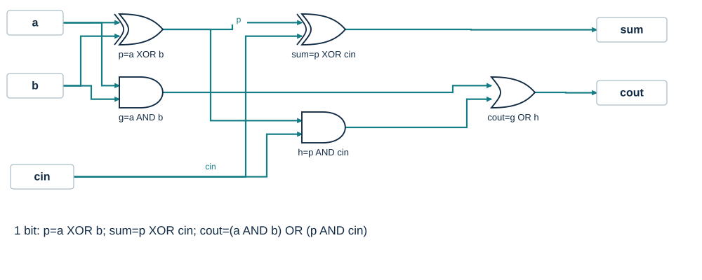
sum=a XOR b XOR cin; cout=majority(a,b,cin).
Tổ hợp; không chứa clock.
Hai nhánh tạo sum và cout dùng chung p. Vector adderN là N bit-slice tương đương, không phải thêm N pipeline stage.
Ký hiệu AND/OR/XOR trong hình là cổng logic; mapper có thể gộp chúng vào LUT và carry primitive. Hai chân vào của mỗi cổng đã tách; dây giao nhau không có dấu nối không biểu thị short.

## S02. MUX2, EQ/NZ và flip-flop
Module: primitive
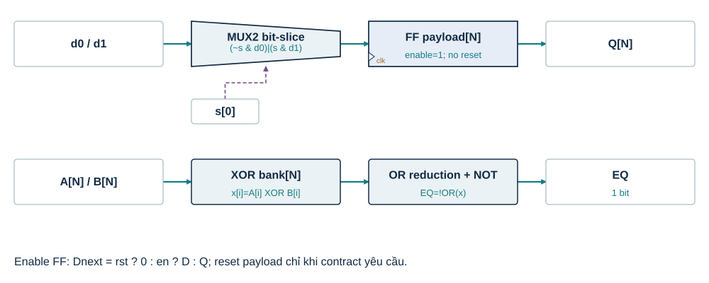
MUX2=(~s & d0)|(s & d1); EQ=~OR(A XOR B); NZ=OR(A).
MUX/EQ tổ hợp; FF chỉ đổi ở posedge.
Một mux busN là N mux bit dùng chung select; không phải chọn từng bit bằng select khác nhau.
FF enable dùng mux hồi tiếp Q ở D; synchronous reset của valid có ưu tiên hơn enable. RAM/payload không tự thêm reset hàng loạt.

## S02B. MUX2 được mở thành NOT, hai AND và OR
Module: primitive
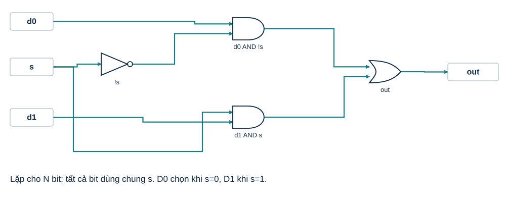
out=(d0 AND NOT(s)) OR (d1 AND s).
Không có FF; chỉ thêm delay tổ hợp trong stage hiện hữu.
MUX4 có thể ghép3 MUX2. Mux enable trước DFF còn có nhánh hồi tiếp Q làm d0.
Đây là mức logic chức năng. FPGA thường gộp NOT/AND/OR vào LUT hoặc mux primitive, không bắt buộc có4 cell rời.

## S02C. Comparator EQ/NZ: XOR bit-slice và cây OR
Module: primitive
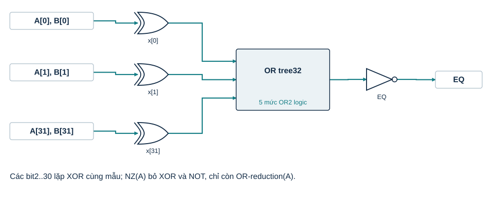
EQ(A,B)=NOT(OR_i(A[i] XOR B[i])); NZ(A)=OR_i(A[i]).
Tổ hợp; pipeline EQ chỉ khi contract đã có register boundary.
OR tree32 có5 mức OR2 trong cấu trúc logic cân bằng; LUT6 có thể gộp nhiều mức nên không dùng số này để tính Fmax.
Trong gate expansion hình dùng bundle hai input A[i]/B[i] vào XOR; cách tách hai chân giống S01. Cây này dùng ở tag, bank conflict, full/empty và decode.

## S03. Cộng/trừ N bit và đường carry
Module: primitive
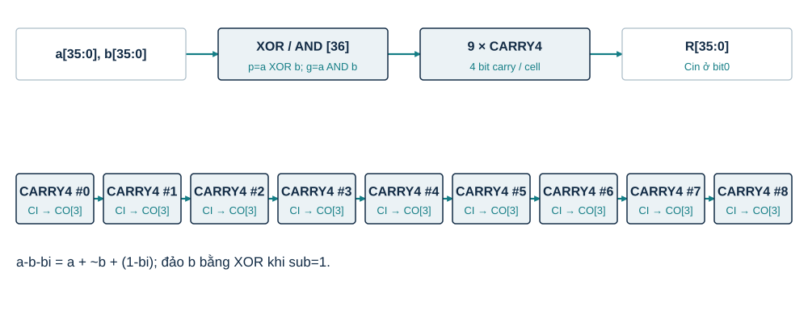
R=lowN(A+B+Cin); subtraction dùng B=NOT(b), Cin=NOT(bi).
Không thêm FF giữa CARRY4 trong cùng một toán tử tổ hợp.
9 CARRY4 là cấu trúc tham chiếu cho adder36 trên7-series; không phải số primitive đã xác nhận sau synth của thiết kế mới.
Khi vẽ N bit-slice phải mở rộng đầu vào đủ width trước NOT/cộng. Tên C0..C5 là ID adder, không phải số clock.

## S04. Một leaf16×16: AND dấu → FF → DSP → FF
Module: ft_leaf_array
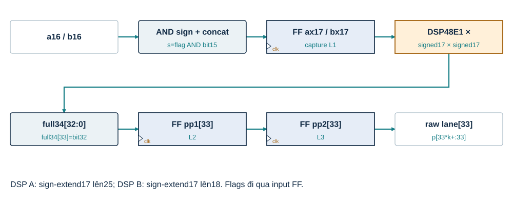
ax=signed({a_signed & a[15],a}); bx tương tự; raw=low33(ax*bx).
Launch L0; input FF L1; pp1 L2; raw L3.
Lặp cấu trúc này4 lần. Không nối sign-select sống của transaction mới vào toán hạng đã chốt của transaction cũ.
Giữ33 bit là chính xác với miền input signed/unsigned16; bỏ bit34 theo quan hệ sign extension, không phải approximate arithmetic.

## S05. Bốn raw product → cat/cross FF → fused65
Module: ft_leaf_array
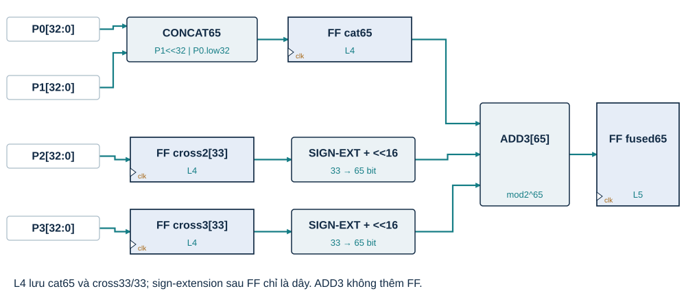
F=P0+(P2<<16)+(P3<<16)+(P1<<32).
Raw L3 → cat/cross L4 → fused L5; không thêm data FF giữa hai phép cộng.
cat là dây nối, P0 low32 hợp lệ khi lo×lo unsigned. Cross phải sign-extend trước khi dịch.
Sơ đồ có ADD3 để không ép một CSA chưa đo. Nếu triển khai CSA tổ hợp, vẫn phải giữ modulo65, cùng boundary L4/L5 và equivalence từng bit.

## S06. ft_addsub: hai raw chain và hai correction chain
Module: ft_addsub
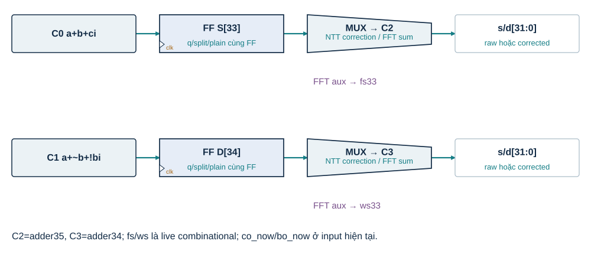
NTT s=a+b hoặc a+b-q; d=a-b hoặc a-b+q. FFT s/d wrap, C2/C3 tạo fs/ws.
Input → FF trung gian → correction/mux tổ hợp → FF của caller.
Không đặt FF ở s/d nội bộ. Out_valid là valid của FF intermediate; fs/ws không tự theo out_valid.
Các nhánh raw bypass và candidate gặp nhau tại mux output. C2/C3 input mux nằm trước adder để dùng chung arithmetic, không dựng hai adder theo mode.

## S07. ft_addsub: mở bit guard để cắt borrow packed
Module: ft_addsub
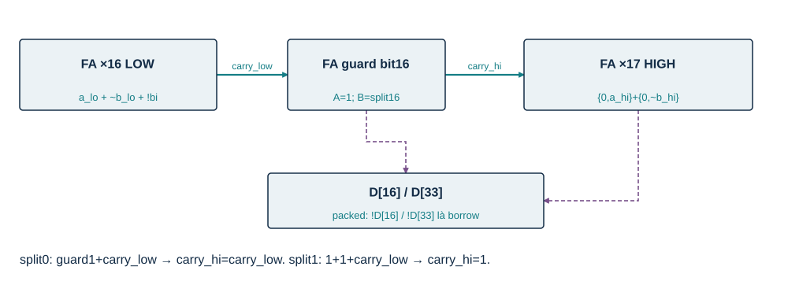
D34={0,a_hi,1,a_lo}+{0,~b_hi,split,~b_lo}+!bi.
C1 tổ hợp trước intermediate FF; correction dùng flags đã chốt.
split0 truyền quan hệ carry/borrow giữa hai nửa để tạo phép trừ32. split1 tách hai phép trừ16.
Packed carry-low được giữ ở guard; lấy d={D[32:17],D[15:0]}, không lấy D[31:0]. Các width/slice C2/C3 vẫn theo chương28.

## S07B. C2/C3: thấy rõ mux operand, adder và mux output
Module: ft_addsub
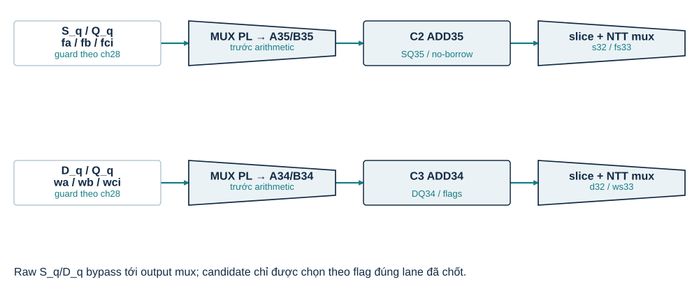
C2 NTT S-q hoặc fa+fb+fci; C3 NTT D+q hoặc wa+wb+wci.
Cùng khoảng sau intermediate FF tới FF consumer; không chèn FF giữa mux và adder.
PL là plain đã register cùng S/D, không là plain của request mới. fs/ws vẫn lấy các operand phụ sống từ FF của caller.
Adder35 và adder34 là hai chain riêng vì cần hai kết quả đồng thời; mỗi chain dùng lại giữa FFT/NTT. Guard và slice chính xác ở chương28.

## S08. ft_reduce_or_sum: một adder36 cho ba chế độ
Module: ft_reduce_or_sum
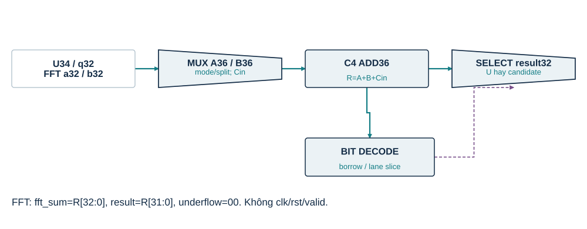
R36=A36+B36+Cin. Scalar B=NOT(zeroextend36(q)); FFT B=zeroextend36(fft_b).
NTT U FF C18 → C4 tổ hợp → corrected FF C19 ở mont.
Scalar underflow=R[35]. Packed underflow={~R[35],~R[17]}; không dùng cùng polarity.
Một phép cộng36 được chia sẻ theo operand mux. Không thêm comparator U>=q riêng nếu carry/borrow đã cung cấp điều kiện chọn chính xác.

## S09. C4 packed: sơ đồ bit17 và polarity borrow
Module: ft_reduce_or_sum
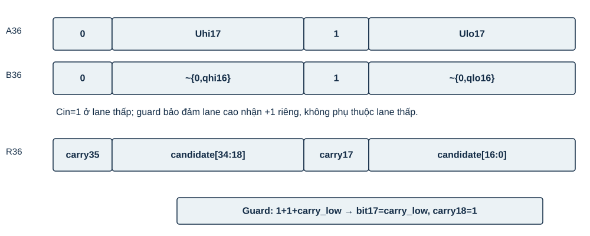
Candidate low=R[15:0]; high=R[33:18]. Borrow low=!R[17], high=!R[35].
Cả hai lane xử lý cùng khoảng tổ hợp C18..C19.
u_bus={Uhi17,Ulo17}; cổng vào chưa có guard. Guard17 chỉ được chèn khi tạo A36/B36.
Không cho Ulo carry vào phép hiệu chỉnh Uhi. Chọn U gốc hay candidate riêng từng lane, underflow là điều kiện chọn chứ không là fault.

## S10. ft_mont_pipe scalar: feedback T → m → mq
Module: ft_mont_pipe
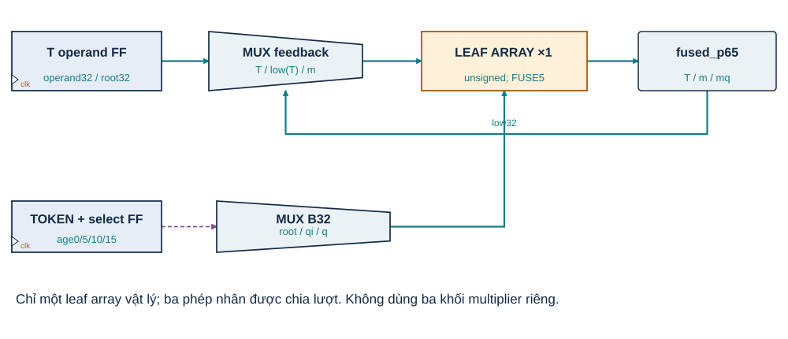
T=a·root; m=low32(T)·qi mod2^32; mq=m·q.
Launch C2/C7/C12; product sau C7/C12/C17.
Chốt select từ token nhìn trước; product mới đi qua mux vào input FF của leaf ở cạnh tiếp theo. Không chèn full-width feedback FF.
B32 lấy root đã giữ của T hoặc q/qi context cố định. Ba lượt của các packet khác nhau có thể xen kẽ trong cùng khoảng pipeline.

## S11. ft_mont_pipe packed: dùng cả bốn leaf
Module: ft_mont_pipe
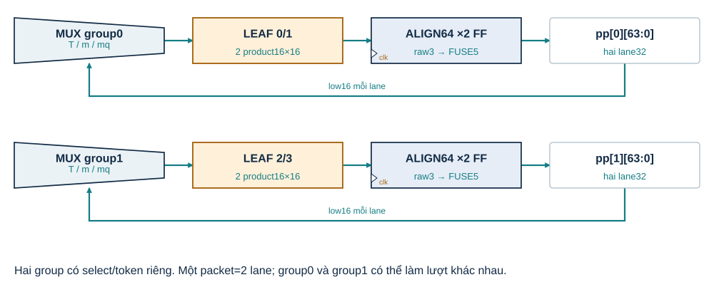
pp[g]={raw_product_lane1[31:0],raw_product_lane0[31:0]}; lấy low16/high16 từng product.
Raw C5/C10/C15 → align1 → align2 C7/C12/C17.
Group0 leaf0/1, group1 leaf2/3. Lịch launch modulo3 lần lượt (T,m),(mq,T),(m,mq).
Không lấy fused_p cho packed. leaf_valid[1:0]/[3:2] chỉ mask lượt hợp lệ, không dừng FF của leaf.

## S12. Mont history chung, chọn group và chốt correction
Module: ft_mont_pipe
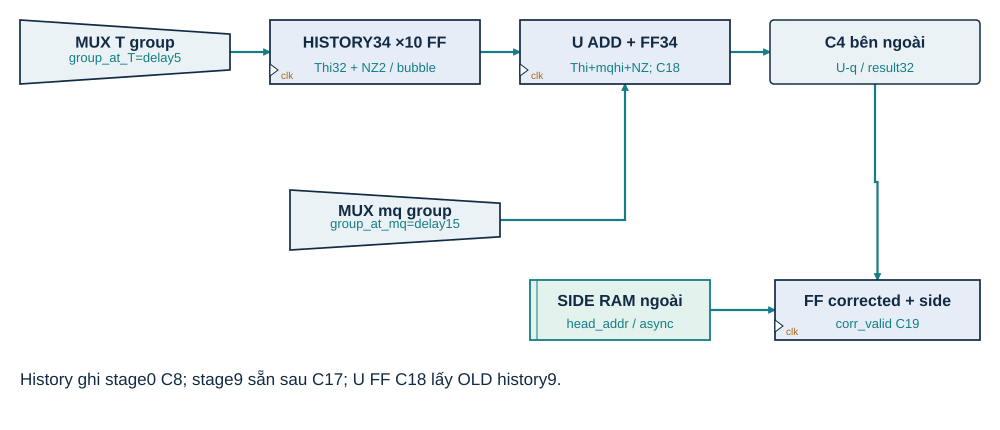
history34={T_hi_word32,NZ2}; packed U={Uhi17,Ulo17}, scalar U={0,U33}.
C18 U → C19 correction + side read/release. Không shift history theo valid.
History data shift mỗi clock; valid/bubble và group đi đúng tuổi. Không dùng delay15(group) để chọn T ở C7.
Side pointer thuộc state; mont chỉ phát side_ra=head_addr và side_re đúng cạnh C19. Correction FF lấy dữ liệu cũ trước khi head tăng.

## S13. ft_tile_state: RAM thực và sáu cặp cổng riêng
Module: ft_tile_state
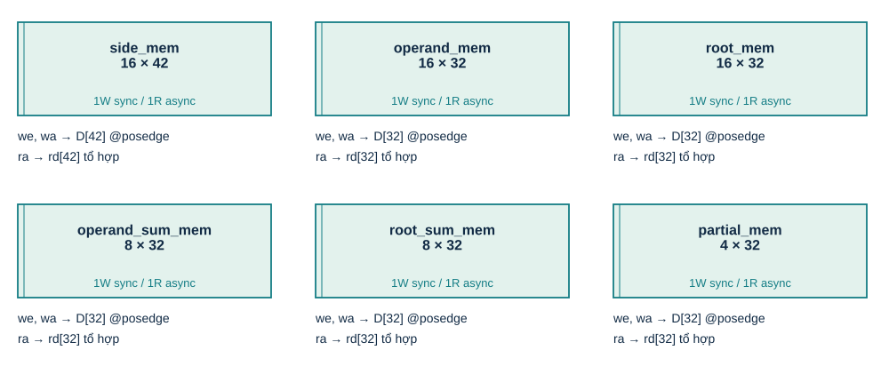
FFT address=buffer·2L+semantic_word; sum address=buffer·L+limb; partial address=limb.
Write tại cạnh we; read tổ hợp giữa hai cạnh, FF consumer nằm ngoài state.
Các đường đọc/ghi là cổng độc lập của từng RAM, không phải một RAM6R/6W tập trung. Không thêm FF output RAM trong module.
Side42={0,pairing,tag8,data32}; array không reset. Partial read-modify-write lấy p0 trước cạnh và ghi tổng sau cạnh.

## S14. State: incrementer, comparator và reserve/release
Module: ft_tile_state
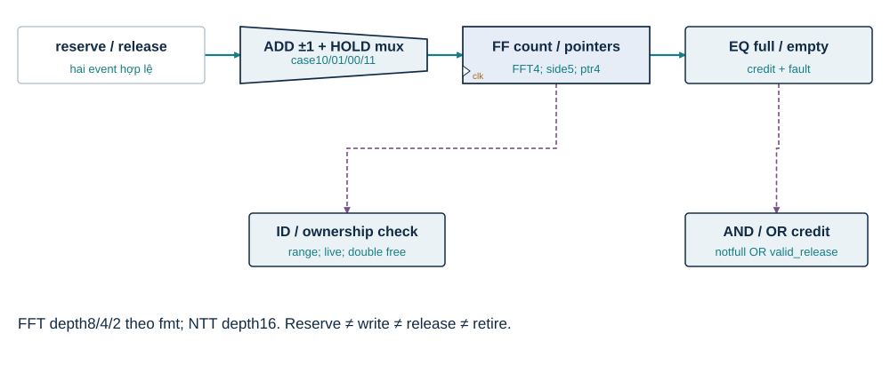
count_next=count+reserve_valid-release_valid; pointer tăng modulo depth.
NTT reserve C0, write C2, release C19; FFT reserve first beat, free combine cuối.
Không đánh đồng count buffer với outstanding. alloc_buf/tail được caller chốt khi reserve, không lấy pointer sống ở beat sau.
Full+release có thể nhận mới nếu release hợp lệ và reuse đúng ID/lịch. Empty+reserve không cho phép free một vật chưa tồn tại.

## S14B. Counter/pointer: XOR, AND, mux hold và FF
Module: ft_tile_state
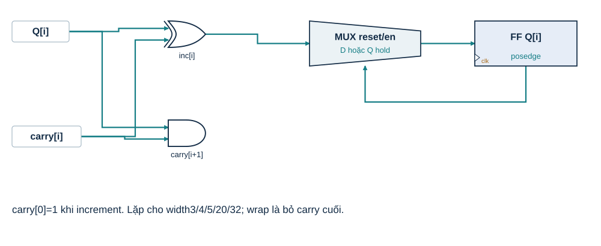
inc[i]=Q[i] XOR carry[i]; carry[i+1]=Q[i] AND carry[i].
State đổi tại cạnh reserve/release/epoch; reset ưu tiên trước enable.
Đây là khai triển incrementer dùng cho pointer và counter. Count ±1 còn cần chọn cộng/trừ theo hai event; không thay bằng tăng mọi clock.
Pointer có thể wrap nhưng occupancy không được wrap full thành0. Count FFT4 bit, side5 bit là width đã khóa.

## S15. ft_fft_accum: mux seed, adder68 và carry cột
Module: ft_fft_accum
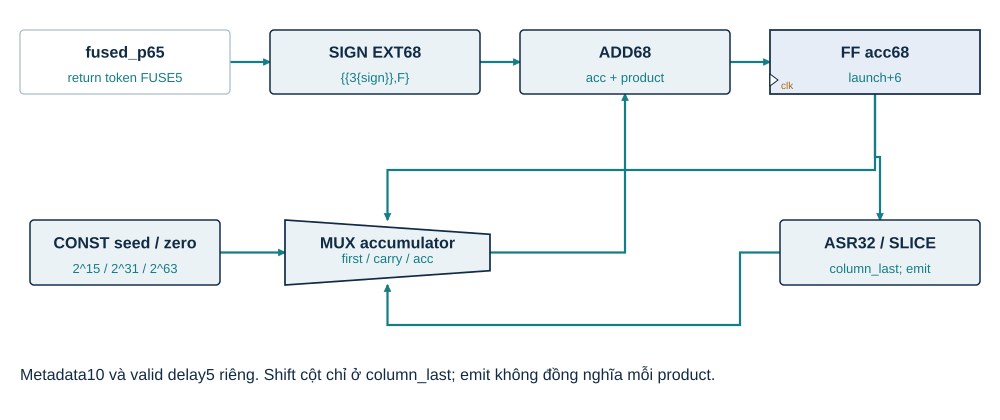
acc_next=acc_in+signextend68(fused65); carry_next=signed(acc_next)>>>32 khi last cột.
Fused launch+5 → MAC/limb launch+6 → combine launch+7.
W128 emit step5/9/12/14 theo timing.json. Emit lấy slice của acc_next tại MAC; carry cho cột sau lấy acc_q đã chốt rồi ASR32 vào mux. Low columns vẫn góp carry dù không emit.
ASR là nối dây/slice sign extension cho shift32; không tạo barrel shifter tổng quát. Native64 seed0.

## S16. ft_fft_combine: RAM, C4 và một subtract C5
Module: ft_fft_combine
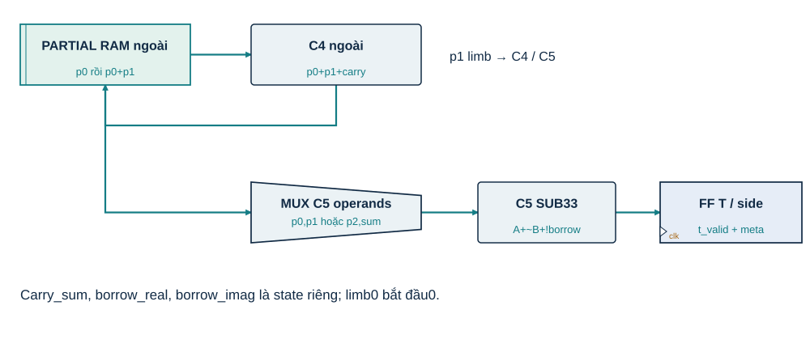
real=p0-p1; partial=p0+p1; imag=p2-partial, wrap theo W.
p0/p1 write partial và C5 capture tại combine; free ở p2 limb cuối.
C4 không nằm bên trong combine; hình C4 là kết nối tới instance chung của tile.
MUX C5 đổi thứ tự operand theo product; không giữ một borrow dùng chung cho cả hai phép trừ. Side được chốt cùng T trước khi buffer free.

## S17. ft_native_align: increment carry và half64 bằng dây
Module: ft_native_align
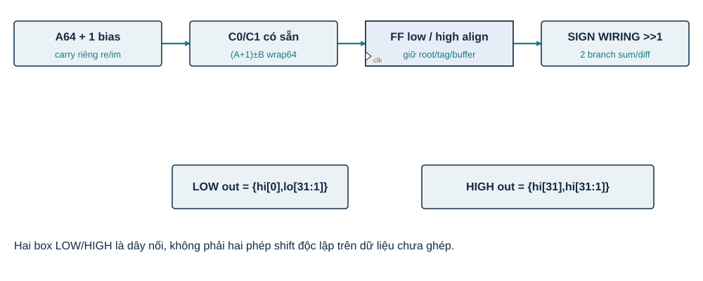
half(v)=signed(wrap64(v+1))>>>1; bias A dùng lại cho cả (A+1)+B và (A+1)-B.
Native inverse64 thêm2 clock input alignment; H11, free29.
C0/C1 ở hình thuộc addsub dùng chung, không instantiate thêm hai adder64 trong native_align.
Phải chờ đúng high beat trước khi tạo low output có hi[0]. Root/tag/first đi cùng data; không lấy context/buffer hiện tại thay token cũ.

## S18. ft_tile: ranh giới physical sharing và output FF
Module: ft_tile
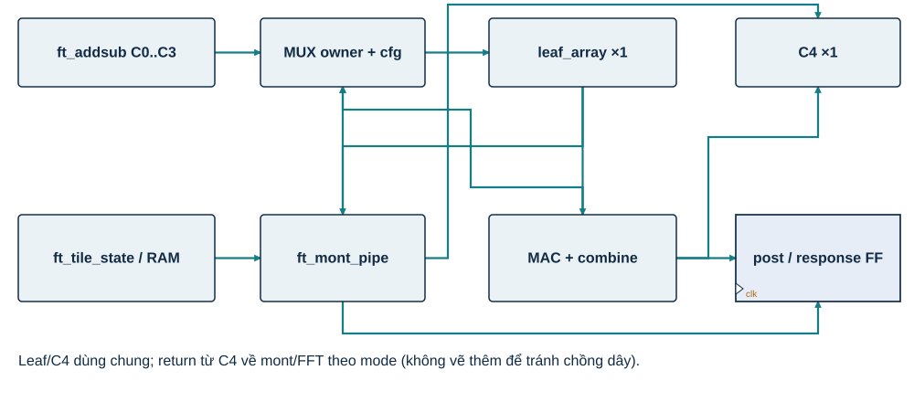
CT/GS đổi nơi dùng addsub; FFT wrap, NTT modulo; packed two-group nhưng chỉ một context q.
COLD→CFG→READY→BUSY; response không có ready; busy gồm output pending.
Chỉ1 leaf array,1 C4 và1 addsub/tile. Mont/FFT cấp operand vào owner mux; product về hai controller nhưng valid được qualify theo context, không nối serial hai engine.
Các mux vật lý đi theo cổng leaf/C4/side; không dựng crossbar kết nối mọi khối. Chặn nhận CFG khi busy và giữ cấu hình cũ.

## S19. ft_cfg_decode: comparator và pipeline5 stage
Module: ft_cfg_decode
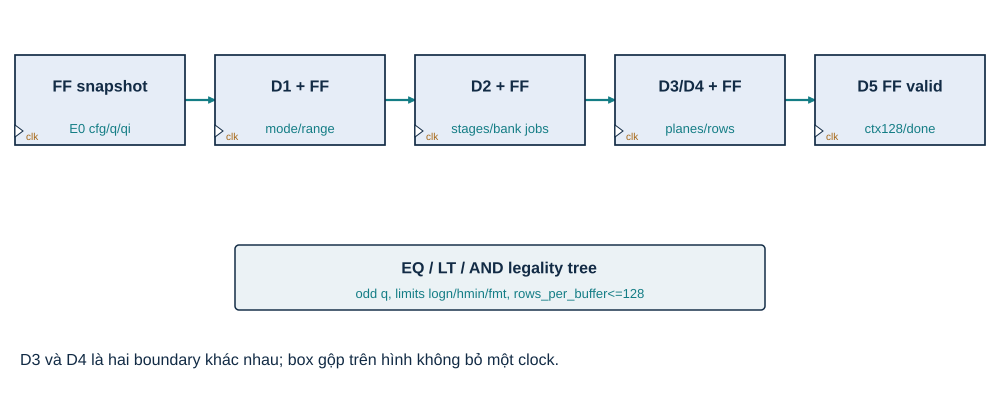
Geometry dùng min/max/cộng trừ log; rows=1<<rowlog; capacity exponent kiểm trước dịch/narrow.
E0 snapshot; D1..D5 E1..E5; core E6; frontend E7.
Mỗi stage có valid tương ứng. Không nối combinational toàn cfg word qua mọi phép so sánh vào ready.
Dùng widened temporaries để bắt hmin>logn và underflow; decode không kiểm primality/root order.

## S20. ft_data_mem: một bank1R1W, lặp32 lần
Module: ft_data_mem
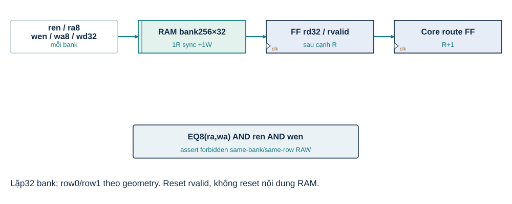
32×256×32 bit; ping-pong dùng hai vùng row trong cùng bank.
RAM data sau R; route FF R+1; tile fire R+2.
FF rd trong hình là read register của cổng RAM/inference, không thêm một tầng output FF sau RAM đã sync.
RAW comparator là assertion/monitor để kiểm lịch; không tuyên bố phần cứng tự chữa mọi descriptor sai.

## S21. ft_root_mem: AND destination và cổng read đồng bộ
Module: ft_root_mem
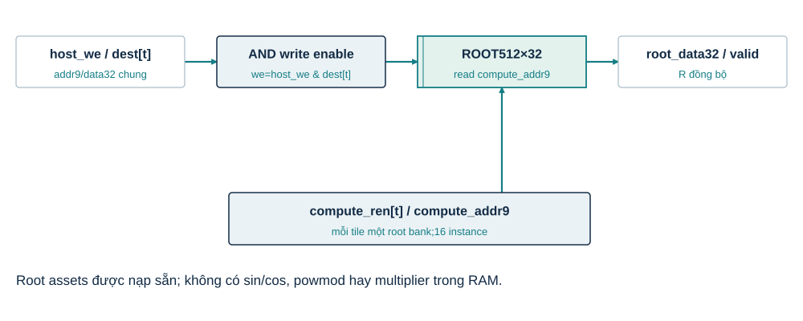
Root word32 theo format; packed root16 đúng miền R16 trước khi nạp.
Root read cùng R với data; root_valid đi cùng root_data qua route alignment.
Host chỉ ghi khi idle. ROOT write invalidate root_committed; COMMIT không kiểm root mathematical order.
Lặp16 bank, address compute chung nhưng enable từng tile. Không reset array hoặc nhân đôi bảng root cho mỗi precision.

## S22. ft_cg_addr: slice, rotate, XOR và nối row
Module: ft_cg_addr
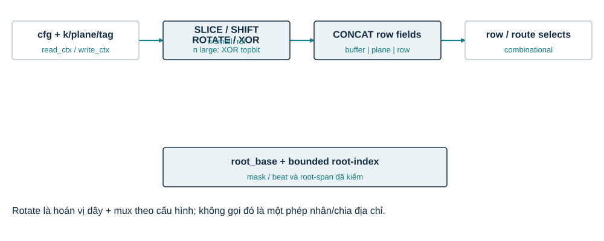
row=buf*rows*planes+pl*rows+(p>>5); bank large=(p&31) XOR (topbit<<4).
Tổ hợp, không clk/rst. Core sở hữu các register boundary.
Read dùng read_stage; write dùng write_ctx/out_tag của output. Chồng lấp tầng không được lấy chung một stage counter.
Cấu hình n0 tránh rotate width0; mọi field row không chồng bit sau range-check. Không pipeline one-hot32.

## S23. ft_cg_route: bốn nguồn bằng ba mux2/bus
Module: ft_cg_route
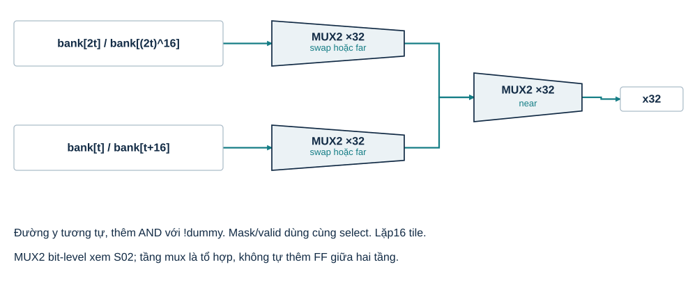
MUX4 = MUX2(near, MUX2(swap,...), MUX2(far,...)); y_dummy=0.
Route tổ hợp tới request FF R+1; write route tới bank commit E+1.
Mỗi đầu vào có các nguồn constant theo tile, không có selector bank tùy ý. Không dựng mux32 trên mỗi output.
Write route hoán vị theo write_ctx, không dùng select read hiện tại; output bank write-mask cũng đi đúng đường dữ liệu.

## S24. ft_fft_program: incrementer, EQ và LUT index
Module: ft_fft_program
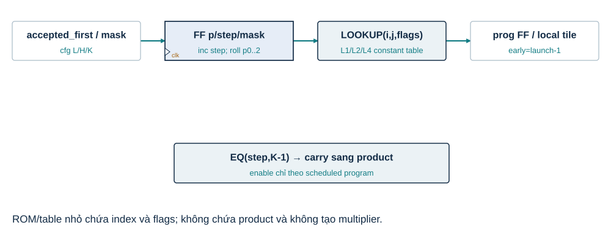
launch=H+pK+s; K1/4/15. L4 emit ở step5/9/12/14.
Prog phát early; local tile register địa chỉ trước khoảng operand launch.
Program chung16 tile, mask giữ từ accepted_first. Token return không lấy counter program sống.
Các bit first/last-column/emit được decode từ lookup và delay cùng product. Không tiến step khi không có program hợp lệ.

## S25. ft_issue_ctrl: bộ đếm và cổng qualify issue
Module: ft_issue_ctrl
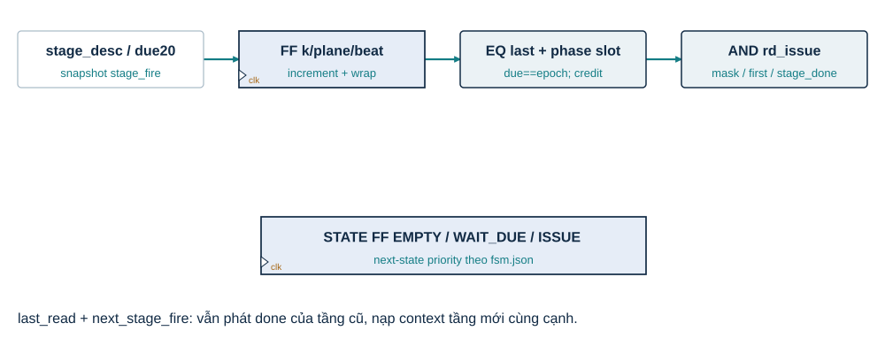
issue=due/slot hợp lệ AND context-credit; counters liệt kê read theo geometry.
Read R → tile fire R+2; stage_issue_done là last read, không phải DONE kernel.
Không dùng phi_launch làm phase nhận request. Scheduled deadline miss không được tự stall rồi đổi khoảng gap.
Counter context chuyển tầng bằng mux load/increment/hold, priority reset cao nhất.

## S26. ft_stage_ctrl: RAM descriptor, timestamp và context
Module: ft_stage_ctrl
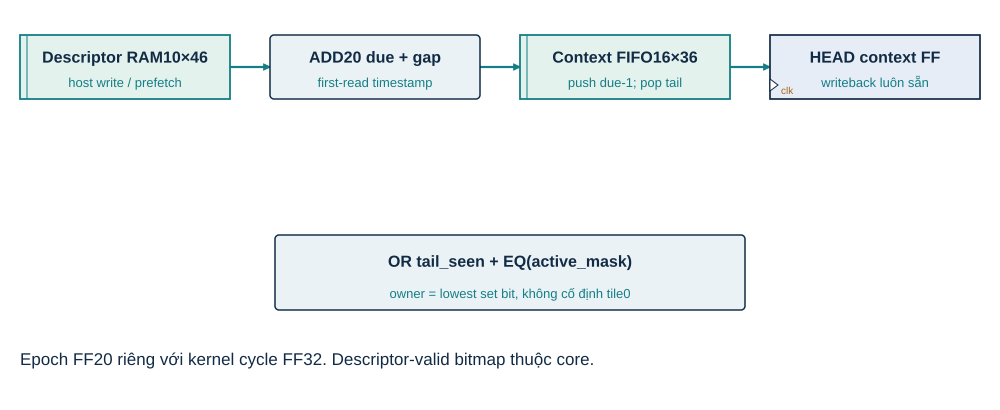
next_due=old_first_read+gap; all_tail=((seen|commit)&mask)==mask.
Context push trước first_read1 clock; pop ở terminal bank commit của mọi active tile.
Gap cuối0 bị bỏ qua; không dùng gap làm delay sau last read. Chỉ một context mới mỗi stage.
FIFO có head/next lookahead S27 để không tạo bubble khi output hai tầng ở hai clock liên tiếp.

## S27. Context FIFO: head/next FF và bypass vật lý
Module: ft_stage_ctrl
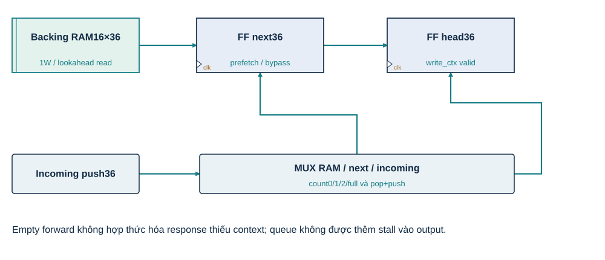
count_next=count+push-pop; mux selection phụ thuộc old count và sự kiện đồng thời.
Tail-pop E → head mới sau E sẵn cho output kế ở E+1.
count1 pop+push: incoming thay head. count2 pop+push: old next→head, incoming→next; bypass tránh đọc nhầm word RAM vừa ghi.
Full pop+push phải lấy head cũ; không zero queue hoặc thay head bằng incoming mới nhất.

## S28. ft_writeback: EQ tag, mask và AND write-enable
Module: ft_writeback
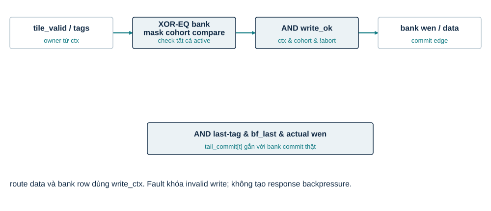
write_ok=ctx_valid AND cohort_ok AND NOT(abort/fault). tail_commit chỉ trên terminal write thật.
Response sau E → bank commit E+1; tail-pop cùng commit; DONE muộn hơn khi drain.
Owner chỉ chọn tag tham chiếu; vẫn kiểm mask và tag của tất cả active tile, kể cả khi tile0 không active.
Không thêm full-width write FF trong0.2. Comparator/qualify là tổ hợp từ các boundary đã khóa.

## S29. ft_host_map: so bank, mux phase và gather FF
Module: ft_host_map
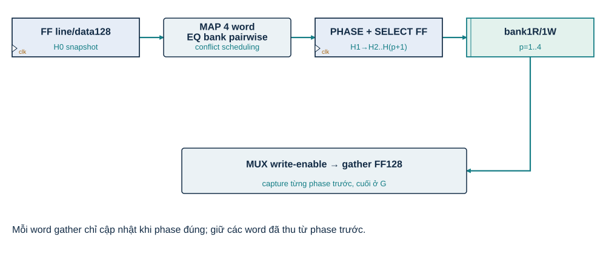
Tách line thành4 bank/row; phân phase sao cho mỗi bank tối đa1 access trong một phase.
H0 snapshot; H1 prep; H2..H(p+1) service; G=H(p+2) capture cuối.
Số phase do bank conflict thực, không lấy fmt làm số phase. Selector pipeline phải căn read RAM result.
Không chỉ gather tất cả word ở cuối từ output RAM cuối; phải capture phase cũ trong khi issue phase kế.

## S30. ft_read_normalize: carry cut và arithmetic shifter
Module: ft_read_normalize
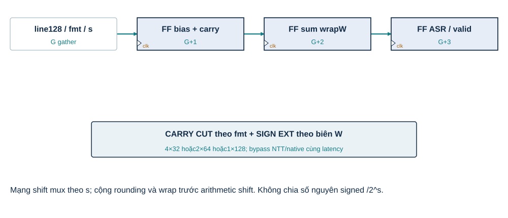
div2e(v,s)=signed(wrapW(v+2^(s-1)))>>>s, branch s0 trả v.
G+1 bias/carry, G+2 sum, G+3 out_valid; core G+4, frontend G+5.
Cắt carry giữa hai số64 hoặc bốn số32. Sign extension chỉ dùng sign của đúng giá trị W, không sign của cả line.
Các box FF biểu diễn boundary đã khóa, không phải thêm một FF sau từng bit mux của barrel shifter.

## S30B. Normalizer: arithmetic barrel shifter bằng mux2
Module: ft_read_normalize
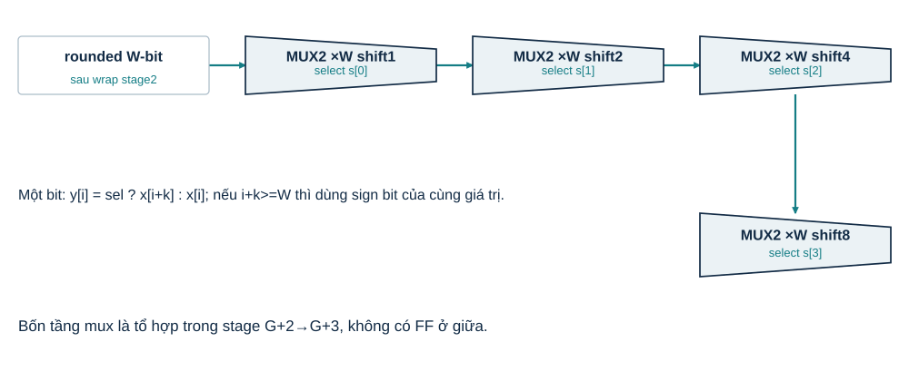
Dịch theo các trọng số1/2/4/8 tạo s0..9; bit ngoài biên W được thay bằng sign của giá trị đó.
rounded register G+2 → mạng mux tổ hợp → output register G+3.
Ở fmt32 lặp4 miền, fmt64 lặp2 miền; không để x[i+k] chạy sang số kế bên trong line128.
Mạng này là một cách phân rã tổ hợp hợp lệ của stage3. Không đổi bias/wrap hoặc thêm stage chỉ để hợp hình.

## S31. ft_core: state FF, priority và cây drain
Module: ft_core
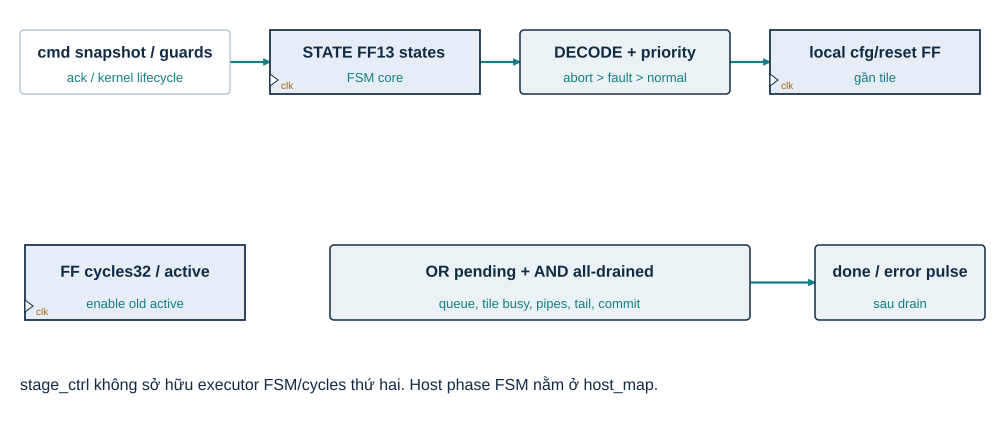
DONE=all_reads_issued AND context_empty AND tiles_idle AND pipes_empty AND tail_clear, sau last commit.
START X→reset X+1→CFG X+2→settle X+3→ctx X+4→RUN X+5.
Cycle counter không chạy cho host/CFG; identity cycles0. Epoch20 thuộc stage, cycle32 thuộc core.
Sơ đồ state bit không ép one-hot hay binary encoding; mapper/implementation chọn, hành vi theo7 FSM khóa.

## S32. ft_cmd_frontend: snapshot FF và token hold
Module: ft_cmd_frontend
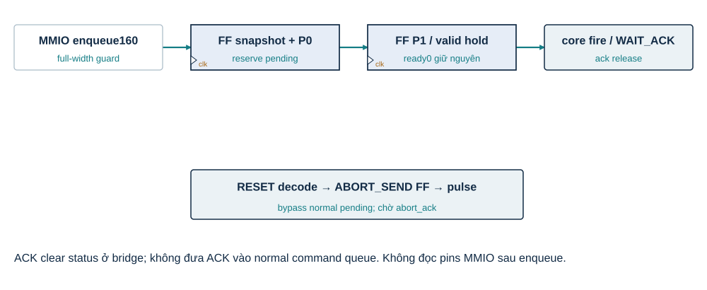
fire=valid AND ready; payload giữ nguyên trong lúc pending.
FREE→P0→P1→WAIT_ACK; RESET đi ABORT_SEND/ABORT_WAIT, abort_req1 clock.
P1 giữ cả opcode/data khi core chưa sẵn sàng. Không chỉ giữ valid còn payload lấy live pins.
READ line/ack/output/read_complete/pending cập nhật nguyên tử tại frontend; soft reset không hạ AXI B/R đang stall.

## S33. Frontend status: AND/OR và reset/clear priority
Module: ft_cmd_frontend
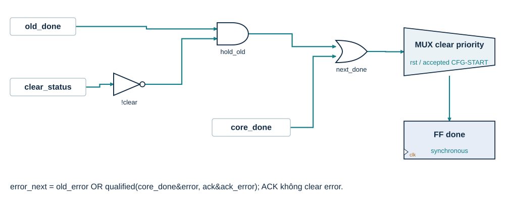
done_next=(old_done & !clear_status)|core_done, trừ accepted CFG/START clear có ưu tiên cao hơn.
Status FF cập nhật tại cạnh; new completion thắng ACK clear khi không có accepted CFG/START.
OR trên hình là cổng biểu diễn chức năng; mux priority trước D giữ quy tắc sticky chính xác.
Không OR mức core_error cũ vào error mỗi clock; chỉ lấy lỗi tại completion/ack được qualify. read_complete có điều kiện clear riêng theo spec10.

## S34. ft_axil_top: AW/W slots, join và B/R hold
Module: ft_axil_top
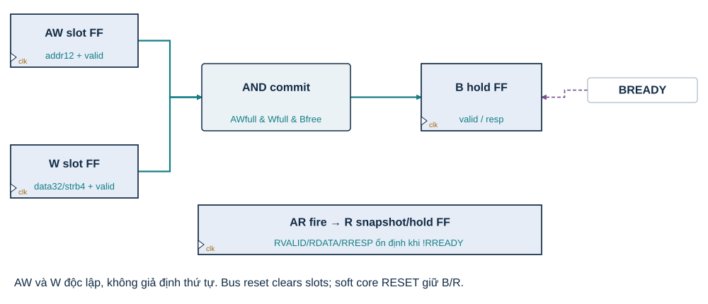
Write commit khi đã nhận đủ address/data và có chỗ B. Read snapshot khi AR fire.
AXI handshake theo mỗi channel; B không phải kernel DONE hoặc core command ack.
Một write/read outstanding. Giữ RDATA của status đã snapshot dù status nội bộ thay đổi khi R stall.
Không ghép AW cũ với W mới sau bus reset. Invalid address/alignment/command trả SLVERR theo map3.1.

## S35. AXI byte-enable và cổng merge32
Module: ft_axil_top
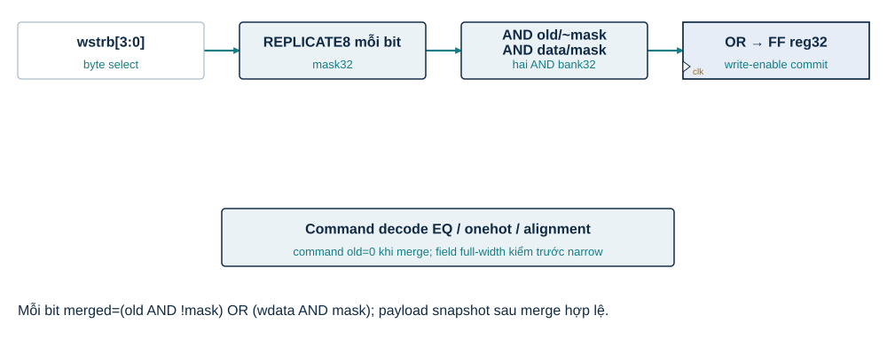
mask32=concat(repeat8(wstrb[i])); merged=(old&~mask)|(wdata&mask).
Register update đúng một lần khi AW/W được commit; không lặp write lúc B bị stall.
Mask1 byte không làm thay các byte khác. Command old0 khác các register RW có old value.
Không thêm tín hiệu security từ AWPROT/ARPROT nếu chưa hiện thực. Các cổng bus đầy đủ nằm trong chương27.

## D01. Leaf: từng chân sign, D, Q và CLK
Module: ft_leaf_array
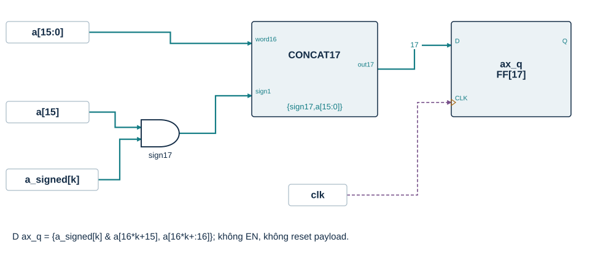
a16 unsigned FFFF→0_FFFF=65535; signed FFFF→1_FFFF=-1.
Capture L1. Sign và word được chốt cùng cạnh, bx_q tương tự.
Lặp cho b và4 leaf. Q của ax_q/bx_q cấp signed multiplier; không dùng signed_select sống sau L1.
Tên ax_q là gợi ý. D/Q/CLK là chân primitive nội bộ, không phải port mới của ft_leaf_array.

## D02. Leaf: sign-extend tới DSP và hai product FF
Module: ft_leaf_array
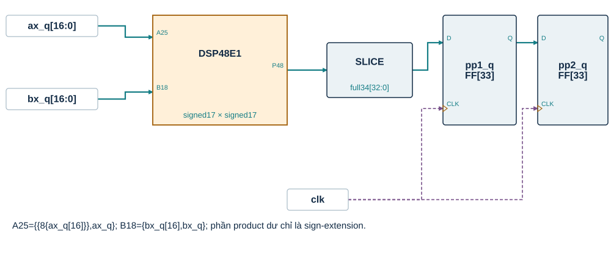
Multiplier25×18 cho43 bit, sign-extend trong P48; full34=low34(P48), raw33=full34[32:0].
pp1 capture L2, pp2 capture L3; raw_p lane lấy Q pp2_q trực tiếp.
DSP trên hình là mục tiêu inference, không khẳng định mọi input/product FF đều đã được mapper hấp thụ vào DSP.
Không thêm output raw FF; pp2_q chính là register output. Q sau L3 chỉ được consumer FF lấy tại L4.

## D03. Fused65: mở ADD3 thành hai adder tổ hợp
Module: ft_leaf_array
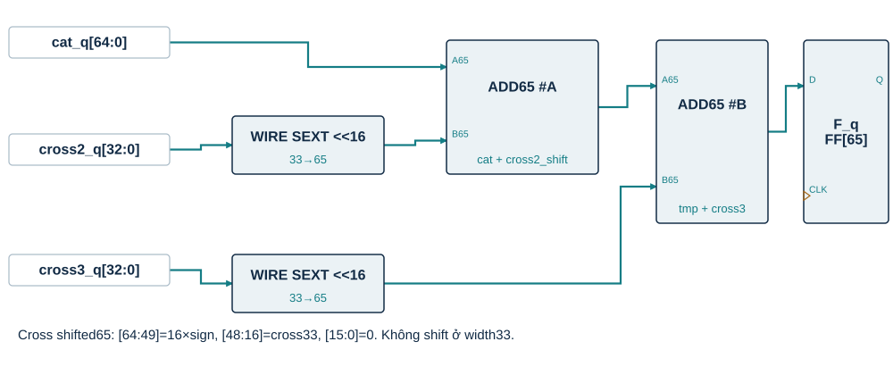
tmp=low65(cat_q+cross2_shift); F=low65(tmp+cross3_shift).
Hai adder nằm giữa L4 và L5; F_q chốt L5, không FF trung gian.
Đây là một cách tổ chức tổ hợp tham chiếu chính xác modulo2^65. Mapper có thể dùng cấu trúc khác; không thay thế bằng số liệu timing chưa đo.
CLK của F_q cùng clk leaf; không reset/enable. Carry ngoài bit64 không được đưa thành limb FFT bổ sung.

## D04. C2: hai input mux35 và carry-in riêng
Module: ft_addsub
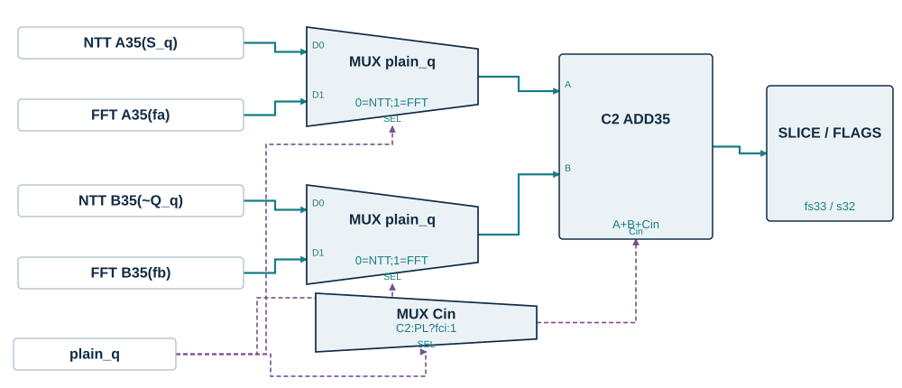
A/B/Cin theo công thức C2 của chương28; Q/PK/PL đã register cùng S/D.
Intermediate FF → mux + adder + output selection → consumer ở cạnh sau.
Mỗi mux có hai nguồn độc lập đúng width; guard/zero-extension của từng nguồn theo chương28. Không short D0 và D1 hoặc dùng một net thay cả hai.
plain_q điều khiển cả A và B; Cin cũng chọn cùng owner. Không gate clock hoặc thêm FF giữa mux và adder.

## D05. C3: hai input mux34 và carry-in riêng
Module: ft_addsub
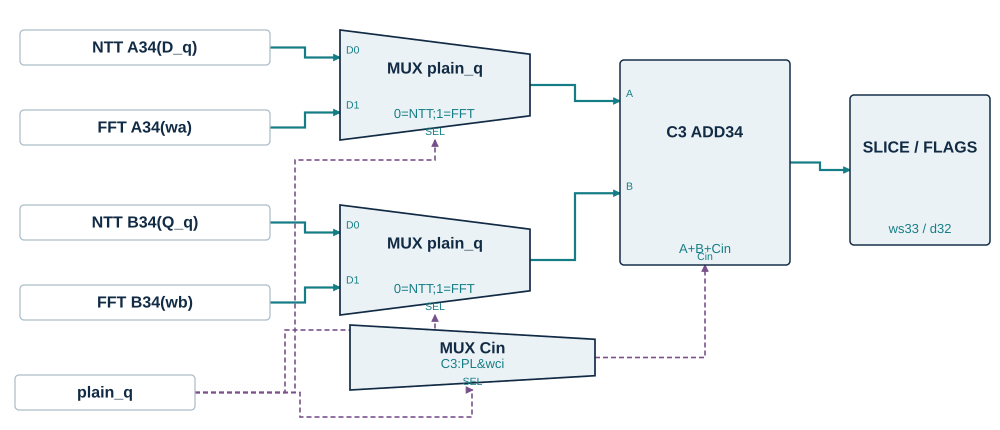
A/B/Cin theo công thức C3 của chương28; Q/PK/PL đã register cùng S/D.
Intermediate FF → mux + adder + output selection → consumer ở cạnh sau.
Mỗi mux có hai nguồn độc lập đúng width; guard/zero-extension của từng nguồn theo chương28. Không short D0 và D1 hoặc dùng một net thay cả hai.
plain_q điều khiển cả A và B; Cin cũng chọn cùng owner. Không gate clock hoặc thêm FF giữa mux và adder.

## D06. C4: chân A36, B36, Cin và decode flags
Module: ft_reduce_or_sum
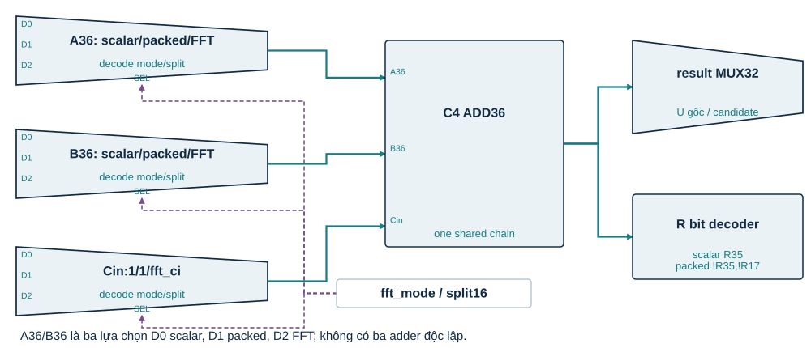
R36=low36(A36+B36+Cin); result chọn raw U hoặc R slice theo đúng lane.
Tổ hợp trong C18..C19 hoặc MAC..combine; không clock nội bộ.
U gốc phải đi bypass tới result mux, tách khỏi candidate R. fft_sum lấy R[32:0] trực tiếp, không qua NTT select.
D0/D1/D2 là ký hiệu nguồn logic; decoder ưu tiên fft_mode trước split16. B scalar phải NOT sau zero-extend36.

## D07. Mont U: hai adder17 dùng chung scalar/packed
Module: ft_mont_pipe
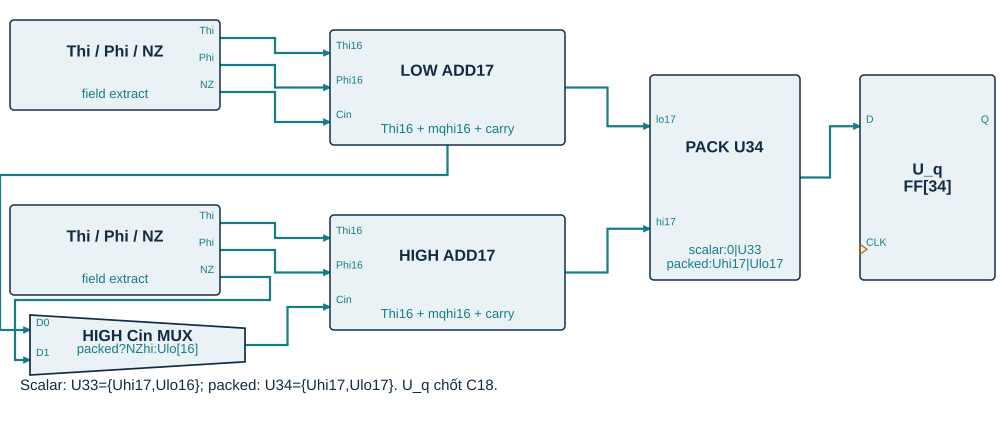
Ulo=Thi_lo+Phi_lo+NZlo; Uhi=Thi_hi+Phi_hi+(packed?NZhi:Ulo[16]).
Inputs mq/history sẵn sau C17 → U_q C18 → C4 → corr_q C19.
Một cách phân rã của U arithmetic không đổi độ chính xác. Scalar phải truyền carry thấp; packed phải dùng NZhi độc lập.
Các pin src trong hình là bundle ba tín hiệu, được tách tới chân Thi/Phi/Cin; không nối ba bit khác nghĩa vào một net.

## D08. History10: vẽ đủ từng stage và cạnh chứa X
Module: ft_mont_pipe
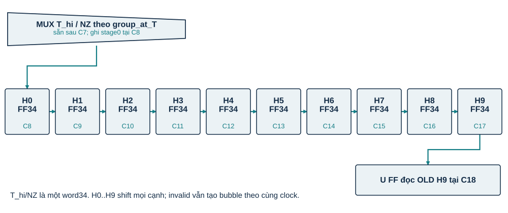
H0(X) sau C8; H9(X) sau C17. H9 trước cạnh C18 và mq(X) tạo U(X).
Không gọi đây là trễ9; ghi H0→consumer C18 cách10 cạnh capture.
Không gating shift bằng T_valid. Nếu giữ stage trong bubble, mq vẫn về theo clock thật và sẽ ghép nhầm T.
Reset valid pipeline để hủy ownership; payload history không cần reset0.

## D09. Mont token: từng valid FF và reset
Module: ft_mont_pipe
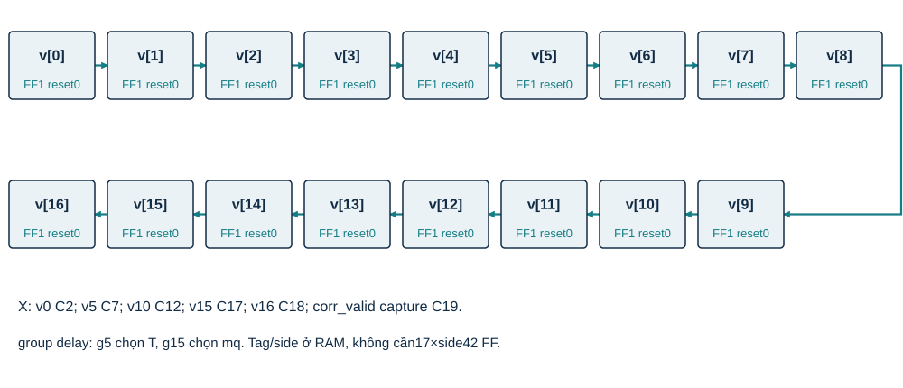
v[0]_next=packet_valid; v[i]_next=v[i-1]; reset mọi v về0.
Select m chốt từ old v4 tại C7; mq từ old v9 tại C12; U dùng old v15 C18.
Các FF cùng clock, shift cả khi invalid. Group chạy cùng tuổi nhưng chỉ consume khi token hợp lệ.
Đường v8→v9 xuống hàng là một FF stage duy nhất, không là phép stall hay thêm boundary ẩn.

## D10. Tile RAM: tách rõ WE, WA, WD, RA, RD
Module: ft_tile_state
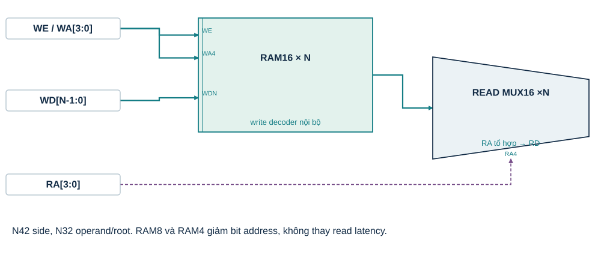
Word select là decoder địa chỉ; read RD=mem[RA] tổ hợp, write mem[WA]<=WD tại WE posedge.
Caller register RA theo lịch, consumer chốt RD ở cạnh kế; state không thêm RA/RD FF.
READ MUX là cấu trúc logic bên trong macro LUTRAM, không yêu cầu hiện thực array bằng hàng trăm FF.
Nếu WE0, nội dung giữ. Reset không chạy vòng for clear RAM. Same-address partial dùng old-data capture trước cạnh rồi write mới.

## D11. Credit: D counter, comparator và event qualification
Module: ft_tile_state

count_next=count + reserve_ok - release_ok; tail/head tiến theo event tương ứng.
FFT reserve first beat; NTT reserve C0, release C19; outstanding vẫn còn đến response.
Count5 NTT có giá trị16; tail/head4 wrap là đúng. Không dùng cùng4 bit cho cả occupancy và pointer.
Empty+reserve+release không hợp thức hóa release vật chưa sống. Full+release chỉ cho alloc lại ID đúng sau khi old data được capture.

## D12. MAC68: hai đích FF acc và limb từ cùng acc_next
Module: ft_fft_accum

acc_q.D=acc_next; limb_q.D=window(acc_next); acc_in chọn seed/carry/raw Q.
Chốt cả hai tại MAC launch+6; chỉ limb_valid khi column_last&&emit.
Q hồi tiếp cho product kế tiếp; ASR32 chỉ chọn khi cột trước đã last. first-product có ưu tiên cao nhất để bỏ trạng thái butterfly cũ.
EN ở hình là update qualifier, không clock gate. Reset token/valid, không thay seed bằng reset accumulator mọi clock.

## D13. C5: đổi operand và chọn borrow đúng phép trừ
Module: ft_fft_combine

p1: A=partial_p0,B=p1; p2: A=p2,B=partial_sum; low32(A-B-bi).
C5 và side cùng capture tại combine; output post-stage tiêu thụ ở cạnh sau.
B33 đảo sau mở rộng33, Cin=!borrow_in. Bit32 của hiệu33 là borrow vì miền A/B32 và bi0/1.
Không dùng borrow_real làm carry_sum của C4 hoặc làm borrow_imag. Mỗi phép khởi đầu ở limb0 bằng0.

## D14. Native half: ghi rõ từng lát bit low/high
Module: ft_native_align

Cả sum và diff đã chứa bias+1 và wrap64 trước wiring ASR1.
Giữ low để đợi high; tổng alignment +2 clock của native inverse64.
Đường HIGH không phụ thuộc low; đường LOW bắt buộc lấy high[0]. Không shift low độc lập khi high chưa có.
Đây là signed half native, không dùng cho NTT modular half hoặc IFFT host normalization.

## D15. Host rounding: carry bị cắt đúng biên giá trị
Module: ft_read_normalize

G+1 chốt bias/carry; G+2 bốn adder32 dùng carry đã chuẩn bị; không nối sang số kế tiếp.
Stage1 carry/addend, stage2 wrap sum, stage3 shifter; không tăng số stage.
Bias nằm trong low word của mỗi giá trị W vì s0..9. Khi s0, bias0 và không tạo s-1.
Công thức AND prefix mô tả overflow của cộng power-of-two; producer phải qualify normalize và ranh giới fmt.

## D16. Token và metadata: FF song song, reset khác payload
Module: ft_fft_accum

Delay valid/meta5 từ operand launch để căn fused; MAC/output thêm boundary đã khóa.
Mọi valid reset0; payload có thể giữ X nhưng không được consume khi valid0.
Không delay valid5 nhưng delay metadata4, hoặc chỉ shift khi valid1. Bubble phải chiếm vị trí clock thực.
Side42 được lưu RAM, không nhân bản toàn pipeline nếu không cần. Chỉ metadata phục vụ product đi cùng product.

## D17. Tile owner: dữ liệu, dấu và valid phải chọn cùng mode
Module: ft_tile

Mỗi bus a/b có một owner mux tương ứng; không chọn a từ NTT và b/flags từ FFT.
Context giữ trong BUSY; owner không đổi chỉ vì một controller đang có bubble.
Đầu ra leaf có thể fanout tới mont/accum nhưng token qualify chỉ consumer hợp lệ. C4 có owner mux riêng theo cùng context.
Không xem owner mux như arbiter nhiều job đồng thời. Profile0.2 chỉ một kernel/context.

## D18. AXI: phương trình giữ response và sự kiện commit
Module: ft_axil_top

Bvalid_next=(Bvalid&&!Bready)|wr_commit, reset bus ưu tiên; Rdata hold khi !Rready.
B/R bus reset khác soft core reset. Command enqueue một lần tại wr_commit hợp lệ.
Pin slots ở AND là bundle AW_full&W_full đã qualify; AND còn nhận !BVALID. Có thể tách thành hai AND nếu viết structural thuần.
Dữ liệu Bresp/Rdata cũng phải giữ, không chỉ valid. Khi lỗi địa chỉ/command vẫn tạo một response hợp lệ với SLVERR.

# 36. Nối instance và thứ tự consume dữ liệu

Bảng dưới là net binding theo vai trò instance. Dấu / trong tên a/b chỉ hai net song song độc lập, không ghép bit hoặc nối điện hai cổng output. Các instance đều cùng clock trong profile0.2; clk/rst không được tự lấy từ tín hiệu data hoặc FSM.

## 36.1 Wiring trong một tile

| Nguồn | Đích | Bit | Quy tắc |
| --- | --- | --- | --- |
| leaves.raw_p | mont.raw_p | 132 | Direct; packed alignment2 ở mont, không ở leaf |
| leaves.fused_p | mont.fused_p / accum.fused_p | 65 | Fanout dữ liệu; valid riêng theo mode |
| mont.leaf_a/b | owner mux → leaves.a/b | 64 mỗi bus | NTT scalar/packed candidate; không signed |
| FFT operand/root RAM read | owner mux → leaves.a/b | 4×16 mỗi bus | Fused map low/high; signed-select theo top limb |
| mont.u_bus | C4.u_bus | 34 | C18 U register tới C4 tổ hợp |
| combine.c4_a/b/ci | C4.fft_a/b/ci | 32/32/1 | C4.fft_mode=FFT context; C4.split16=packed context |
| C4.result | mont.corrected | 32 | Không thêm FF; mont chốt C19 |
| C4.fft_sum | combine.c4_sum | 33 | Không thêm FF; combine chốt partial/carry tại p1 |
| mont.side_we/wa/wd | state.side_we/wa/wd (owner mux) | 1/4/42 | NTT write C2; FFT producer là owner khác |
| mont.side_ra / combine.side_ra | owner mux → state.side_ra | 4 | Chọn theo context, không cả hai reader cùng lúc |
| state.side_rd | mont.side_rd / combine.side_rd | 42 | Async read; consumer register đúng event |
| mont.side_re | state.ntt_release | 1 | Trước cạnh C19, không dùng corr_valid sau cạnh thay thế |
| state.ntt_head_addr | mont.head_addr | 4 | Head cũ trước release |
| state.ntt_alloc_addr | reserve slot FF ở tile → mont.alloc_addr | 4 | C0 giữ slot, căn đến packet boundary C2 |
| combine.partial_ra/we/wa/wd | state.partial_* | 2/1/2/32 | RAM của state, không tạo RAM thứ hai |
| state.partial_rd | combine.partial_rd | 32 | Old p0 tại p1; old sum tại p2 |
| combine.release_buf/id | state.free_buf/free_buf_id | 1/3 | Combine p2 limb cuối, không ở rsp cuối |
| accum.limb_valid/data/meta | combine.limb_valid/data/meta | 1/32/7 | MAC launch+6 → combine launch+7 |
| mont.corr_* / combine.t_* | tile post-stage → rsp_* | data/tag/valid | CT qua addsub; GS qua side/T; rsp không backpressure |

## 36.2 Wiring cấp core và host

| Nguồn | Đích | Bit | Quy tắc |
| --- | --- | --- | --- |
| axil MMIO enqueue | frontend.mmio_* | 4/160/valid-ready | Snapshot giữ trước khi core nhận |
| frontend.cmd_* | core.cmd_* | 4/160/valid-ready | Normal command P1 hold đến fire |
| frontend.abort_req | core.abort_req | 1 | Bypass queue; pulse1 clock |
| core.ack/line/kernel/status | frontend.core_* | theo ports | ACK command khác DONE kernel |
| cfg_decode.cfg_ctx | core snapshot → stage/issue/program/address | 128 | Không broadcast tất cả128 bit tới FF arithmetic |
| stage.stage_* | issue.stage_* | id4/desc46/due20 | Stage activation first_read-1 |
| issue.stage_done/done_stage | stage.issue_stage_done/done_stage | 1/4 | Done read tầng cũ, không compute complete |
| issue read indices | cg_addr.read_* | 4/5/3/3/buf/internal | Read context |
| cg_addr root/rows/select | RAM request + metadata FF | 9/8/select | R read; metadata căn RAM output |
| data.rdata/rvalid + root.root_data/valid | cg_route → request FF trong core | 1024/32 +512/16 | Route R+1, tile fire R+2 |
| program.prog_* | local program FF ở tile active | product2/step4/mask16 | Early decode trước launch |
| tile.rsp_* | writeback.tile_* / route.tile_data | 16×64/8/valid/last | Output reserve trước, không có rsp_ready |
| stage.write_ctx | cg_addr/cg_route/writeback.write_ctx | 36+valid | Write context tách read context |
| writeback.out_tag | cg_addr/cg_route.out_tag | 8 | Từ owner của head, không tile0 cứng |
| route.routed_wdata | writeback.routed_wdata | 1024 | Data mux; writeback qualify mask/address |
| writeback.wen/waddr/wdata | owner mux → data memory write | 32/256/1024 | Commit sau rsp1 clock |
| writeback.tail_commit | stage.tail_commit | 16 | Cùng cạnh bank commit thật |
| host_map ren/wen/addr/data | owner mux → data memory | theo ports | Chỉ host khi compute idle |
| host_map.gather_* | normalizer.line_data/in_valid | 128/1 | Gather đủ phase; không normalize trong RAM |
| normalizer.out_valid/data | core READ ack/line_rsp | 1/128 | Core G+4; frontend G+5 |

## 36.3 Các chân không được nối nhầm

1. C4.result vào mont.corrected32; C4.fft_sum vào combine.c4_sum33. Đừng bỏ carry của tổng FFT chỉ vì result cũng có low32.
2. mont.side_re là event trước C19 để state release slot; corr_valid mới xuất hiện sau C19 và không thay thế event đó.
3. Leaf raw/fused cùng thời điểm thuộc hai lượt khác nhau. Packed không dùng fused; FFT không lấy raw lane như một real product32×32 hoàn chỉnh.
4. out_valid của addsub xác nhận s/d từ intermediate FF; fs/ws và co_now/bo_now có latency khác, caller phải dùng qualifier riêng.
5. write_ctx/out_tag tạo write row/route; read_ctx tạo read row/route. Nếu buộc hai context thành một khi overlap, dữ liệu đúng số học vẫn có thể ghi sai tầng.

# 37. Hồ sơ triển khai chi tiết từng module

Mỗi hồ sơ có binding cho toàn bộ port, bảng D/width/enable/reset của register nội bộ tham chiếu và các bất biến phải assert. Tên register nội bộ là gợi ý có thể thay; numerical semantics, port và clock boundary vẫn theo contract khóa. Những lựa chọn encoding/ownership chưa khóa không được ghi thành chứng cứ RTL đã triển khai.

| Hồ sơ | Sheet structural đối chiếu |
| --- | --- |
| ft_leaf_array | S04, S05, D01, D02, D03 |
| ft_addsub | S06, S07, S07B, D04, D05 |
| ft_reduce_or_sum | S08, S09, D06 |
| ft_mont_pipe | S10, S11, S12, D07, D08, D09 |
| ft_tile_state | S13, S14, S14B, D10, D11 |
| ft_fft_accum | S15, D12, D16 |
| ft_fft_combine | S16, D13 |
| ft_native_align | S17, D14 |
| ft_tile | S18, D17 |
| ft_cfg_decode | S19 |
| ft_data_mem | S20 |
| ft_root_mem | S21 |
| ft_cg_addr | S22 |
| ft_cg_route | S23 |
| ft_fft_program | S24 |
| ft_issue_ctrl | S25 |
| ft_stage_ctrl | S26, S27 |
| ft_writeback | S28 |
| ft_host_map | S29 |
| ft_read_normalize | S30, S30B, D15 |
| ft_core | S31 |
| ft_cmd_frontend | S32, S33 |
| ft_axil_top | S34, S35, D18 |

# 37.01. ft_leaf_array

## A. Binding và nghĩa của từng nhóm cổng

| Port / nhóm port | Nguồn, nơi dùng và điều kiện hợp lệ |
| --- | --- |
| clk | Clock duy nhất; input FF, product FF và fused FF đều lấy posedge, không clock-enable. |
| a b | Bốn word16: leaf k nhận bus[16*k+:16]. Fused mapping do caller chuẩn bị, không tự hoán vị. |
| a_signed b_signed | Bit k chọn signed16 cho word k; chốt đồng thời với word, hoặc chốt signed17 đã mở rộng. |
| raw_p | raw_p[33*k+:33]=pp2_q[k]. Bốn product của cùng lượt launch, sau launch+3. |
| fused_p | 65 bit sau launch+5. Chỉ được dùng khi bốn leaf tạo đúng một tích32×32; packed dùng raw. |

## B. Register, D và update/reset

| Register tham chiếu | Width | D / điều kiện update | Reset / thời điểm |
| --- | --- | --- | --- |
| ax_q[4],bx_q[4] | 17 signed mỗi word | D={flag&word15,word}; mỗi clock | Không reset; L1 |
| pp1_q[4] | 33 mỗi leaf | D=full34[32:0] | Không reset; L2 |
| pp2_q[4] | 33 mỗi leaf | D=pp1_q | Không reset; L3 |
| cat_q,c2_q,c3_q | 65,33,33 | D={P1,P0.low32},P2,P3 | Không reset; L4 |
| fused_q | 65 | D=cat+(sext65(c2)<<16)+(sext65(c3)<<16) | Không reset; L5 |

## C. Bất biến để viết assertion

1. Không có valid/rst/en trong interface: tile giữ token riêng. Sau reset của tile, data cũ vẫn chạy nhưng không được consume.
2. Các bit sign-extension/zero-padding sau FF là dây. Không suy ra thêm33→65 FF cho cross products.
3. consumer FF tại cạnh L5 chỉ nhìn fused của lượt trước; fused mới sau L5 được consumer lấy tại L6.

# 37.02. ft_addsub

## A. Binding và nghĩa của từng nhóm cổng

| Port / nhóm port | Nguồn, nơi dùng và điều kiện hợp lệ |
| --- | --- |
| clk rst | Clock và reset synchronous active-high; reset out_valid, không cần reset S/D/Q payload. |
| in_valid | Chốt cùng a/b/q/ci/bi/plain/split ở intermediate boundary; không là ready hoặc pause. |
| a b | Operand32 sống cho C0/C1, có thể là limb FFT hoặc hai residue16 packed. |
| q | Modulus32 hoặc {q_hi16,q_lo16}; register Q cùng intermediate, không đọc q sống ở correction. |
| ci bi | C0 carry-in và C1 borrow-in. NTT dùng0; FFT lấy carry/borrow đúng limb trước. |
| split16 plain | split16 tách lane NTT; plain=1 chọn FFT. Cả hai phải register cùng S/D. |
| fa fb fci | Operand/carry phụ sống cho C2 khi plain_q1; fs=fa+fb+fci, không qua input FF ở đây. |
| wa wb wci | Operand/carry phụ sống cho C3 khi plain_q1; ws=wa+wb+wci. |
| s d out_valid | s/d combinational từ intermediate FF; out_valid là valid FF một tầng, consumer lấy ở cạnh sau. |
| co_now bo_now | Combinational từ input hiện tại; caller chốt cùng cạnh capture limb hiện tại để dùng limb kế. |
| fs ws | Tổng33 sống từ C2/C3 ở FFT; caller dùng sum-write enable riêng. out_valid không xác nhận fs/ws. |

## B. Register, D và update/reset

| Register tham chiếu | Width | D / điều kiện update | Reset / thời điểm |
| --- | --- | --- | --- |
| S_q,D_q,Q_q | 33,34,32 | Mỗi clock lấy sum/difference/q hiện tại | Payload không reset |
| PK_q,PL_q | 1+1 | D=split16,plain cùng S_q/D_q | Chỉ consume khi token/config hợp lệ |
| V_q | 1 | rst?0:in_valid | out_valid=V_q |

## C. Bất biến để viết assertion

1. Mã hóa guard và slices là bắt buộc: xem chương28. C2/C3 dùng PL_q, không dùng plain hiện tại.
2. Không viết always_ff cho s/d thêm một tầng. Không giữ S_q khi in_valid0 nhưng vẫn chạy valid sai lịch; free-running payload là lựa chọn đơn giản.
3. Q_q của NTT giao dịch X không được lấy từ CFG của giao dịch Y.

# 37.03. ft_reduce_or_sum

## A. Binding và nghĩa của từng nhóm cổng

| Port / nhóm port | Nguồn, nơi dùng và điều kiện hợp lệ |
| --- | --- |
| fft_mode split16 | fft_mode có ưu tiên chọn nhánh FFT; split16 chỉ có nghĩa khi fft_mode0. |
| u_bus | Scalar {0,U33}; packed {Uhi17,Ulo17}. Không lấy high lane bằng slice31:16. |
| q_word | Scalar q32, packed hai q16; mở rộng trước NOT để đủ bù hai36. |
| fft_a fft_b fft_ci | Hai limb của p0/p1 và carry của tổng đó, lấy từ combine và partial RAM. |
| result | Correction NTT chuẩn hóa32 hoặc low32 của tổng FFT; module không tự register. |
| fft_sum | R36[32:0], chỉ có ý nghĩa FFT. Bit32 trở thành carry_sum ở caller. |
| underflow | Scalar {borrow,borrow}; packed {borrow_hi,borrow_lo}; FFT00. Không báo kernel fault. |

## B. Register, D và update/reset

| Register tham chiếu | Width | D / điều kiện update | Reset / thời điểm |
| --- | --- | --- | --- |
| Không có FF | 0 | Tạo A36/B36/CI → R36 → slice/mux | Không clk/rst/valid |

## C. Bất biến để viết assertion

1. Một biểu thức cộng36 sau input mux. Không instantiate multiplier, divider hoặc ba bộ trừ theo mode.
2. Scalar borrow R35; packed borrow !R35/!R17. Các cờ khác polarity do mã hóa khác nhau.
3. Đường U_q→C4→corr_q nằm trong C18..C19; thêm FF tại C4 sẽ đổi contract.

# 37.04. ft_mont_pipe

## A. Binding và nghĩa của từng nhóm cổng

| Port / nhóm port | Nguồn, nơi dùng và điều kiện hợp lệ |
| --- | --- |
| clk rst | Reset mọi token/valid/select cần thiết; payload alignment/history không bắt buộc reset. |
| cfg_mode q_word qi_word | Context ổn định khi chạy. q/qi packed đã nhân bản low16 bởi tile. |
| packet_valid group | Packet/token ở boundary C2. group chọn leaf0/1 hoặc2/3; chỉ packed mới dùng. |
| operand root | Dữ liệu cho T: scalar32 hoặc hai lane16, chốt C2 để launch sau cạnh. |
| side tag pairing | Dữ liệu phụ được đóng gói42 bit và ghi side RAM tại C2; không delay toàn bộ19 clock bằng FF. |
| alloc_addr | Slot đã reserve tại C0 và căn theo packet tới C2. Không đọc ntt_tail mới nhất thay slot cũ. |
| head_addr side_rd | Địa chỉ head do state sở hữu; side_rd42 là async read phục vụ capture C19. |
| fused_p raw_p | Product từ leaf array: scalar dùng fused, packed dùng raw.low32 qua hai align FF. |
| corrected | Nối từ C4.result; giá trị tổ hợp từ U_q trong C18..C19. |
| leaf_a leaf_b leaf_valid | Operand candidate NTT và mask4 leaf cho owner mux ở tile. Flags signed của NTT buộc0 ở tile. |
| u_bus u_valid | U_q34 và valid sau C18; tile nối tới C4, fft_mode0, split theo packed. |
| side_we side_wa side_wd | WE/WA/WD tới side RAM, phải ổn định trước C2 để RAM ghi tại C2. |
| side_re side_ra | Cửa sổ đọc/release trước C19; side_ra=head_addr. side_re nối state.ntt_release, không dùng corr_valid thay nó. |
| corr_valid corr_data corr_side corr_tag corr_pairing | Cùng bộ FF sau C19: corrected + side_rd cũ; tile tiêu thụ C20 để GS response hoặc CT post-stage. |
| fault | Vi phạm điều phối local như collision. Phase/credit ở tầng tile, không giả định mont có các input kiểm chưa tồn tại. |

## B. Register, D và update/reset

| Register tham chiếu | Width | D / điều kiện update | Reset / thời điểm |
| --- | --- | --- | --- |
| operand_q,root_q | 32+32 | D=input tại packet C2 | Không thêm input latency |
| v_age[0:16],g_age[0:15] | 17+16 | Shift mỗi clock; age0 chốt C2 | Valid reset0; group chỉ dùng khi valid |
| pp_align1/2[2] | 2×2×64 | Raw packed chốt hai cạnh sau raw | Không reset payload |
| hist_q[0:9] | 10×34 | C8 ghi {Thi32,NZ2}, mỗi clock shift | Dữ liệu kèm bubble, không compress |
| U_q,VU_q | 34+1 | C18 lấy old hist9 + mq; VU age16 | VU reset0 |
| corr_q,side/tag/pair_q,VC_q | 32+32+8+1+1 | C19 lấy C4/side_rd và VU cũ | VC reset0 |

## C. Bất biến để viết assertion

1. Sau C2 v_age0 của X; sau C7 v_age5; sau C12 age10; sau C17 age15; sau C18 age16. C18 U FF đọc old age15, C19 correction đọc old age16.
2. Select feedback có thể chốt tại C7 từ old age4 và C12 từ old age9; leaf input nhận lượt mới tại C8/C13. Không chốt thêm feedback data FF.
3. group_at_T sau C7 lấy delay5 từ launch C2; mq sau C17 lấy delay15. Dùng cùng một select group cho cả hai là sai.
4. Mỗi packet hai lane nhưng chỉ một side slot. Hai group không nhân đôi history; tối đa một T packet về mỗi clock.

# 37.05. ft_tile_state

## A. Binding và nghĩa của từng nhóm cổng

| Port / nhóm port | Nguồn, nơi dùng và điều kiện hợp lệ |
| --- | --- |
| clk rst | Reset count/pointer/ownership, không clear nội dung sáu RAM. |
| fmt | L=1/2/4, số buffer8/4/2; giữ ổn định khi còn state sống. |
| alloc alloc_ready alloc_buf | alloc là reserve FFT thực tế; alloc_buf là ID trước cạnh, caller giữ cho toàn bộ butterfly. Không dùng alloc_ready làm global ready NTT. |
| free_buf free_buf_id fft_count | Release ID tại combine p2 cuối; count4 giữ occupancy, không là outstanding đến response. |
| ntt_reserve ntt_release side_count | Reserve tại request C0, release C19; side_count5 có thể bằng16. Cả hai là event tại cạnh, không mức giữ nhiều clock. |
| ntt_alloc_addr ntt_head_addr | Tail/head4 bit trước cạnh, state sở hữu pointer vòng; mont/tile chỉ dùng địa chỉ đó. |
| side_we side_wa side_wd side_ra side_rd | Side16×42, WE/WA/WD sync; RA→RD async. Packed/FFT dùng cùng RAM theo context. |
| operand_we operand_wa operand_wd operand_ra operand_rd | Operand16×32, independent1W1R. Caller tính semantic index và địa chỉ buffer. |
| root_we root_wa root_wd root_ra root_rd | Root16×32 trong tile, không phải bảng root512 của toàn core. |
| operand_sum_we operand_sum_wa operand_sum_wd operand_sum_ra operand_sum_rd | Sum operand8×32, địa chỉ buffer·L+limb; write tại sum-write của caller. |
| root_sum_we root_sum_wa root_sum_wd root_sum_ra root_sum_rd | Sum root8×32, cùng lifetime với operand_sum nhưng RAM/cổng riêng. |
| partial_we partial_wa partial_wd partial_ra partial_rd | Partial4×32, địa chỉ limb không có buffer; p0→p0+p1→read bởi p2 theo program. |
| fault | Overflow/underflow/free ID sai hoặc ownership violation được cài; lỗi phải được tile đưa lên core để abort. |

## B. Register, D và update/reset

| Register tham chiếu | Width | D / điều kiện update | Reset / thời điểm |
| --- | --- | --- | --- |
| RAM payload | 2336 bit logic | Sáu write-enable độc lập; async read | Không reset array |
| tail_q,head_q | 4+4 | +1 khi ntt reserve/release hợp lệ | Reset0 |
| side_count_q | 5 | count+reserve-release | Reset0 |
| next_fft_id_q,fft_count_q | 3+4 | Pointer modulo8/4/2 và count | Reset0 |
| ownership state | implementation choice | Bitmap8 hoặc ID-order check theo lịch | Reset empty; không đổi port |

## C. Bất biến để viết assertion

1. Các cổng địa chỉ đã là địa chỉ vật lý của RAM nhỏ; không register RA lần nữa trong module.
2. C2 side write là sau reserve2 clock. Full+release tại C19 chỉ cho reserve mới; write mới C21 nên không overwrite dữ liệu đang capture.
3. RAM partial đọc cũ trước cạnh và ghi mới sau NBA. Hành vi này không được thay bằng synchronous read không bù latency.

# 37.06. ft_fft_accum

## A. Binding và nghĩa của từng nhóm cổng

| Port / nhóm port | Nguồn, nơi dùng và điều kiện hợp lệ |
| --- | --- |
| clk rst | MAC payload và token; reset valid/first-state để không emit dữ liệu cũ. |
| launch_valid launch_meta | Token tại operand launch; meta10={buffer3,product2,limb2,emit,column_last,first}; delay đúng5 tới fused. |
| fused_p | Signed65 bit pattern; sign-extend lên68 trước cộng, không zero-extend khi product âm. |
| native fmt | Chọn seed0 cho native64, seed2^15/31/63 cho FFT thường; F/window theo fmt. |
| limb_valid limb_data limb_meta | Output sau MAC launch+6 khi emit&&column_last; data32 và meta7={buffer3,product2,limb2}. |

## B. Register, D và update/reset

| Register tham chiếu | Width | D / điều kiện update | Reset / thời điểm |
| --- | --- | --- | --- |
| meta_q/valid_q | 5×(10+1) | Delay theo launch, không lấy prog sống | Valid reset0 |
| acc_q,lastcol_q | 68 signed+1 | D=acc_in+sext(fused); giữ trạng thái column_last | Chỉ update product-valid |
| limb_q,meta_out_q,V_q | 32+7+1 | Lấy slice của acc_next tại MAC event | Valid reset0 |

## C. Bất biến để viết assertion

1. acc_in chọn first→seed, lastcol_old→ASR32(acc_q), còn lại→acc_q. first có ưu tiên hơn carry cột cũ.
2. Ở cùng cạnh MAC chốt acc_next và limb từ acc_next; không dùng acc_q cũ làm limb nếu token yêu cầu emit.
3. Shift32 cố định là wiring có sign extension; barrel shifter host là phần khác. W128 emit5/9/12/14.

# 37.07. ft_fft_combine

## A. Binding và nghĩa của từng nhóm cổng

| Port / nhóm port | Nguồn, nơi dùng và điều kiện hợp lệ |
| --- | --- |
| clk rst | Reset token/carry/borrow theo frame; reset payload không bắt buộc. |
| limb_valid limb_data limb_meta | Từ accum, meta chỉ đúng butterfly/product/limb. Không suy buffer từ counter alloc hiện tại. |
| side_rd partial_rd | Async read từ state; side42 của đúng real/imag và partial32 của đúng limb. |
| c4_sum | Nối C4.fft_sum; low32 ghi partial khi p1, bit32 chốt carry_sum. |
| fmt | L=1/2/4 để xác định cuối limb và địa chỉ side; không đổi giữa frame. |
| c4_valid c4_a c4_b c4_ci | Candidate/valid tới owner C4: p0_limb + p1_limb + carry_sum (limb0=0). |
| side_ra partial_ra | Side address theo buffer + (real/imag offset) + limb; partial address chỉ limb2. |
| partial_we partial_wa partial_wd | p0 ghi data, p1 ghi c4_sum.low32; p2 không ghi partial. |
| t_valid t_data t_side t_tag t_last | Combine FF sau launch+7, t_data từ C5; metadata/side lấy cùng cạnh. |
| release_buf release_id | Release tại capture p2 limb cuối, ID lấy từ token; khác response retire ở tile. |

## B. Register, D và update/reset

| Register tham chiếu | Width | D / điều kiện update | Reset / thời điểm |
| --- | --- | --- | --- |
| carry_sum_q | 1 | D=C4.bit32 khi p1 limb valid | Limb0 dùng0 |
| borrow_re_q,borrow_im_q | 1+1 | D=borrow C5 đúng product1/2 | Mỗi phép reset tại limb0 |
| T_q,side_q,tag_q,V_q | 32+32+8+1 | Capture C5 và side_rd tại combine | V reset0 |
| buffer/product/limb token | 3+2+2 | Theo limb_meta, không thêm data stage | Metadata đúng event |

## C. Bất biến để viết assertion

1. C5 A=p0,B=p1 ở product1; A=p2,B=partial_sum ở product2. borrow flag theo phép trừ33 bù hai hoặc phép trừ mở rộng nhất quán.
2. C4 là ngoài combine, không tạo bản sao. partial read-modify-write tại p1 cần đọc giá trị trước cạnh.
3. release_buf không làm clear T/side/tag FF; các output này còn được tile dùng sau free.

# 37.08. ft_native_align

## A. Binding và nghĩa của từng nhóm cổng

| Port / nhóm port | Nguồn, nơi dùng và điều kiện hợp lệ |
| --- | --- |
| clk rst | Reset valid và trạng thái căn beat/native increment; không tiêu thụ low cũ sau reset. |
| native inverse fmt | Half chỉ native&&inverse&&fmt64; bypass vẫn theo boundary đã khóa. |
| raw_valid raw_xy raw_root raw_tag raw_buf raw_beat raw_first | Bundle trước pre-addsub. biased_xy cấp A+1 đúng carry theo real/imag, giữ Y và metadata của frame. |
| post_valid post_sum post_diff post_root post_tag post_buf post_beat post_first | Bundle sau pre-addsub; low có thể phải giữ chờ high để shift64 đúng. |
| biased_xy | Dữ liệu vào addsub sau bias; không là kết quả half. |
| aligned_valid aligned_side aligned_operand aligned_root aligned_tag aligned_buf aligned_beat aligned_first | Bundle sau alignment: side=sum_half, operand=diff_half; native inverse64 thêm2 clock input. |

## B. Register, D và update/reset

| Register tham chiếu | Width | D / điều kiện update | Reset / thời điểm |
| --- | --- | --- | --- |
| inc_carry_re/im | 1+1 | Carry increment A+1 theo limb/plane | Reset theo frame/reset |
| low_sum/low_diff + metadata | implementation split | Giữ low chờ high[0] | Valid reset0 |
| aligned payload + valid | bundle theo ports | Half và root/tag cùng transaction | Không tạo normalize cuối |

## C. Bất biến để viết assertion

1. Native half wrap64(v+1) trước ASR1, khác modular_half_unsigned của NTT.
2. Low output cần high[0]; high output cần high[31] sign. Không shift từng beat độc lập.
3. Các thanh ghi giữ low/high phải xuất hiện trong latency +2 đã khóa; không cộng thêm2 rồi vẫn giữ H11.

# 37.09. ft_tile

## A. Binding và nghĩa của từng nhóm cổng

| Port / nhóm port | Nguồn, nơi dùng và điều kiện hợp lệ |
| --- | --- |
| clk rst | Reset synchronous local; core tạo thứ tự reset→config→settle, không cùng cạnh. |
| cfg_valid cfg_mode cfg_inverse cfg_native cfg_fmt cfg_q cfg_qinv | Context chốt khi READY/COLD, không đổi khi BUSY; mode0 scalar,1 FFT,2 packed,3 invalid. |
| req_valid req_ready | Fire tại cạnh khi cả hai1; ready kiểm configured/phase/credit, không dùng để sửa một lịch sai sau khi đã phát. |
| req_data req_root req_tag req_pairing req_first | req_data={Y32,X32}; FFT beat interleaved, req_first chỉ reserve1 buffer; NTT pairing theo packet. |
| prog_valid prog_product prog_step | Program early chung từ core, decode local địa chỉ/sign của lần launch kế. |
| rsp_valid rsp_data rsp_tag rsp_bf_last | Output không ready. rsp_data64 là cặp kết quả32, tag8; last mỗi NTT packet hoặc imaginary limb cuối FFT. |
| busy fault | busy thật gồm outstanding và pipeline pending. fault phải chặn hành vi không hợp lệ và lên core. |

## B. Register, D và update/reset

| Register tham chiếu | Width | D / điều kiện update | Reset / thời điểm |
| --- | --- | --- | --- |
| cfg_q/context | width theo fields | CFG hợp lệ, không trong BUSY | Reset configured0 |
| phase_q | 2 | Modulo3 từ origin sau CFG | Không dùng phase để suy return group |
| outstanding_q | 5 hoặc đủ bound | +nhận packet/butterfly; -rsp cuối | Không dùng buffer count thay nó |
| input/side/response tokens | theo manifest | C0→C1→C2 và C19→C20/21 | Reset tất cả valid |

## C. Bất biến để viết assertion

1. Không có instantiated arithmetic riêng cho mode chỉ vì dễ nối. Leaf/C4/addsub owner mux nằm ở tile.
2. CT response lấy addsub A±T; GS response lấy side_half/T. INTT root đã chứa half của nhánh T.
3. Khi buffer đã free nhưng response còn pending, busy vẫn1 và không cho CFG mới.

# 37.10. ft_cfg_decode

## A. Binding và nghĩa của từng nhóm cổng

| Port / nhóm port | Nguồn, nơi dùng và điều kiện hợp lệ |
| --- | --- |
| clk rst | FSM decode6 state và valid reset; không reset toàn bộ payload context nếu valid0. |
| cfg_valid cfg_ready | fire khi cả hai1; chỉ một decode pending. |
| cfg_word q qi | Full-width snapshot E0. Kiểm reserved/range trước pack/narrow; qinv là producer-supplied. |
| params_valid cfg_ctx cfg_done cfg_error | Context128/done sau D5 nếu hợp lệ; lỗi báo done/error, không phát compute; core capture E6. |

## B. Register, D và update/reset

| Register tham chiếu | Width | D / điều kiện update | Reset / thời điểm |
| --- | --- | --- | --- |
| snapshot_q | cfg32+q32+qi32 | D=input tại E0 fire | Hold qua decode |
| derived logs | widened temporaries | D1..D4 tách n/base/bj/rj/rows | Không truncate trước range check |
| ctx_q,done_q,error_q | 128+1+1 | D5 kết luận hợp lệ | Pulse done, valid qualify |

## C. Bất biến để viết assertion

1. cfg_error không chứng minh root sai/đúng; primality và order thuộc generator.
2. Điều kiện hmin<logn được kiểm trước unsigned subtract. rows_per_buffer≤128 gồm cả plane/job capacity.

# 37.11. ft_data_mem

## A. Binding và nghĩa của từng nhóm cổng

| Port / nhóm port | Nguồn, nơi dùng và điều kiện hợp lệ |
| --- | --- |
| clk rst | Reset rvalid; không clear array. Gating write khi abort/reset nằm ở owner/core. |
| ren raddr | ren[b] chọn read bank b; raddr[8*b+:8] là row. |
| wen waddr wdata | wen[b], waddr[8*b+:8], wdata[32*b+:32] tạo write commit của bank b. |
| rdata rvalid | Sau cạnh read R: rdata[32*b+:32] cùng rvalid[b]; core căn metadata R+1. |

## B. Register, D và update/reset

| Register tham chiếu | Width | D / điều kiện update | Reset / thời điểm |
| --- | --- | --- | --- |
| mem[32][256] | 32 bit/word | 1 sync read +1 write/bank | Không reset |
| rd_q,rv_q | 32×32 +32 | Read tại R, output sau R | rv reset0; không thêm rd FF thứ hai |

## C. Bất biến để viết assertion

1. Không phụ thuộc read-first/write-first vì data BRAM same-bank/same-row RAW cùng cạnh bị cấm.
2. Host/compute dùng owner mux trước RAM; không cho hai writer đồng thời.

# 37.12. ft_root_mem

## A. Binding và nghĩa của từng nhóm cổng

| Port / nhóm port | Nguồn, nơi dùng và điều kiện hợp lệ |
| --- | --- |
| clk rst | Reset root_valid; không clear bảng root. |
| compute_ren compute_addr | Enable16 riêng mỗi tile, address9 chung cho lượt read đồng bộ. |
| host_we dest addr data | we[t]=host_we&&dest[t], row=addr9, wd=data32 chung; host chỉ ghi idle. |
| root_data root_valid | root_data[32*t+:32] và valid[t] sau R, căn với data read cùng R. |

## B. Register, D và update/reset

| Register tham chiếu | Width | D / điều kiện update | Reset / thời điểm |
| --- | --- | --- | --- |
| root_mem[16][512] | 32 bit/word | Host write-mask và compute read | Không reset |
| root_rdata/root_rvalid | 512+16 | Sau R đồng bộ | Valid reset0 |

## C. Bất biến để viết assertion

1. Packed q/root đã chuyển đúng R16 ở producer; RAM không tự chuyển miền.
2. ROOT write làm invalidate committed ở core; COMMIT không phải kiểm checksum/toán học của root.

# 37.13. ft_cg_addr

## A. Binding và nghĩa của từng nhóm cổng

| Port / nhóm port | Nguồn, nơi dùng và điều kiện hợp lệ |
| --- | --- |
| cfg_ctx | Geometry128 đã range-check, không đi qua decoder lần nữa. |
| read_stage read_k read_plane read_beat read_buf read_internal | Context read hiện tại để tạo row và route selects; counters thuộc issue. |
| write_ctx out_tag | Context36 của output đang về và tag8 chọn word write; không lấy read_stage. |
| rd_row0 rd_row1 wr_row0 wr_row1 | Row8 cho hai half-bank của read/write, combinational theo geometry. |
| route_near route_swap route_far route_dummy | Các select1 bit tới route, phải được core register cùng RAM latency. |
| root_addr | Địa chỉ9 theo root packing của generator, root_base/mask và beat hợp lệ. |

## B. Register, D và update/reset

| Register tham chiếu | Width | D / điều kiện update | Reset / thời điểm |
| --- | --- | --- | --- |
| Không có FF | 0 | Slice/rotate/XOR/concat tổ hợp | Không clk/rst |

## C. Bất biến để viết assertion

1. Giữ n0 và width rotate đúng n/5 bit. Không cho shift âm hoặc field row chồng nhau.
2. Không thêm FF địa chỉ trong module chỉ để giảm timing; phải dùng boundary core đã khóa.

# 37.14. ft_cg_route

## A. Binding và nghĩa của từng nhóm cổng

| Port / nhóm port | Nguồn, nơi dùng và điều kiện hợp lệ |
| --- | --- |
| bank_data read_meta read_valid | Data32 bank từ RAM, meta30 của đúng lượt read, valid của cohort; không lấy mask/stage sống. |
| tile_data write_ctx out_tag cfg_ctx | Response16×64 và context write để hoán vị về32 bank. |
| tile_x tile_y req_meta req_valid | Hai bus16×32 và bundle meta30 đi tới route/request FF của core. |
| routed_wdata | 32×32 data theo write route; writeback tạo mask/address/commit tương ứng. |

## B. Register, D và update/reset

| Register tham chiếu | Width | D / điều kiện update | Reset / thời điểm |
| --- | --- | --- | --- |
| Không có FF | 0 | Mux4 cố định theo tile, dummy0 | Request FF thuộc core |

## C. Bất biến để viết assertion

1. Mỗi mux chỉ có bốn nguồn đã biết. Không thay bằng variable bank index tạo crossbar32 nguồn.
2. Valid/mask dùng cùng select như data; route write không dùng read_meta của tầng khác.

# 37.15. ft_fft_program

## A. Binding và nghĩa của từng nhóm cổng

| Port / nhóm port | Nguồn, nơi dùng và điều kiện hợp lệ |
| --- | --- |
| clk rst cfg_ctx | Giữ H/K/L và state program; reset token/counter. |
| accepted_first accepted_mask | Event cohort đã nhận first beat; mask16 giữ cho toàn program của butterfly. |
| prog_valid prog_product prog_step prog_mask | Output early cho tile: product0/1/2 và step0..K-1; mask thuộc đúng butterfly. |

## B. Register, D và update/reset

| Register tham chiếu | Width | D / điều kiện update | Reset / thời điểm |
| --- | --- | --- | --- |
| product_q,step_q | 2+4 | Increment step; wrap sang product | Reset state, không emit khi invalid |
| mask_q,program_valid | 16+1 | Latch accepted_first cohort | Hold trong frame |

## C. Bất biến để viết assertion

1. L4 table emit5/9/12/14, không theo bảng ASCII draft sai vị trí.
2. Local return metadata đi theo token ở tile, không dùng prog_step hiện tại sau5 clock.

# 37.16. ft_issue_ctrl

## A. Binding và nghĩa của từng nhóm cổng

| Port / nhóm port | Nguồn, nơi dùng và điều kiện hợp lệ |
| --- | --- |
| clk rst cfg_ctx | FSM issue và counters reset; cfg cố định trong kernel. |
| stage_valid stage_ready stage_id stage_desc stage_due | Handshake context tầng với deadline first-read20; snapshot khi fire. |
| epoch epoch_run write_context_credit | Thời gian từ stage_ctrl, enable kernel issue và credit queue cho output tương lai. |
| rd_issue active_mask k plane beat src_buf internal first | Cùng một read event: enable, index5/3/3, source buffer, special internal và first FFT beat. |
| stage_issue_done done_stage | Pulse tại last read tầng cũ, dù cùng cạnh nhận tầng mới. |

## B. Register, D và update/reset

| Register tham chiếu | Width | D / điều kiện update | Reset / thời điểm |
| --- | --- | --- | --- |
| stage snapshot | id4+desc46+due20 | Load khi stage_valid&&stage_ready | Hold đến hết tầng |
| k/plane/beat counters | 5+3+3 | Tiến đúng read event | Reset khi nhận tầng |
| state_q | encoding choice | EMPTY/WAIT_DUE/ISSUE | Reset EMPTY |

## C. Bất biến để viết assertion

1. Scheduled stage_ready chỉ EMPTY hoặc last-read-lookahead. Không tự dời deadline để tránh fault.
2. Phi_req và phi_launch khác2 clock; read được đặt trước tile accept2 clock.

# 37.17. ft_stage_ctrl

## A. Binding và nghĩa của từng nhóm cổng

| Port / nhóm port | Nguồn, nơi dùng và điều kiện hợp lệ |
| --- | --- |
| clk rst cfg_ctx | Stage FSM/epoch/queue; cfg đã decode giữ trong kernel. |
| kernel_begin epoch_reset activate_first | Bắt đầu lifecycle, origin epoch và activation đầu theo executor; không đồng nhất ba pulse. |
| desc_we desc_stage desc_data | Ghi descriptor10×46 khi idle; stage index4 phải0..9 trước narrow. |
| issue_stage_ready issue_stage_done done_stage | Handshake/last-read của issue, xác định đúng context cũ khi đổi tầng. |
| tail_commit fault | Mask16 các terminal write vừa commit, và abort/fault qualification từ core. |
| stage_valid stage_id stage_desc stage_due | Context tầng phát đúng first_read-1, không là queue tùy ý có thể stall vô hạn. |
| epoch | Counter20 mốc0 sau tile CFG, tách cycle32 ở core. |
| write_context_credit write_ctx_valid write_ctx | Queue16×36; head/next lookahead cấp writeback không thêm bubble. |
| all_reads_issued contexts_empty stage_fault | Hết read khác hết output. stage_fault khi deadline/queue/lifecycle vi phạm. |

## B. Register, D và update/reset

| Register tham chiếu | Width | D / điều kiện update | Reset / thời điểm |
| --- | --- | --- | --- |
| desc_ram | 10×46 | Host write/prefetch | Data không reset |
| ctx_ram,head_q,next_q | 16×36 +2×36 | Push/pop/lookahead/bypass | Valid/count reset0 |
| ctx_count/headptr/tailptr | 5+4+4 | Update từ event hợp lệ | Không wrap full count |
| epoch_q,tail_seen_q | 20+16 | Epoch run; accumulate terminal commit | Reset kernel/state |

## C. Bất biến để viết assertion

1. all_tail xét (old_seen|tail_commit)&active_mask trước pop. Pop không chờ tile0 nếu tile0 không active.
2. Count2 pop+push cần bypass incoming vào next; đọc backing RAM có thể đang là vị trí vừa overwrite.

# 37.18. ft_writeback

## A. Binding và nghĩa của từng nhóm cổng

| Port / nhóm port | Nguồn, nơi dùng và điều kiện hợp lệ |
| --- | --- |
| clk rst cfg_ctx | Clock/control state theo tích hợp, không tự thêm full-width write pipeline. |
| write_ctx_valid write_ctx | Head36 của tầng output; owner chọn tag tham chiếu, active mask kiểm mọi tile. |
| tile_valid tile_data tile_tag tile_bf_last | 16 response bundle: data64/tile, tag8/tile và terminal flag/tile. |
| wr_row0 wr_row1 routed_wdata | Row của write context và data đã route; không chọn từ read stage hiện tại. |
| abort_req | Chặn write ngay theo priority abort trước fault/normal, không đợi response drain. |
| wen waddr wdata | Bank commit bus32 enable,8 bit row/bank,32 bit data/bank. |
| tail_commit | Mask terminal của write sẽ commit ở cạnh hiện tại, cùng gating với wen. |
| fault out_tag | fault khi cohort/context/tag sai; out_tag chung từ owner hợp lệ để cg_addr/route tạo write mapping. |

## B. Register, D và update/reset

| Register tham chiếu | Width | D / điều kiện update | Reset / thời điểm |
| --- | --- | --- | --- |
| Control diagnostics | implementation choice | Không cần payload write FF mới | Reset fault/valid theo core |
| tail tracking | state ở stage_ctrl | tail_commit là event sang stage | Không duplicate queue ở writeback |

## C. Bất biến để viết assertion

1. Không instantiate FF wdata1024 thêm; tile response sau E phải đến bank commit E+1.
2. out_tag lấy từ owner đã lưu trong context; không chọn từ tile0 bất kể mask.

# 37.19. ft_host_map

## A. Binding và nghĩa của từng nhóm cổng

| Port / nhóm port | Nguồn, nơi dùng và điều kiện hợp lệ |
| --- | --- |
| clk rst | Reset phase/gather valid, không cần clear payload cũ khi không valid. |
| req_valid req_ready is_read line data cfg_ctx | Snapshot H0: read/write, line10 và payload128; giữ không phụ thuộc live pins. |
| bank_rdata bank_rvalid | Read result của phase cũ, bank word32 và valid từng bank; capture bằng selector pipeline. |
| ren raddr wen waddr wdata | Bốn word được phân phase1..4, mỗi bank tối đa1 access/phase. |
| gather_valid gather_data | Line128 đủ mọi phase sau G; chỉ có ý nghĩa cho READ. |
| request_done fault | LOAD xong tại write phase cuối; READ xong gather; fault OOB/mapping/valid sai. |

## B. Register, D và update/reset

| Register tham chiếu | Width | D / điều kiện update | Reset / thời điểm |
| --- | --- | --- | --- |
| line/data/is_read snapshot | 10+128+1 | H0 fire | Hold đến transaction xong |
| phase map/selector | bounded arrays4 word | H1 prep; latch selector từng read | Valid reset0 |
| gather_q | 128 | Chỉ ghi word thuộc phase trả về | Không overwrite word phase trước |
| FSM/phase_q | 4 states +phase2 | H2..H(p+1), GATHER cuối | Reset IDLE |

## C. Bất biến để viết assertion

1. G=H(p+2). Chốt phase j-1 khi issue phase j, không đợi cuối rồi đọc output RAM cuối cho mọi word.
2. p phụ thuộc bank conflicts thực, không đơn giản bằng L hoặc fmt.

# 37.20. ft_read_normalize

## A. Binding và nghĩa của từng nhóm cổng

| Port / nhóm port | Nguồn, nơi dùng và điều kiện hợp lệ |
| --- | --- |
| clk rst in_valid | Pipeline3 stage, reset mọi valid; không clear toàn line payload. |
| line_data fmt shift normalize | Bundle đầu vào G: format32/64/128, s0..9, enable normalize. Native/NTT normalize0 nhưng cùng latency. |
| out_valid data | Line chuẩn hóa sau3 clock; core chốt G+4. Không ghi ngược vào data RAM. |

## B. Register, D và update/reset

| Register tham chiếu | Width | D / điều kiện update | Reset / thời điểm |
| --- | --- | --- | --- |
| bias/carry/fmt/s/v1 | bundle stage1 | G+1 từ gather và config | V1 reset0 |
| sum_wrap/fmt/s/v2 | 128 +metadata | G+2 cộng trong biên từng W | V2 reset0 |
| data_q,v3 | 128+1 | G+3 arithmetic shift hoặc bypass | V3 reset0 |

## C. Bất biến để viết assertion

1. Wrap xảy ra trước ASR. s0 không được tạo biểu thức dịch với s-1 âm.
2. Trong một line có4 dấu độc lập ở fmt32 hoặc2 dấu ở fmt64. Không lấy sign bit127 cho mọi số.

# 37.21. ft_core

## A. Binding và nghĩa của từng nhóm cổng

| Port / nhóm port | Nguồn, nơi dùng và điều kiện hợp lệ |
| --- | --- |
| clk rst | Executor/reset toàn core, clear context valid; array giữ nguyên. |
| cmd_valid cmd_ready cmd_op cmd_payload | Command160 snapshot từ frontend; fire một lần, không đọc MMIO sống. |
| abort_req abort_ack | Soft reset bypass; flush/suppress write, RECOVER0/1 rồi ack, không là normal queued command. |
| ack_valid ack_error | Pulse đã apply hoặc từ chối command; START ack không chờ kernel_done. |
| line_rsp_valid line_rsp_data | Line128 READ đã gather/normalize, đi cùng ack để frontend latch output nguyên tử. |
| kernel_busy kernel_done kernel_error kernel_cycles | Trạng thái kernel thật và cycle32; host/CFG không giả làm busy kernel. |
| cfg_available load_available read_available | Availability đã qualify theo lifecycle/config và quyền command; frontend còn xét pending reservation. |

## B. Register, D và update/reset

| Register tham chiếu | Width | D / điều kiện update | Reset / thời điểm |
| --- | --- | --- | --- |
| state_q | 13 states, encoding choice | Priority abort/fault/command theo fsm.json | Reset RECOVER0 |
| configured,roots_committed,desc_valid | 1+1+10 | CFG invalidate, root write invalidate commit | Reset0 |
| kernel_active,cycles_q | 1+32 | START set; count old active gồm DONE edge | Identity0 |
| local cfg/reset/route FF | theo boundary | X+1 reset, X+2 cfg; route R+1 | Reset mọi token |

## C. Bất biến để viết assertion

1. drained gồm last commit đã xảy ra, queue empty, tile busy0 và các pipeline rỗng. all_reads_issued không đủ.
2. Core không giữ FSM host phase hoặc stage FSM thứ hai; chỉ executor ownership.

# 37.22. ft_cmd_frontend

## A. Binding và nghĩa của từng nhóm cổng

| Port / nhóm port | Nguồn, nơi dùng và điều kiện hợp lệ |
| --- | --- |
| clk rst | Reset reservation/status/token; bus B/R reset ở axil_top, soft reset không clear bus response. |
| mmio_valid mmio_ready mmio_op mmio_payload | Enqueue normal command khi FREE và availability hợp lệ; snapshot160 tại nhận. |
| soft_reset clear_status | RESET bypass sang abort; ACK clear done/read_complete ở bridge, không normal command. |
| core_cmd_ready core_ack_valid core_ack_error | Core handshake và ack-qualified error, chờ đúng token cũ. |
| core_abort_ack | Kết thúc ABORT_WAIT, release reservation và context status theo priority reset. |
| core_line_valid core_line_data | READ output128 được capture cùng core ack, không phụ thuộc AXI AR/R handshake. |
| core_busy core_done core_error core_cycles | Trạng thái kernel từ core. Lỗi chỉ lấy khi core_done&&core_error hoặc core_ack&&ack_error. |
| core_cfg_available core_load_available core_read_available | Đầu vào availability từ core, còn phải kết hợp state/pending để tạo ready ra MMIO. |
| cmd_valid cmd_op cmd_payload | Token P1 giữ nguyên op/payload đến fire, không trôi dữ liệu trong stall. |
| abort_req | Pulse1 clock trong ABORT_SEND, không giữ cao toàn ABORT_WAIT. |
| pending done_sticky error_sticky read_complete | Status FF với ưu tiên clear/set riêng; pending giữ tới ack hoặc abort_ack. |
| output_line cycles cfg_ready load_ready read_ready | Holding line128/cycle32 và availability đã qualify để MMIO đọc/nhận lệnh. |

## B. Register, D và update/reset

| Register tham chiếu | Width | D / điều kiện update | Reset / thời điểm |
| --- | --- | --- | --- |
| snapshot/op/token | 160+4+valid | Enqueue→P0→P1 hold→WAIT_ACK | Reset pending0 |
| sticky status | done/error/read_complete | Ưu tiên theo spec10 | Reset/accepted CFG/START clear theo cờ |
| output_line_q | 128 | READ line+ack nguyên tử | Giữ khi chưa READ mới |
| abort state | 2 states trong FSM6 | ABORT_SEND pulse→WAIT | Không reset bus slots |

## C. Bất biến để viết assertion

1. core_error mức cao cũ không được liên tục set lại error sau clear; qualify theo completion/ack.
2. Accepted CFG/START clear thắng old completion; nếu chỉ ACK clear cùng new completion thì new completion thắng.

# 37.23. ft_axil_top

## A. Binding và nghĩa của từng nhóm cổng

| Port / nhóm port | Nguồn, nơi dùng và điều kiện hợp lệ |
| --- | --- |
| aclk aresetn | AXI clock và reset ngoài active-low; chuyển reset nội bộ theo policy synchronous một clock. |
| s_axi_awaddr s_axi_awprot s_axi_awvalid s_axi_awready | AW slot độc lập W: giữ address12 khi handshake; prot không tự tạo tính năng security. |
| s_axi_wdata s_axi_wstrb s_axi_wvalid s_axi_wready | W slot giữ data32/strb4 khi handshake, không đòi AW đã đến. |
| s_axi_bresp s_axi_bvalid s_axi_bready | B response giữ đến ready. B xác nhận write/enqueue, không kernel done. |
| s_axi_araddr s_axi_arprot s_axi_arvalid s_axi_arready | Read-address handshake snapshot giá trị register đọc, kể cả status thay đổi sau đó. |
| s_axi_rdata s_axi_rresp s_axi_rvalid s_axi_rready | R holding32/resp, giữ nguyên khi stall; soft RESET không hạ response đã phát. |

## B. Register, D và update/reset

| Register tham chiếu | Width | D / điều kiện update | Reset / thời điểm |
| --- | --- | --- | --- |
| AW slot | 12+valid | AW fire→full, commit→empty | Chỉ bus reset clear |
| W slot | 32+4+valid | W fire→full, commit→empty | Chỉ bus reset clear |
| B/R holding | resp2+valid; data32+resp2+valid | Commit/read capture; hold đến ready | Soft reset giữ |
| MMIO register file | map3.1 | Byte-mask merge mỗi accepted write | Theo register reset policy |

## C. Bất biến để viết assertion

1. Write commit chỉ một lần khi đủ AW/W và B có chỗ; không lặp command trong lúc B stall.
2. Một outstanding write và read. Không ghép AW cũ với W mới sau bus reset; invalid/unaligned/multiple command trả lỗi.

# 38. Bảng mux và lịch token để tự viết RTL

## 38.1 Các mux arithmetic không được bỏ sót

| Mux | Điều kiện | D được chọn |
| --- | --- | --- |
| Leaf sign extension | signed_flag=0 /1 | 0 / word[15] ở bit16 |
| C2/C3 owner | plain_q0 /1 | NTT correction operands / live FFT aux operands |
| C4 owner | FFT / scalar NTT / packed NTT | A36/B36/Cin đúng bảng chương29 |
| Mont A | T / m / mq | operand_q / low(T) / low(product_m) |
| Mont B | T / m / mq | root_q / qi_word / q_word |
| Mont high Cin | scalar / packed | Ulo[16] / NZhi |
| MAC acc_in | first / !first&&prev_last / còn lại | seed / arithmetic_shift32(acc_q) / acc_q |
| C5 A/B | product1 / product2 | partial,p1 / p2,partial_sum |
| C5 bi | limb0 / limb>0 product1 / product2 | 0 / borrow_real / borrow_imag |
| Native half | native inverse64 / còn lại | wrap64(v+1) ASR1 / profile bypass |
| Normalizer | normalize&&s>0 / còn lại | wrap-bias rồi ASR / bypass cùng latency |
| AXI register D | bus reset / accepted write / hold | reset value / byte merge / old Q |

## 38.2 Token Montgomery: xem giá trị trước cạnh

| Cạnh | Q đang có trước cạnh | Capture tại cạnh | Q sau cạnh |
| --- | --- | --- | --- |
| C2 | packet_valid/input X | Operand/root, v0, side write | Launch T(X) |
| C7 | old v4(X), group4 | Select m nhìn trước | T return và launch m(X), v5(X) |
| C8 | T(X), old v5 | H0={Thi,NZ}; leaf m input | H0(X) |
| C12 | old v9(X) | Select mq | m return và launch mq(X), v10(X) |
| C17 | old v14 và H8(X) | Leaf mq return; history shift | mq(X), H9(X), v15(X) |
| C18 | mq(X), OLD H9(X), old v15 | U_q, VU | U(X), v16(X) |
| C19 | C4(U(X)), side_rd(head cũ), old VU | Correction/side/tag FF; release | corr_valid(X), head tiến |
| C20 / C21 | Correction/post token đã chốt | GS/CT response theo profile | Retire outstanding tại rsp cuối |

v_age0 ở ví dụ chốt tại operand C2. Đây khác với mốc leaf capture C3. Khi viết testbench, score dữ liệu sau NBA, nhưng model consumer ở cạnh phải dùng giá trị cũ trước cạnh.

## 38.3 Checklist khi chuyển sơ đồ thành always_ff

1. Mỗi register chỉ có một owner always_ff. Mỗi combinational block gán đủ default; không tạo latch từ một nhánh mode bị bỏ sót.
2. Literal có width; concat trước NOT; $signed rõ tại DSP/MAC/ASR. Carry/borrow và residue dùng unsigned có bit mở rộng.
3. Phân biệt EN update với clock gate. Không làm gated clock bằng valid; profile một clock, payload có thể free-run dưới valid riêng.
4. Bảng register mô tả implementation tham chiếu, không cho phép thêm stage. Nếu cần thêm FF vì timing, phải version pipeline/planner/test trước integration.
5. Test ít nhất hai transaction liên tiếp có dữ liệu/tag/flags khác nhau; vector đơn lẻ không bắt lỗi lấy pins sống hoặc trộn stage.
