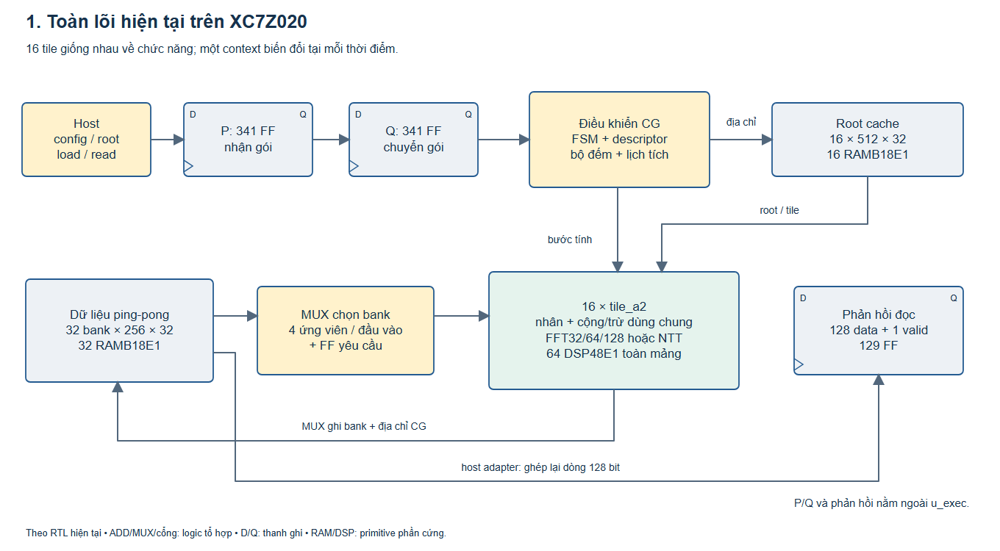
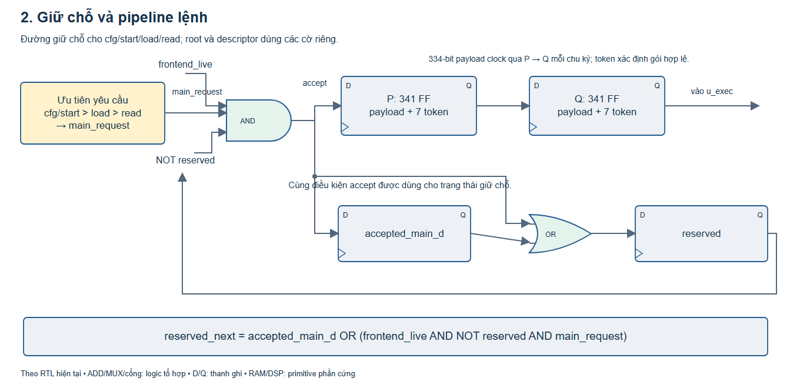
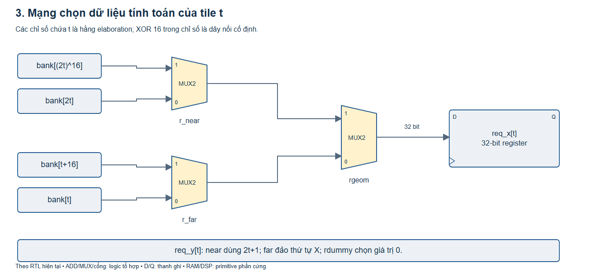
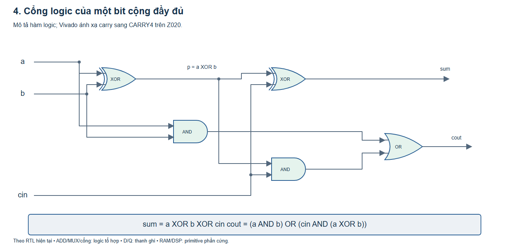
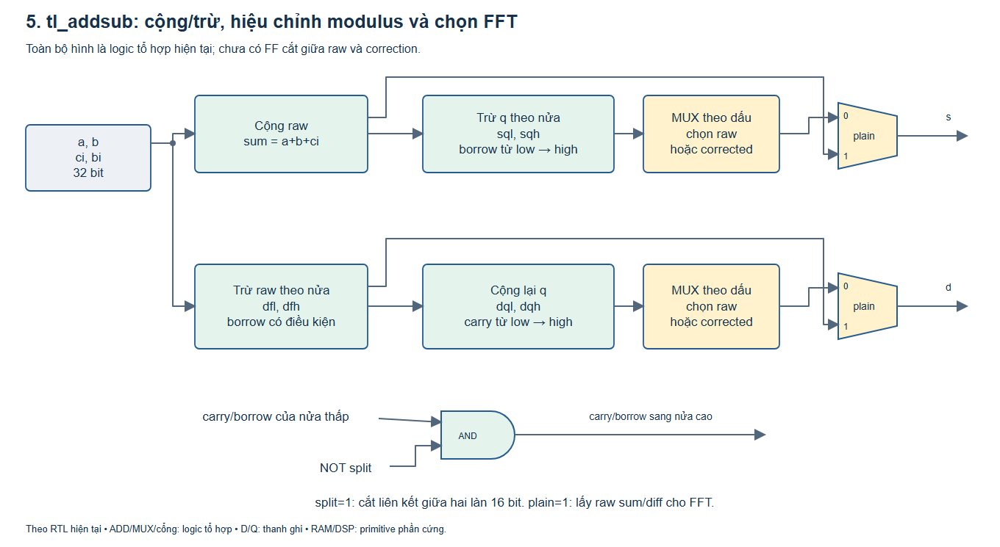
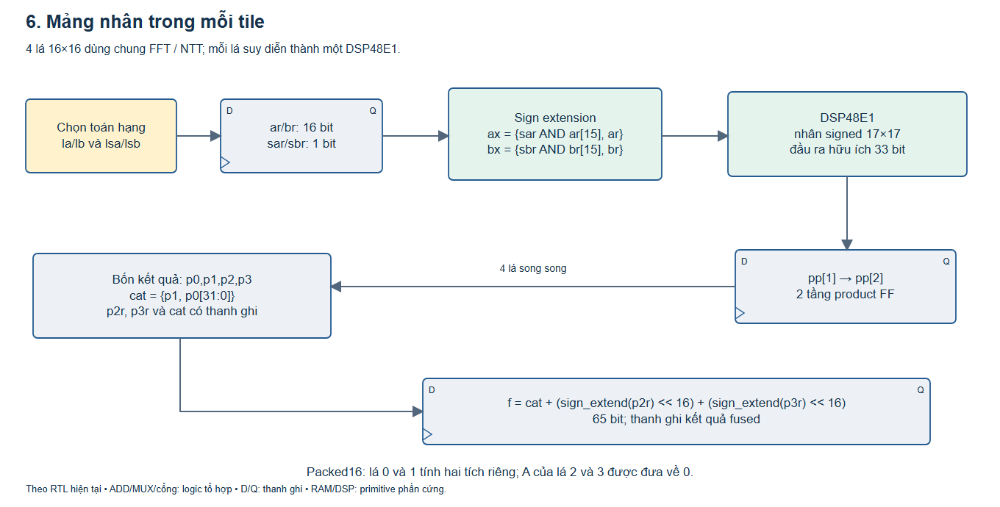
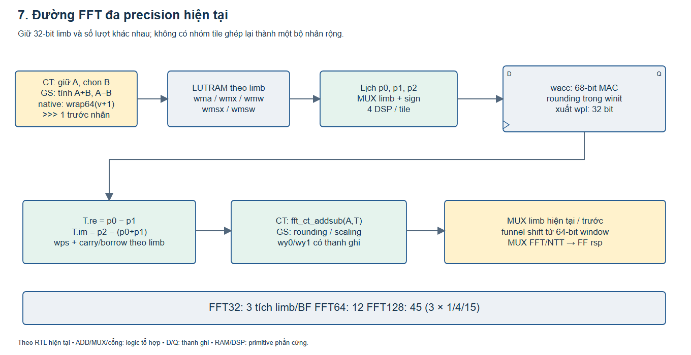
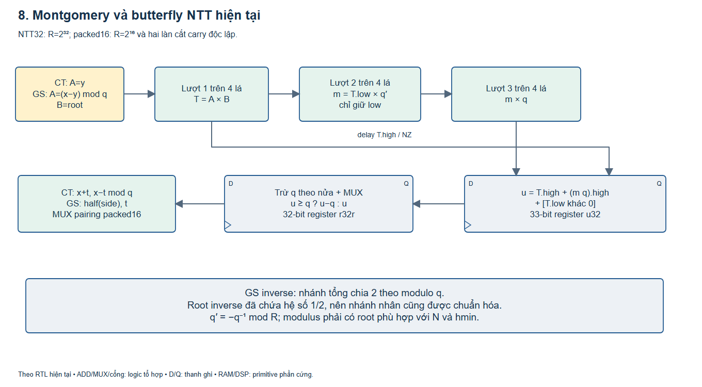

# Mô tả RTL hiện tại trên XC7Z020: cấu trúc logic và đánh giá mục tiêu 100 MHz

**Bản chụp ngày 03/11/2026. Tài liệu này mô tả thiết kế đang có, không đề xuất rồi coi như đã triển khai. Chưa tối ưu thêm và không đổi RTL.**

Nguồn chính là ba file trong [bản synth Z020](../experiments/a_cg_z020_dispatch2/rtl/): `a_cg_fast.sv`, `tile_a.sv`, `mul_ss.v`. Đây là bản sao từng byte của `a_cg_cmd_dispatch2` đã kiểm tra số học và ứng dụng C. Kết quả phần cứng hiện có là **synth OOC trên `xc7z020clg400-2`**, chưa P&R hoặc chạy board Qiming.

Các hình dưới đây mô tả **cổng logic và toán tử theo RTL**: MUX, XOR/AND/OR, cộng/trừ, carry, thanh ghi và bộ nhớ. Hình không phải netlist gate-level do Vivado xuất. LUT, CARRY4, DSP48E1 và RAMB18E1 là các primitive thực tế trong kết quả ánh xạ; không tự suy số LUT từ số cổng trong hình. Các hình có cả bản PNG và [bản SVG để chỉnh sửa](figures/rtl_z020/).

## 1. Thiết kế hiện tại làm được gì?

| Khả năng | Cách hiện thực đang có |
|---|---|
| FFT/IFFT nhiều precision | Thành phần thực/ảo rộng 32, 64 hoặc 128 bit; mỗi thành phần chia thành các từ 32 bit và tính qua nhiều lượt |
| Kiểu số FFT | Fixed-point có dấu; số bit phần lẻ lần lượt 16/32/64 trong đường thông thường. Tên FFT64 không có nghĩa IEEE FP64 |
| Native NTRUGen64 | Nhánh số học và chuẩn hóa riêng theo contract NTRUGen, được kiểm bằng reference |
| NTT/INTT nhiều modulus | Nạp `q`, `qprime` và root phù hợp; một bộ tham số hoạt động tại một thời điểm |
| NTT32 | `q` lẻ, `3 <= q < 2^31`; điều kiện root và `N/hmin` vẫn phải thỏa |
| Packed16 | Hai butterfly hệ số 16 bit trong một request, `q < 2^15`; carry giữa hai làn bị cắt |
| Kích thước | `logn <= 10`, với các kiểm tra cấu hình/bố trí bộ nhớ trong core |
| Batch | Nhiều transform độc lập **cùng cấu hình** được đặt vào các vị trí/bank còn trống, trong giới hạn bộ nhớ |
| Context | Một context FFT hoặc NTT tại một thời điểm; không chạy đồng thời nhiều modulus khác nhau trong cùng job |

**Cơ chế đa precision hiện tại là tính theo từng phần 32 bit trong mỗi tile.** Mỗi tile tự hoàn thành butterfly rộng của mình. Mười sáu tile không ghép lại để tạo một bộ nhân 64/128 bit chung. Đây là điều cần viết đúng khi mô tả đóng góp paper.

## 2. Toàn lõi và tài nguyên đã đo



Một giao dịch đi qua hai tầng nhận/chuyển lệnh, sau đó vào `a_cg_exec`. Bên trong có điều khiển, bộ nhớ chia bank, root cache và 16 tile. Kết quả tính được ghi về bộ nhớ. Host đọc lại theo từng dòng 128 bit; dữ liệu đọc và valid đi qua thêm một tầng phản hồi.

| Tài nguyên sau synth trên Z020 | Số đo | Tỷ lệ chip |
|---|---:|---:|
| Tổng LUT | 37.841 | 71,1% |
| LUT logic | 34.605 | Nằm trong tổng LUT |
| LUTRAM | 2.496 | Nằm trong tổng LUT |
| SRL | 740 | Nằm trong tổng LUT |
| FF | 27.397 | 25,7% |
| DSP48E1 | 64 | 29,1% |
| RAMB18E1 | 48 | 17,1% dung lượng BRAM |

Nguồn: [util.rpt](../study/build/a_cg_z020_dispatch2/synth/util.rpt) và [util_hier.rpt](../study/build/a_cg_z020_dispatch2/synth/util_hier.rpt).

Theo cách Vivado phân cấp, wrapper và các bộ giải mã của nó chiếm tổng 22 LUT, phần trực tiếp ở `u_exec` là 6.039 LUT, và các nhánh tile chiếm 31.780 LUT. Phân cấp này giúp tìm nơi tập trung tài nguyên; logic có thể bị gộp giữa các instance nên không coi đây là phép tách chi phí chức năng tuyệt đối. Chẳng hạn tile 0 lớn hơn các tile khác không có nghĩa thuật toán giao thêm việc cho tile 0.

Hai khối có thể nhận diện rõ trong các tile là `u_as`: phần lớn 494 LUT/tile, tổng 7.903 LUT theo phân cấp; và `u_fft_ct`: 65 LUT/tile, tổng 1.040 LUT. Đây là **số đo module**, không phải số LUT có thể xóa miễn phí.

## 3. Nhận lệnh: cổng ưu tiên, giữ chỗ và thanh ghi P/Q



Mỗi tầng P và Q chứa 334 bit payload cùng 7 bit token: config, start, load, read, root-write, root-commit và descriptor-write. Payload được clock qua thanh ghi mỗi chu kỳ. Token cho biết payload nào được phép tác động lên core.

Đường giữ chỗ cho bốn lệnh chính dùng logic sau, bỏ riêng nhánh reset để dễ đọc:

```verilog
main_request = (cfg_valid || start) ? c_cfg_ready :
               load_valid ? c_load_ready :
               (read_valid && c_read_ready);

accept_main = frontend_live && !reserved && main_request;
accepted_main_d_next = accept_main;
reserved_next = accepted_main_d || accept_main;
```

`main_request` là mạng MUX ưu tiên. `accept_main` là AND của ba điều kiện. `reserved_next` là OR giữa lệnh vừa nhận và lệnh đã nhận ở chu kỳ trước. Hai FF `accepted_main_d` và `reserved` giữ cửa nhận đóng trong lúc lệnh chính đi qua P rồi Q. Config/start có ưu tiên cao hơn load, load cao hơn read; một yêu cầu ưu tiên cao có thể chặn yêu cầu thấp dù nó chưa được core chấp nhận.

Root và descriptor có các token riêng, được chấp nhận khi cửa config phù hợp và không bị config/start chiếm ưu tiên. Chúng có thể đi liên tục một từ mỗi clock; chúng không tự chiếm `reserved` như bốn lệnh chính.

Các FF token có reset đồng bộ theo cạnh lên clock. Giao tiếp ngoài còn được mask tổ hợp bởi `rst`, nên ready/busy/response-valid có thể bị chặn ngay khi assert reset. Không diễn giải các hình FF này thành reset bất đồng bộ cho mọi thanh ghi; payload P/Q không cần reset vì token quyết định dữ liệu có được sử dụng hay không.

Đầu ra đọc có `rsp_data_q[127:0]` và `rsp_valid_q`. Valid bị xóa khi reset trực tiếp hoặc reset trễ còn hoạt động. `busy` bao phủ cả `p_start`, `q_start` và thời gian core đang chạy, tránh khoảng trống busy giữa hai tầng.

Tổng FF của wrapper khớp báo cáo:

```text
P 341 + Q 341 + phản hồi 129
+ p_rst + frontend_live + accepted_main_d + reserved = 815 FF
```

Thêm hai tầng giao tiếp không thay đổi thứ tự phép toán bên trong tile. Khoảng cách tối thiểu giữa các lệnh host chính đã tăng từ 2 lên 3 clock; root/descriptor thêm một clock trễ nhưng vẫn nhận một từ/clock. Đây là độ trễ phải tính khi báo hiệu năng toàn hệ thống.

## 4. Điều khiển và địa chỉ CG

`a_cg_exec` có FSM gồm `IDLE`, `HLOAD`, `HREAD`, `HCATCH`, `RESET_TILE`, `CONFIG_TILE`, `SETTLE`, `STAGE`, `RUN`, `HPREP`. Cấu hình còn đi qua `cfg_pipe[4:0]`; các phép suy ra bố cục bộ nhớ được chia theo chu kỳ cấu hình thay vì tính tất cả trong một đường tổ hợp.

Descriptor có 10 hàng, mỗi hàng 46 bit. Nó giữ mask tile, root base/mask và khoảng cách phát đọc. Các thanh ghi `stage_idx`, `k`, `beat`, `part` cùng các phép dịch, cộng, so sánh và MUX tạo địa chỉ/nhịp phát. `reset_local` và `config_local` là bản có thanh ghi tại từng tile.

Khoảng phát butterfly theo cấu hình hiện tại:

| Mode | Khoảng phát/chu kỳ chương trình chính |
|---|---:|
| NTT32 hoặc packed16 | 3 clock |
| FFT32 | 3 clock |
| FFT64 | 12 clock |
| FFT128 | 45 clock |

Với FFT, một chương trình `product/step` dùng chung cho cả mảng; operand, bộ nhớ limb và tích lũy vẫn nằm tại từng tile. Lịch chung phát thứ tự tích `p0`, `p1`, `p2`. Không có 16 bộ sinh chương trình nhân FFT độc lập.

Tile được dùng theo lịch của core. Bản này buộc `idle=1` và `wspace=1`; `req_ready` vẫn kiểm mode/direction và phase của NTT, nhưng không phải một giao diện tile tổng quát có kiểm đầy buffer cho mọi burst tùy ý. Các kiểm tra overflow dựa trên lịch core và assertion mô phỏng. Cần giữ đúng phạm vi này khi tái sử dụng tile độc lập.

## 5. Bộ nhớ và mạng nối

### 5.1 Bộ nhớ vật lý

| Bộ nhớ | Khai báo RTL | Dung lượng dữ liệu logic | Ánh xạ synth |
|---|---|---:|---|
| Dữ liệu | 32 bank, mỗi bank `mem[0:255]` × 32 bit | 32 KiB | 32 RAMB18E1 |
| Root | 16 bank, mỗi bank `root_mem[0:511]` × 32 bit | 32 KiB | 16 RAMB18E1 |
| Descriptor | 10 × 46 bit | 460 bit | Logic/bộ nhớ nhỏ |
| Trung gian tile | Các mảng 32 hoặc 42 bit có địa chỉ ngắn | Theo từng mảng | LUTRAM; các delay có thể thành SRL |

Hai buffer dữ liệu ping-pong dùng hai vùng địa chỉ của cùng các bank, đổi vai trò qua bit tầng. Dung lượng logic không bằng dung lượng BRAM đã cấp phát: các primitive có granularity cố định.

Mỗi bank dữ liệu có một đường đọc có thanh ghi `dout` và một đường ghi. Các MUX chọn giữa địa chỉ/dữ liệu tính toán và host. Logic chọn word host gồm so sánh bank, kiểm tra phase/oob, và MUX ưu tiên giữa bốn word của dòng 128 bit. Bởi vậy **mạng tính bốn nguồn không có nghĩa toàn bộ mạng host cũng chỉ có bốn nguồn**.

### 5.2 Mạng đọc của tile



Với tile `t`, biểu thức hiện tại là:

```verilog
req_x[t] <= rgeom
    ? (r_near ? bank_rdata[(2*t)^16] : bank_rdata[2*t])
    : (r_far  ? bank_rdata[t+16]     : bank_rdata[t]);

req_y[t] <= rdummy ? 0 : rgeom
    ? (r_near ? bank_rdata[(2*t+1)^16] : bank_rdata[2*t+1])
    : (r_far  ? bank_rdata[t]          : bank_rdata[t+16]);
```

Đây là ba MUX 2:1 về mặt hàm logic cho một đầu vào bốn ứng viên, rồi một thanh ghi 32 bit. Đầu Y còn có MUX chọn 0 ở trường hợp `rdummy`. Vivado có thể gộp các MUX vào LUT/mux chuyên dụng; không lấy ba MUX/bit để suy thẳng ra ba LUT/bit.

Một bit MUX có hàm `y = (!s AND d0) OR (s AND d1)`. Phép so sánh bank 5 bit ở host có hàm AND của năm XNOR giữa địa chỉ và số bank. Đây là diễn giải bằng cổng của các biểu thức chọn/so sánh trong RTL; không phải cam kết Vivado sẽ tạo từng cổng riêng lẻ.

`t` là hằng của vòng `generate`. Vì vậy `(2*t)^16` là hoán vị dây cố định lúc tạo phần cứng, không phải một bộ XOR địa chỉ chạy mỗi clock. Các selector `rgeom/r_near/r_far` mới là tín hiệu runtime.

## 6. Cộng/trừ: từ cổng 1 bit đến khối 32 bit



Một bit cộng có các hàm:

```text
p    = a XOR b
sum  = p XOR cin
cout = (a AND b) OR (p AND cin)
```

Trừ có thể biểu diễn bằng cộng bù hai, nhưng RTL hiện tại viết toán tử `-` và borrow trực tiếp. Trên Z020, Vivado dùng các chuỗi CARRY4. Hình cổng trên giải thích hàm logic; nó không khẳng định mỗi bit chiếm đúng hai XOR, hai AND và một OR vật lý tách rời trong FPGA.



Khối `tl_addsub` có tổng và hiệu cùng lúc. Tổng raw được tính trước, sau đó trừ q; hiệu raw được tính trước, sau đó cộng lại q khi âm. Khi packed, mỗi nửa có quyết định sửa riêng. Khi FFT, `plain=1` lấy kết quả raw để giữ phép wrap và carry/borrow theo limb.

Các biểu thức chính, với `lo = [15:0]`, `hi = [31:16]` và bit mở rộng giữ dấu/carry:

```text
sum = a + b + ci                             // 33 bit
sql = sum.lo - q.lo                          // 17 bit
sqh = sum[32:16] - q.hi - (!split & sql[16])   // 18 bit

dfl = a.lo - b.lo - bi                       // 17 bit
dfh = a.hi - b.hi - (!split & dfl[16])         // 17 bit
dql = dfl.lo + q.lo                          // 17 bit
dqh = dfh.lo + q.hi + (!split & dql[16])       // 16 bit, wrap
```

MUX sau đó dùng dấu/borrow để chọn raw hoặc corrected. Trong NTT32, dấu của toàn từ quyết định cả kết quả; packed16 dùng dấu riêng từng nửa. Cổng AND với `!split` quyết định carry/borrow có đi từ làn thấp sang làn cao hay không. Không có thanh ghi cắt ở giữa các bước trong hình này.

Ngoài s/d, khối còn xuất `co=sum[32]` và `bo=dfh[16]`. Các bit carry/borrow được lưu và dùng cho limb tiếp theo của FFT; hình chỉ vẽ hai bus kết quả chính để dễ đọc.

`u_as` được dùng ở đầu vào cho GS và ở sau nhân cho CT của NTT. Đường CT của FFT có thêm `fft_ct_addsub` riêng, chỉ làm raw sum/diff. Vì vậy không nên viết rằng mọi bộ cộng của FFT/NTT đều đã hợp nhất vào một khối duy nhất.

## 7. Mảng nhân chung trong mỗi tile



Mỗi tile có bốn lá 16×16. Trước phép nhân, toán hạng được mở rộng thành signed 17 bit:

```verilog
ax = {a_signed & a[15], a};
bx = {b_signed & b[15], b};
full = ax * bx;
product = full[32:0];
```

Bit ghép phía trên được tạo bằng cổng AND. Cách mở rộng này cho phép cùng lá tính unsigned hoặc signed 16 bit; đầu ra 33 bit giữ kết quả cần thiết. Synth trên Z020 dùng một DSP48E1 cho mỗi lá, tổng 64 DSP cho 16 tile.

Bốn lá tương ứng `lo×lo`, `hi×hi`, `lo×hi`, `hi×lo`. Các thanh ghi `cat`, `p2r`, `p3r` cùng bộ cộng tạo:

```text
f = cat + (sign_extend(p2r) << 16) + (sign_extend(p3r) << 16)
```

`f` rộng 65 bit. `LEAF_PD=2` cho hai tầng FF kết quả lá; công thức latency fused trong RTL là `FUSE = 1 + LEAF_PD + 2 = 5`. Đây là latency phần nhân fused, không phải toàn bộ latency của butterfly.

Ở packed16, lá 0 và 1 mang hai tích 16×16 độc lập; toán hạng A của lá 2 và 3 được đưa về 0. Hai lane không biến thành bốn lane và số DSP vật lý vẫn là bốn/tile.

## 8. Đường FFT đa precision



Đặt `L = W/32`. Hai thành phần thực/ảo đi xen kẽ theo từng limb 32 bit. Những mảng chính là:

| Mảng/thanh ghi | Nội dung |
|---|---|
| `wma[0:15]`, mỗi phần 42 bit | A-side hoặc tổng GS, tag, scale/pairing và slot; cũng giữ side data NTT |
| `wmx[0:15]`, `wmw[0:15]`, mỗi phần 32 bit | Operand phức và root theo beat |
| `wmsx[0:7]`, `wmsw[0:7]`, mỗi phần 32 bit | Tổng hai thành phần dùng cho tích thứ ba |
| `wacc[67:0]` | Tích lũy các tích limb; giá trị khởi đầu chứa rounding theo mode |
| `wps[0:3]`, mỗi phần 32 bit | p0, sau đó p0+p1, theo limb |
| `wy0l/wy0p`, `wy1l/wy1p` | Limb hiện tại/trước để ghép cửa sổ dịch đầu ra |

Ba tích được tính theo thứ tự:

```text
p0 = o.re × wr
p1 = o.im × wi
p2 = (o.re + o.im) × (wr + wi)
T.re = p0 - p1
T.im = p2 - (p0 + p1)
```

Mọi tổng, tích, wrap và rounding phải giữ đúng contract của RTL/reference. Không được thay các biểu thức fixed-point này bằng công thức số thực rồi cho rằng kết quả từng bit vẫn giống nhau.

| Độ rộng W | L | Tích limb cho một tích fixed-point | Tích limb cho ba tích của BF |
|---|---:|---:|---:|
| 32 | 1 | 1 | 3 |
| 64 | 2 | 4 | 12 |
| 128 | 4 | 15 | 45 |

Ở 128 bit, RTL bỏ các cột chỉ nằm trên phần kết quả sau wrap; các tích thấp ảnh hưởng carry vẫn được tính. Đây không phải cắt bớt precision tùy ý.

CT giữ A và tạo `A+T`, `A−T` ở đầu ra. GS tạo tổng/hiệu ở đầu vào trước nhân. IFFT thông thường có rounding rồi dịch theo contract ở tầng được đánh dấu scale. Nhánh native NTRUGen64 có phép `wrap64(v+1) >>> 1` ở hai nhánh GS trước nhân. Phần dịch dùng cửa sổ ghép hai limb; nó không phải một bộ dịch nguyên khối 128 bit.

## 9. Đường NTT và packed16



Đường Montgomery đang dùng lại chính mảng nhân, không có ba bộ nhân riêng cho ba bước:

```text
R = 2^32                 // hoặc 2^16 cho từng lane packed
qprime = -q^(-1) mod R
T = A × B
m = (T.low × qprime) mod R
u = T.high + (m × q).high + [T.low != 0]
r = (u >= q) ? (u - q) : u
```

T.high và cờ khác 0 của T.low đi qua delay để gặp đúng kết quả lượt thứ ba. `u32` và `r32r` là hai thanh ghi sau các phép cộng/rút gọn. Với packed16, high/low của hai tích được ghép lại theo lane; cổng carry giữa các lane bị cắt.

Đầu vào butterfly cần là các hệ số đã ở miền chuẩn `[0,q)` theo contract, để các bước hiệu chỉnh một lần có hiệu lực. Packed16 phải nạp qprime và root theo `R=2^16`; không chỉ đóng gói hệ số rồi giữ nguyên bảng Montgomery `R=2^32`.

CT dùng `t = Mont(y,root)` rồi xuất `(x+t, x−t) mod q`. GS tính tổng/hiệu trước nhân. Trong INTT, tổng được chia 2 theo modulo q bằng `half()`. **Root inverse đã nhân sẵn `1/2`**, nên nhánh nhân cũng được chuẩn hóa; không bỏ qua chi tiết này khi viết mô hình tham chiếu. Quy ước root được kiểm tại [ntt_prime_core.py](../model/ntt_prime_core.py) và [ntt_core_sched.py](../model/ntt_core_sched.py).

Đổi modulus là đổi q, qprime và root. Không tạo lại một reducer cho từng q. Dù tile có khai báo hai slot modulus, core hiện chỉ cấu hình và dùng slot 0; không mô tả thành hai context modulus chạy đồng thời.

## 10. Phần nào thực sự dùng chung?

| Thành phần | FFT | NTT | Trạng thái hiện tại |
|---|---|---|---|
| Bốn lá nhân/tile | Tích limb cho p0/p1/p2 | Ba lượt Montgomery | Dùng chung thật |
| Bộ ghép tích 65 bit | Tạo tích từ các lá | Tạo T, m, m×q | Dùng chung thật; packed vô hiệu cross products |
| `u_as` | GS raw sum/diff | GS input hoặc CT output, có correction | Dùng chung; có MUX và carry theo mode |
| `fft_ct_addsub` | CT output | Không dùng | Giữ riêng |
| `wma` | Side data FFT | Side data NTT | Dùng chung theo mode |
| Bộ nhớ dữ liệu/root và mạng bank | Có | Có | Dùng chung; host nạp đúng bảng |
| MAC 68 bit, p0/p1/p2 và scaling | Có | Không dùng | Logic riêng FFT |
| T.high/NZ, u và correction Montgomery | Không dùng | Có | Logic riêng NTT |
| Điều khiển tầng và batch | Có | Có | Chung khung, khác số bước/nhịp phát |

Một khối nằm trong tile không đồng nghĩa nó hữu ích trong mọi mode. Các đường riêng vẫn tồn tại trong netlist dù mode đang chạy không sử dụng chúng. Thiết kế hiện tại chưa chứng minh đạt 30k LUT; số synth còn cao hơn mục tiêu 7.841 LUT.

## 11. Timing ở 100 MHz thực sự nói gì?

Lượt đo mới **mở lại DCP đã synth với mục tiêu 5 ns**, giữ nguyên netlist và các giá trị uncertainty/I/O delay, rồi phân tích với clock 10 ns. Không synth lại, không đặt/nối mạch, không dùng case analysis, false path hoặc multicycle path, không chạy directive tối ưu.

| Phép đo trên cùng netlist synth | Setup WNS nội bộ | Hold nội bộ |
|---|---:|---:|
| Clock 5 ns, 200 MHz | −3,604 ns | +0,126 ns |
| Clock 10 ns, 100 MHz | **+1,396 ns** | **+0,126 ns** |

Nguồn: [metrics_100.txt](../study/build/rtl_z020_description/metrics_100.txt), [setup](../study/build/rtl_z020_description/internal_setup_100.rpt), [hold](../study/build/rtl_z020_description/internal_hold_100.rpt), [Tcl tái lập](../study/rtl_z020_description/timing_100.tcl).

Khoảng tăng 5 ns là hệ quả của việc đổi chu kỳ clock, **không phải RTL nhanh hơn**. Số LUT vẫn thuộc netlist ban đầu. Đường setup báo chậm nhất từ thanh ghi input tile đến `rd_reg`, dài 8,501 ns theo ước tính synth, gồm 4,749 ns logic và 3,752 ns net chưa placement; có 19 mức logic, trong đó 11 CARRY4.

Như vậy **có cơ sở nhắm vận hành 100 MHz**, nhưng chưa có bằng chứng P&R đóng timing trên Z020. Các đường I/O OOC vẫn thiếu mô hình route/pin thực tế và giữ vi phạm hold; đổi tần số không tự sửa loại hold này. Khi tích hợp phải kiểm tra các đường launch/capture với host/clock thực. Không dùng số P&R của ZCU106 để gắn nhãn Z020 đã chạy 100 hoặc 200 MHz.

## 12. Nếu chạy 100 MHz, độ trễ sẽ là bao nhiêu?

Ở 100 MHz, một clock là 0,01 µs. Bảng dưới lấy số cycle trong log mô phỏng RTL dispatch2. RTL Z020 giống từng byte nên số cycle logic được giữ; quy đổi thời gian chỉ là **dự tính khi phần cứng thực sự đáp ứng 100 MHz**.

| Workload, chiều forward, một job | Kernel cycle | Kernel ở 100 MHz | Toàn lượt driver ở 100 MHz |
|---|---:|---:|---:|
| NTT q=3329, N=256, hmin=1 | 265 | 2,65 µs | 11,83 µs |
| Packed16, cùng q/N/hmin | 217 | 2,17 µs | 6,87 µs |
| NTT q=8380417, N=256 | 301 | 3,01 µs | 12,20 µs |
| NTT q=12289, N=1024 | 985 | 9,85 µs | 45,94 µs |
| Packed16, q=12289, N=1024 | 505 | 5,05 µs | 25,78 µs |
| FFT32, logn=10 | 453 | 4,53 µs | 40,60 µs |
| FFT64, logn=10 | 1.752 | 17,52 µs | 90,47 µs |
| FFT128, logn=10 | 6.508 | 65,08 µs | 251,69 µs |

**Quy ước FFT:** `logn=10` là 1.024 thành phần vô hướng, tương ứng 512 điểm phức. Đây không phải FFT 1.024 điểm phức.

“Toàn lượt driver” là `all_host_cycles` của test C++ hiện tại: cấu hình, descriptor/root được nạp lại, load dữ liệu, kernel và đọc kết quả. Nó không phải latency AXI/DMA đã đo trên board. Kernel và giao tiếp phải báo riêng; phép tái sử dụng context/root giữa nhiều job có thể đổi overhead. Nguồn số: [sim.log](../study/build/a_cg_cmd_dispatch2/sim.log).

Các số này cũng chưa phải thời gian sinh khóa/ký/xác minh FN-DSA hoàn chỉnh. Một thao tác ứng dụng gọi nhiều transform và có các bước còn ở C.

## 13. 100 MHz có đủ để claim paper không?

**Đánh giá của mình: có thể, nhưng 100 MHz chỉ là điều kiện triển khai; nó không tự làm nên đóng góp nghiên cứu.** Không thể bảo đảm khả năng được nhận bài bằng một ngưỡng MHz. Nếu ứng dụng cần vài µs hay vài chục µs cho một transform, bảng trên cho phép kiểm tra mức đáp ứng; hiện chưa có yêu cầu latency ứng dụng cụ thể để kết luận “đủ cho mọi ứng dụng”.

### 13.1 Claim phù hợp với hướng hiện tại

Hướng có thể bảo vệ là **một lõi fixed-point FFT/IFFT nhiều precision và NTT/INTT đổi modulus dùng chung mảng nhân, có packed16, tổ chức bộ nhớ/điều khiển phù hợp và được đối chiếu ứng dụng PQC**. Tần số 100 MHz có thể là điểm vận hành được chọn trên FPGA tài nguyên hạn chế, sau khi timing được xác nhận.

Với 37,8k LUT, bài cần giải thích rõ chi phí đổi lấy các khả năng này. Nếu claim “tiết kiệm diện tích”, “tốt hơn về area–time” hoặc “nhanh hơn”, phải có đối chứng tương ứng. Không cần thắng mọi paper trên mọi thông số; vẫn cần cho thấy đóng góp của mình mang lại lợi ích cụ thể hoặc làm rõ một đánh đổi có giá trị.

Một đối chứng gần là [Unified FFT/NTT, ICASSP 2025, Table I](https://arxiv.org/html/2504.11124v1#S4): tác giả báo 400 MHz trên UltraScale+, 3.716 LUT, 12 DSP, hỗ trợ FFT 512 điểm và NTT 256 điểm cho hai bộ tham số PQC. Đó là phạm vi khác với ba precision fixed-point và modulus runtime của lõi này; không lấy chênh lệch clock hay LUT riêng lẻ để xếp hạng hai thiết kế.

[OpenNTT, TCAD](https://flokrieger.github.io/papers/tcad25_opennttext.pdf) đặt trọng tâm vào tính linh hoạt của generator và đánh đổi bộ nhớ/routing. Khi so sánh cần phân biệt khả năng chọn lúc tạo phần cứng với khả năng đổi runtime trong cùng một bitstream, đồng thời ghi rõ kiểu số FFT và độ rộng modulus. Đây là các điểm phân tích quan trọng hơn việc chỉ đếm MHz.

### 13.2 Bằng chứng nên có trước khi chốt bài

| Nội dung | Hiện có | Còn cần để claim tương ứng |
|---|---|---|
| Đúng số học và thứ tự dữ liệu | 1.026 vector, 38 ca bốn trạng thái, kiểm reset và pipeline | Mô tả rõ phạm vi profile và corner case đã kiểm |
| Gắn với PQC | Replay 74 transform từ C, 4 xác minh chữ ký, artifact tham chiếu trùng | Giữ đúng numerical contract/profile ứng dụng; không mặc định mọi precision đều dùng được cho mọi bước FN-DSA |
| Diện tích trên Z020 | Synth gồm host adapter và root cache | Báo số sau implementation khi có; nêu rõ AXI/DMA nào được tính |
| Vận hành 100 MHz | Timing synth nội bộ có margin | P&R tại 10 ns và timing giao tiếp tích hợp; chạy board nếu claim đã demo trên board |
| Giá của tính linh hoạt | Có thống kê phần dùng chung/riêng | Đối chứng cùng chức năng hoặc ablation: packed/tắt packed, ít precision/đủ precision |
| Lợi ích hiệu năng | Có cycle/kernel và overhead driver | So latency cùng bài toán, cùng kiểu số và phạm vi chức năng; ghi cả DSP/BRAM |
| Năng lượng | Chưa đo | Chỉ cần bổ sung nếu bài claim energy/power tốt hơn |

Nếu dùng area–time, phải định nghĩa “area” rõ: LUT·µs chỉ phản ánh LUT; DSP và BRAM vẫn cần báo kèm. Không cộng LUT, FF, DSP và BRAM thành một số không có mô hình trọng số. Không gọi clock mục tiêu 100 MHz là Fmax đã đo.

**Kết luận ở trạng thái hiện tại:** 100 MHz là mục tiêu hợp lý để tiếp tục xác nhận trên Z020. Chưa đủ cơ sở viết “đã chạy 100 MHz trên board” hoặc “kiến trúc tối ưu hơn các lõi riêng”. Bài có thể đi theo tính linh hoạt và hiệu quả chia sẻ tài nguyên, với dữ liệu so sánh tương ứng. Tài liệu này chưa thực hiện tối ưu mới nào.

## 14. Tài liệu và bằng chứng đi kèm

- [Báo cáo synth Z020](../study/results/a_cg_z020_dispatch2.md), [JSON kết quả và hash](../study/results/a_cg_z020_dispatch2.json).
- [Validation của RTL dispatch2](../study/build/a_cg_cmd_dispatch2/validation.json): bằng chứng tái dùng cho source Z020 giống từng byte.
- [Mã sinh hình](../study/rtl_z020_description/draw_figures.py); SVG có thể chỉnh sửa trong cùng thư mục với PNG.
- [Báo cáo timing đầy đủ ở 10 ns](../study/build/rtl_z020_description/timing_100.rpt).
- [Bằng chứng đối chiếu tài liệu, cycle, hình và hash nguồn](../study/results/rtl_z020_description.json).
- [Mã tham chiếu và quy ước root NTT](../model/ntt_prime_core.py).

Các source RTL, cấu hình synth 5 ns và checkpoint gốc được giữ nguyên. Chỉ thêm tài liệu, hình và báo cáo phân tích read-only.
