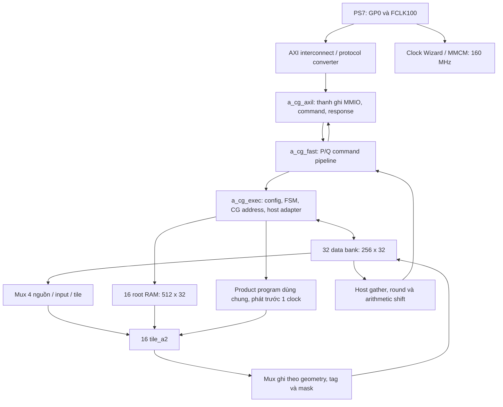

# 3.0 — đặc tả triển khai RTL và cấu trúc cổng logic

Ngày: 2026-11-04. Implementation được mô tả: **`a_cg_z020_system160`**.

Tài liệu này dùng để viết lại hoặc review RTL theo baseline đã được nhận. Nó mô tả hai loại “cổng”: **cổng giao tiếp** input/output của module, và **cổng logic** AND/OR/XOR, mux, bộ cộng, thanh ghi và bộ nhớ bên trong. Mô tả mức cổng là cấu trúc tương đương của RTL; không phải danh sách từng LUT trong netlist đã route và không yêu cầu thay DSP/BRAM bằng cổng rời.

**Phải** giữ numerical semantics, thứ tự dữ liệu và quan hệ valid/tag. Có thể đặt lại tên tín hiệu hoặc chia module để dễ viết; nếu thay pipeline, lịch hoặc mapping thì phải cập nhật planner/test và đo STA lại. Bản RTL viết lại **không tự thừa hưởng** số 160 MHz/31.242 LUT của baseline.

Nguồn chuẩn: [manifest baseline](../../../experiments/BASELINE.json), [RTL](../../../experiments/a_cg_z020_system160/rtl/), [planner](../../../experiments/a_cg_z020_system160/planner.py). Phạm vi thuật toán ở [00](00_pham_vi.md), số học ở [01](01_so_hoc.md), API ở [02](02_giao_dien.md), bộ nhớ ở [03](03_bo_nho.md), kiểm chứng ở [04](04_kiem_chung.md).

## 1. Cấu hình phải dựng

| Hạng mục | Giá trị baseline |
|---|---|
| Số tile | 16, cùng loại, mọi tile hỗ trợ mọi mode của core |
| Leaf/tile | 4 leaf; input 16 bit, sign-select; tổng 64 leaf |
| Tile parameters trong core | `TREN_MANG=1`, `LEAF_PD=2` mặc định, `IN_REG=1`, `EN_REG=0`, `PHASE=0` |
| Precision FFT thường | 32/64/128 bit mỗi thành phần; L=1/2/4 limb 32 bit |
| Native NTRUGen | Mode riêng, chỉ FFT64 |
| NTT thường / packed16 | R=2³² / R=2¹⁶ mỗi lane; q lẻ, dưới 2³¹ / dưới 2¹⁵ |
| Data RAM | 32 bank × 256 × 32 bit; một read đồng bộ, một write mỗi bank |
| Root RAM | 16 bank × 512 × 32 bit; một bank/tile |
| Descriptor | 10 × 46 bit, ghi lúc idle |
| Miền clock tính toán | 160 MHz; không dùng nhiều clock để thực hiện các lượt nhân |
| Giao tiếp hệ thống | PS7 GP0 → AXI interconnect/converter → AXI-Lite 32 bit |

Nhánh `TREN_MANG=3`, các tham số EN_REG khác và hai modulus slot ở tile độc lập là khả năng của source nghiên cứu; **không lấy chúng làm cấu hình đo của baseline**. Core dùng slot 0, `en=1` cho tất cả tile. Không thêm một bộ nhân 64×64/128×128 hoặc một divider `% q` cho mỗi precision/modulus.

## 2. Phân cấp module và dây nối



Các module đang có trong bốn file:

| File | Module | Trách nhiệm |
|---|---|---|
| `mul_ss.v` | `mul_ss` | Phép nhân sign-select tổ hợp; baseline instantiate W=16, IMPL=EXT |
| `tile_a.sv` | `tl_delay` | Dòng trễ dữ liệu có enable, không reset |
| `tile_a.sv` | `tl_leaves` | 4 leaf, pipeline tích và ghép tích 65 bit |
| `tile_a.sv` | `tl_addsub` | Add/sub 2 tầng, correction/sum dùng chung FFT/NTT |
| `tile_a.sv` | `tile_a2` | Operand stage, Montgomery, FFT limb MAC, side state, output |
| `a_cg_fast.sv` | `a_cg_command_decode`, `a_cg_main_request` | Điều kiện nhận lệnh và priority |
| `a_cg_fast.sv` | `a_cg_fast` | Chốt payload/token P/Q, reservation, response register |
| `a_cg_fast.sv` | `a_cg_exec` | Cả transform, RAM, root, lịch và host scale |
| `a_cg_axil.v` | `a_cg_axil` | MMIO 32 bit sang các cổng native |

`system_wrapper` và các IP PS7/MMCM/reset/interconnect do [create_project.tcl](../../../experiments/a_cg_z020_system160/create_project.tcl) sinh; không tự viết một PS7 bằng RTL.

## 3. Quy ước chu kỳ và phần tử cổng cơ sở

Mọi state RTL tính toán dùng cạnh lên. Nếu không ghi khác, `ce=1`. Giá trị “sau cạnh Cn” nghĩa là đã cập nhật nonblocking assignment; một module nhận ở cạnh kế tiếp sẽ nhìn thấy giá trị này. Không trộn chu kỳ xuất hiện valid sau cạnh với chu kỳ consumer ghi RAM ở cạnh sau đó.

### 3.1 Các phương trình cổng

Với một bit full-adder:

```text
p = a XOR b
g = a AND b
s = p XOR cin
cout = g OR (p AND cin)
```

W bit ghép theo carry hoặc để synthesis map vào carry-chain. Không nối ripple qua 128 bit trong một stage chỉ vì biểu thức toán học là một phép cộng 128 bit.

```text
MUX2(sel,A,B) = (A AND replicate(sel)) OR (B AND replicate(NOT sel))
EQ_W(A,B)    = NOT OR_reduce(A XOR B)
NZ_W(A)      = OR_reduce(A)
NOT_W(A)     = bitwise inversion, không phải logical NOT
Q_next       = rst ? reset_value : ce ? D : Q
```

Trong tài liệu này, MUX/MUX2(sel,A,B) luôn có nghĩa **sel ? A : B**. Bộ trừ unsigned phải tăng thêm bit trước phép tính để giữ borrow. Cộng limb có carry và trừ limb có borrow là hai state riêng; không dùng chung carry của real/imag hoặc của hai butterfly.

`a + ~b + 1` hiện thực bộ trừ bằng XOR/NOT và carry-in. Khi packed16 phải sửa carry ở biên lane như mục 8, không chỉ cắt 32-bit result thành hai nửa sau phép cộng.

### 3.2 Reset và clock-enable

- Reset **valid, trạng thái, bộ đếm, context-valid, reservation và output-valid** theo từng module.
- Các data delay, product register, LUTRAM/BRAM không cần xóa để tạo kết quả đúng; sau reset chúng có thể chưa xác định. Chỉ được dùng khi token hợp lệ đã đi tới.
- Không thêm reset đồng loạt cho RAM/payload chỉ để waveform đẹp: có thể đổi suy luận BRAM/SRL và fanout/timing.
- Dùng clock-enable hoặc mux D; không tự tạo gated clock bằng AND giữa `clk` và `en`.
- `tl_delay` chỉ dịch khi en, không có reset. Valid pipeline tương ứng phải được reset để chặn dữ liệu cũ.
- Đây không phải quy tắc bỏ reset của mọi FF: AXI bridge có payload/status sau reset xác định, host core cũng có một số FF data được reset. Phải giữ hành vi đọc sau reset của từng module; chỉ data pipeline/RAM được valid bảo vệ mới không cần reset theo source.
- Không bật macro `FAULT_*`, không override `TL_LEAF_PD/TL_IN_REG/TL_EN_REG/TL_PHASE` khi muốn tái hiện đúng cấu hình đã đo. Các shadow/assert trong `ifndef SYNTHESIS` không phải datapath cần tổng hợp.

## 4. Cổng native của a_cg_fast

Cùng giao diện về ý nghĩa với `a_cg_exec`, nhưng frontend thêm capture và reservation. Bảng này liệt kê đủ các nhóm cổng; I/O tính theo module `a_cg_fast`.

| Nhóm | Input | Output | Ý nghĩa |
|---|---|---|---|
| Clock/reset | `clk`, `rst` 1 bit | — | Reset active-high, đồng bộ trong core; một số output được mask ngay bằng rst |
| Config token | `cfg_valid` | `cfg_ready` | Chấp nhận tại cạnh khi valid AND ready |
| Mode | `cfg_fft`, `cfg_inverse`, `cfg_ntrugen`, `cfg_packed` | — | Mỗi cờ 1 bit; inverse chọn GS/đường nghịch |
| Kích thước | `cfg_logn[3:0]`, `cfg_fmt[1:0]`, `cfg_hmin[1:0]`, `cfg_jobs_log[2:0]` | — | fmt=0/1/2; job count=2^jobs_log, còn giới hạn bộ nhớ |
| Modulus | `cfg_q[31:0]`, `cfg_qinv[31:0]` | — | q, −q⁻¹ modulo R; không dùng chúng làm FFT twiddle |
| Root write | `root_we`, `root_commit`, `root_dest[15:0]`, `root_addr[8:0]`, `root_data[31:0]` | — | Side command khi cfg window mở; không có root_ready riêng |
| Descriptor | `desc_we`, `desc_stage[3:0]`, `desc_mask[15:0]`, `desc_root_base[8:0]`, `desc_root_mask[4:0]`, `desc_gap[15:0]` | — | Native decoder chỉ phát token khi stage<10 |
| Load | `load_valid`, `load_line[9:0]`, `load_data[127:0]` | `load_ready` | Capture cả dòng, sau đó host adapter phục vụ bank |
| Read request | `read_valid`, `read_line[9:0]` | `read_ready` | Một request dòng 128 bit |
| Read response | — | `read_rsp_valid`, `read_data[127:0]` | Không có read_rsp_ready ở native port; consumer phải thu khi valid |
| Start/status | `start` | `busy`, `done`, `error`, `cycles[31:0]` | Không có start_ready riêng; start dùng cửa cfg-ready, done là pulse |

Phải dùng điều kiện nhận của frontend, không lấy raw `cfg_valid` hoặc `load_valid` điều khiển trực tiếp các bank. AXI bridge chuyển pulse done thành `done_sticky` riêng; không đổi native done thành sticky trong core mà giữ software/scoreboard cũ.

## 5. Frontend: P/Q pipeline và logic nhận lệnh

### 5.1 Priority và các cổng AND/OR

Đặt `open = frontend_live AND NOT reserved`. Các output công khai còn được AND với NOT rst.

```text
cfg_open  = open & c_cfg_ready
load_open = open & c_load_ready & ~cfg_valid & ~start
read_open = open & c_read_ready & ~cfg_valid & ~start & ~load_valid

cfg_fire   = cfg_open & cfg_valid
start_fire = cfg_open & ~cfg_valid & start
load_fire  = load_open & load_valid
read_fire  = read_open & read_valid

root_fire   = cfg_open & ~cfg_valid & ~start & root_we
commit_fire = cfg_open & ~cfg_valid & ~start & root_commit
desc_fire   = cfg_open & ~cfg_valid & ~start & desc_we & (desc_stage<10)
```

Priority main command: **CFG → START → LOAD → READ**. Một request ưu tiên cao có thể chặn request thấp dù availability của nó bằng 0. Root/descriptor là side command; không dùng chúng để đặt main reservation. Vỏ AXI phát từng command một; nếu tự dùng native port phải giữ cùng contract và không tạo nhiều main token.

Decoder không dùng load_valid/read_valid để chặn các side_fire. Vì vậy nó không phải arbiter “chỉ một trong mọi loại lệnh” cho toàn bộ port. Vỏ native mới không được tự dựa vào nó để chống chồng side-write và LOAD/READ; baseline AXI phát đơn lệnh và không khai thác tổ hợp này.

### 5.2 Các thanh ghi bắt buộc

Mọi payload được chốt thành `p_*`, rồi `q_*`; token tương ứng cũng đi P→Q. Payload có thể chạy mỗi clock nhưng chỉ token hợp lệ cho phép consumer sử dụng. Không dùng payload còn sống ngoài port sau handshake.

```text
main_request = (cfg_valid | start) ? c_cfg_ready
             : load_valid ? c_load_ready
             : read_valid & c_read_ready
accept = frontend_live & ~reserved & main_request

accepted_main_d_next = accept
reserved_next       = accepted_main_d | accept
frontend_live_next  = ~rst
p_rst_next          = rst
```

`accepted_main_d` và `reserved` là FF riêng. Không thay reservation bằng OR decoder trên hàng chục cờ rồi phát ngược tới mọi bit payload. Reset xóa token P/Q, reservation và accepted_main_d. `frontend_live` giữ điều kiện mở ingress tại chỗ; reset execution không đi vòng qua toàn decoder để tạo enable D của payload.

`a_cg_exec` nhận `q_*` và reset `p_rst`. Đường đọc trở về thêm `rsp_data_q[127:0]` và `rsp_valid_q`; clear valid khi rst hoặc p_rst. Data và valid phải tăng tầng cùng nhau. Các output error/cycles phản ánh exec và được reset qua p_rst; không mô tả chúng như FF asynchronous-clear ngay khi raw rst đổi mức.

### 5.3 Ví dụ cạnh nhận một command

| Cạnh | P | Q | Execution |
|---|---|---|---|
| C0, raw fire | Chốt payload/token mới | Token cũ | Chưa dùng command mới |
| C1 | Token mới P có thể về 0 | Chốt token/payload từ P | Chưa dùng token Q vừa chốt ở cùng cạnh |
| C2 | — | — | Consumer dùng token Q có từ sau C1 |

Không suy ready đã trở lại chỉ bằng đếm C0..C2: còn cfg pipeline hoặc host/FSM. Producer phải quan sát ready thực tế.

## 6. Config decode, descriptor và FSM toàn transform

### 6.1 Config pipeline 5 tầng

Nhận CFG xóa configured/roots_valid/desc_valid và pending scale, rồi dịch `cfg_pipe[4:0]`. Các phụ thuộc được chốt giữa các bước:

| Bước | Phép tính/FF |
|---|---|
| Capture | fft/inverse/native/packed/fmt/hmin/logn/jobs/q/qi |
| cfg_pipe[0] | `logm`, `base_log`, `hmin_eff`, `job_word_log`; kiểm mode/q/kích thước |
| cfg_pipe[1] | `rowlog=max(logm-5,0)`, `stages`, `bank_jobs_log=min(jobs_log,max(5-logm,0))` |
| cfg_pipe[2] | `row_jobs_log=jobs_log-bank_jobs_log`, `plane_log=base_log+row_jobs_log` |
| cfg_pipe[3] | `row_exponent=rowlog+plane_log`, `planes=1<<plane_log`; kiểm plane_log≤3, row_exponent≤7 |
| cfg_pipe[4] | `rows_per_buf=1<<row_exponent`, configured/error |

Trong đó:

```text
FFT: logm=max(logn-1,0); base_log=fmt+1; job_word_log=logn+fmt
NTT: logm=logn-((packed16 && hmin==0) ? 1 : hmin)
     base_log=(packed16 && hmin!=0) ? hmin-1 : hmin
     job_word_log=logn-packed16
stages=logm + (NTT && packed16 && hmin==0)
```

Phải từ chối `logn>10`, fmt=3, jobs_log>4; native ngoài FFT64; packed ngoài NTT hoặc q≥32768; NTT có q chẵn/q<3/q[31]=1, hmin>2 hoặc hmin≥logn. Không thay một giá trị vượt miền bằng cắt bit rồi coi cấu hình hợp lệ.

### 6.2 Descriptor RAM

`desc[0:9]`, mỗi entry 46 bit:

```text
{active_mask[15:0], root_base[8:0], root_mask[4:0], gap[15:0]}
 bits 45:30        bits 29:21     bits 20:16      bits 15:0
```

Ghi entry khi `desc_we`; set bit `desc_valid[desc_stage]`. ROOT_WRITE clear roots_valid; ROOT_COMMIT set roots_valid. COMMIT không tự chứng minh mọi root đã được nạp đúng. START chỉ chạy khi configured, đủ descriptor cho stages và roots_valid; thiếu thì done/error, không phát job vào tile. Transform identity stages=0 kết thúc không chạy mảng.

`desc_nx` prefetch tầng kế tiếp. Có `stage_idx` cho lượt **đọc** và `write_stage/write_active` cho lượt **ghi**; chúng không luôn bằng nhau vì các tầng có thể chồng lấp. Không dùng active mask của tầng đọc để quyết định write của kết quả tầng trước.

### 6.3 FSM 10 trạng thái

| Mã | State | Việc tại state và chuyển tiếp |
|---:|---|---|
| 0 | IDLE | CFG, START, LOAD hoặc READ theo priority |
| 9 | HPREP | Chốt map bank/row/phase của host line; chuyển HLOAD/HREAD |
| 1 | HLOAD | Phục vụ từng phase host write; hết phase về IDLE |
| 2 | HREAD | Phát từng phase host read; hết phase sang HCATCH |
| 3 | HCATCH | Gather dòng, phát line_valid; có thể nhận dòng đọc kế tiếp |
| 4 | RESET_TILE | Reset local tile đã được dự báo từ accepted start |
| 5 | CONFIG_TILE | Local config pulse, reset local phải đã hạ |
| 6 | SETTLE | Khoảng chuẩn bị cố định trước stage |
| 7 | STAGE | Nạp descriptor và khởi tạo counters/map của stage |
| 8 | RUN | Read/compute/write, chuyển stage đọc theo gap, dừng sau kết quả ghi cuối |

`cycles` tăng trong RESET_TILE..RUN, không tính nạp root/host MMIO. `run_last` dùng rsp_valid[0], tag k/plane cuối và write_stage cuối. Đây là lịch lockstep theo nhóm active của baseline; không được thay bằng giả định mọi rsp của mọi tile luôn valid. Assertion yêu cầu mask response khớp write_active. Lịch hợp lệ phải cung cấp mốc completion tile0; một descriptor mask tùy ý không có tile0 không được bảo đảm hoàn tất chỉ vì bridge nhận ghi mask.

Các ready/busy của exec là FF tính từ **state_next** và configured_next. Không nối comparator state dài trực tiếp ra mọi consumer. Khi đổi FSM, phải cập nhật nhất quán state_next, state register và các ready này.

## 7. Leaf nhân và cây ghép chính xác

### 7.1 mul_ss: ý nghĩa sign-select

Với W=16:

```text
sa = a_signed & a[15]
sb = b_signed & b[15]
ax = signed({sa,a})     // 17 bit
bx = signed({sb,b})     // 17 bit
full = ax * bx          // 34 bit
p = full[32:0]          // 33 bit, đủ cho mọi tổ hợp signed/unsigned 16 bit
```

Baseline dùng IMPL=EXT. Synthesis trên XC7Z020 suy luận leaf vào DSP; không instantiate một `mul_ss` W=32 vì thấy default parameter là 32. Tại mức cổng tổng quát, multiplier là các partial-product AND có trọng số cùng mạng cộng; công cụ được phép dùng primitive DSP tương đương.

Nhánh CORR là biểu diễn khác: `a_u*b_u - sa*2^W*b_u - sb*2^W*a_u + sa*sb*2^(2W)` với độ rộng trung gian đủ. Nó không phải nhánh đã dùng để đo baseline; không đổi EXT/CORR mà giữ nguyên PPA claim.

### 7.2 Bốn leaf và mapping dây

| Leaf | Operand A | Operand B | Phần tích |
|---:|---|---|---|
| 0 | A32[15:0] | B32[15:0] | lo×lo |
| 1 | A32[31:16] | B32[31:16] | hi×hi |
| 2 | A32[15:0] | B32[31:16] | lo×hi |
| 3 | A32[31:16] | B32[15:0] | hi×lo |

`la/lb` là bus 64 bit chứa 4 operand 16 bit, không phải một multiplier 64 bit. `lsa/lsb[3:0]` điều khiển signedness từng leaf. FFT chỉ sign-extend **limb cao nhất** của giá trị W bit; các limb thấp và NTT đều unsigned.

Mỗi leaf có FF ar/br/sar/sbr, rồi `LEAF_PD=2` FF product pp[1:2]. Sau đó thêm một tầng chốt cross-products/cat và một tầng cộng ghép:

```text
cat = {P1[32:0], P0[31:0]}                // 65 bit
cross2 = sign_extend_65(P2) << 16
cross3 = sign_extend_65(P3) << 16
F = cat + cross2 + cross3                 // 65 bit
```

Không bỏ bit dấu P2/P3 hoặc dùng logical zero-extend. `LEAF=1+LEAF_PD=3`; `FUSE=LEAF+2=5` clock từ operand được trình tới leaves đến fused product. Mạng cộng 3 đầu vào có thể được map thành carry resources; không mặc định nó bằng một adder một bit-depth.

Packed16 chốt **A=0 ở leaf 2/3** bằng mux tại FF đầu leaf (`zh`), leaf 0/1 vẫn chạy hai lane. Vì cross-products bằng 0, F chứa hai tích 16×16 độc lập ở các nửa 32 bit. Không thêm multiplier lane riêng.

## 8. Bộ cộng/trừ hai tầng và carry giữa lane

`tl_addsub` W=32 có các cổng: clk/ce; a,b,q[31:0]; ci,bi,split,plain; s,d[31:0]; co,bo; fa,fb,wa,wb[31:0]; fci,wci; fs,ws[32:0].

### 8.1 Bốn chain vật lý và cách dùng chung

| Chain | Chức năng NTT | Khi FFT (`plain=1`) |
|---|---|---|
| C0, stage 1 | a+b+ci | Cộng limb, giữ carry |
| C1, stage 1 | a−b−bi | Trừ limb, giữ borrow |
| C2, stage 2 | sum−q | o.re+o.im+carry |
| C3, stage 2 | difference+q | wr+wi+carry |

C0/C1 cần đồng thời cho butterfly nên baseline không chia một adder qua hai clock. C2/C3 không bị để rảnh ở FFT: mux operand của chúng chọn tổng FFT. Đây là dùng chung mạch, không phải dựng một bộ adder FFT bên cạnh rồi mux hai kết quả ở cuối.

Stage 1 chốt `sum_r[32:0]`, `dif_r[33:0]`, q_r, split_r, plain_r. Stage 2 correction là tổ hợp từ các FF này; output s/d được register ở caller khi cần. `co/bo` là carry/borrow **của input stage hiện tại**, còn s/d thuộc input stage trước: không lấy chúng như cùng một transaction.

`fs/ws` ở nhánh FFT là tổ hợp trên fa/fb/wa/wb và carry do caller trình trong clock hiện tại; các operand này vốn đến từ FF của caller. Chúng không có cùng delay một stage với a/b→s/d. Caller chỉ chốt tổng khi v5 và imaginary beat tương ứng; không thêm một delay “cho giống s/d” rồi giữ nguyên địa chỉ ghi sum RAM.

### 8.2 Cách chèn guard bit

Đặt H=16. Các biểu thức bit-vector cốt lõi của stage 1:

```text
sum = {0,a} + {0,b} + ci                         // 33 bit
dif = {0,a_hi,1,a_lo} + {0,~b_hi,split,~b_lo} + !bi  // 34 bit
co  = sum[32]
bo  = !dif[33]
```

Bit phụ giữa hai lane là vị trí 16 trong chuỗi mở rộng. Khi split=0 nó truyền quan hệ carry/borrow của phép 32 bit; khi split=1 nó tách hiệu chỉnh từng lane. Stage 2 cũng dùng guard, không chỉ stage 1. Để đối chiếu bit slicing chính xác, cần giữ các biểu thức sau với độ rộng như source:

```text
sq = MUX(plain_r,
         {00,fa_hi,1,fa_lo},
         {0,sum_r[32:16],1,sum_r[15:0]})
   + MUX(plain_r,
         {00,fb_hi,0,fb_lo},
         {0,~{0,q_r_hi},split_r,~q_r_lo})
   + (plain_r ? fci : 1)                         // 35 bit

dq = MUX(plain_r,
         {0,wa_hi,1,wa_lo},
         {0,dif_r[32:17],!split_r,dif_r[15:0]})
   + MUX(plain_r,{0,wb_hi,0,wb_lo},{0,q_r_hi,0,q_r_lo})
   + (plain_r & wci)                             // 34 bit
```

Trong hai biểu thức trên, `MUX(p,X,Y)` nghĩa là **p ? X : Y**, cùng quy ước với mục 3.

```text
sum_negative_hi = !sq[34]
sum_negative_lo = split_r ? !sq[16] : sum_negative_hi
dif_negative_hi = !dif_r[33]
dif_negative_lo = split_r ? !dif_r[16] : dif_negative_hi
```

MUX cuối chọn sum_r hoặc sq cho mỗi lane; chọn dif_r hoặc dq theo dấu borrow. FFT plain chọn raw sum/difference và đưa hai tổng C2/C3 ra fs/ws, loại bit guard khi ghép về 33 bit. Đúng source `tl_addsub` là chuẩn cho các slice; không thay dấu của borrow bằng bit MSB 32-bit result.

Đối với packed NTT, x,y<q<2¹⁵ nên sum mỗi lane <2¹⁶. Điều kiện này là lý do một số phép cộng đầu có thể dùng chain thường; nó không cho phép q tới 65535.

## 9. Tile: giao tiếp, mode và điều kiện nhận

| Cổng | Rộng / chiều | Cách dùng |
|---|---|---|
| clk,rst,en | 1/input | rst active-high; core buộc en=1 |
| idle | 1/output | **Source hiện tại buộc bằng 1**, không phải scoreboard in-flight |
| cfg_we,cfg_slot | 1/input | Ghi constants slot; core dùng slot=0 |
| cfg_q,cfg_qinv | 32/input | Packed nhận {q16,q16}/{qi16,qi16}; FFT core cấu hình q không dùng cho modular correction |
| cfg_ntrugen,cfg_fmt | 1 và 2/input | Native và số limb |
| cfg_floor,cfg_halve,cfg_shift | 1,1,4/input | Core floor=0, halve=inverse, shift=logm; shift không tạo divider trong tile baseline |
| req_valid,req_ready | 1/input,output | fire=en & valid & ready |
| req_mode | 2/input | 0 NTT, 1 FFT, 2 packed NTT, 3 không nhận |
| req_dir,req_slot,req_sign | 1/input | CT/GS, modulus slot, packed pairing |
| req_data | 64/input | {y_word,x_word}; ở FFT mỗi beat là một cặp limb |
| req_root | 32/input | Root/limb root của beat |
| req_tag | 8/input | Metadata đi theo phép tính |
| ext_fft_valid,mpr,mst | 1,2,4/input | Program product FFT do core phát trước một clock |
| rsp_valid,data,tag | 1,64,8/output | Kết quả; **không có rsp_ready** |

`md/dir/mf` được cập nhật khi cfg_we, không tự đổi theo từng req_valid. Phải drain/reset lịch trước khi config lại. **Không được lấy idle=1 làm bằng chứng tile đã hết việc.** Trong baseline, controller bảo đảm điều đó bằng start/config/FSM và lịch kết quả.

```text
same = (req_mode==md) & (req_dir==dir)
ntt = (md==0) | ((md==2) & ARR32)
req_ready = same & (!ENREG | ce) & ((ntt & ph==0) | mf)
fire = en & req_valid & req_ready
ph_next = ph==2 ? 0 : ph+1                        // khi ce
```

FFT req_ready không kiểm số ô còn trống. Core phải cấp đúng chương trình và tốc độ để không tràn `wnb`; assertion bắt tràn chứ không có backpressure phần cứng để tự cứu. Không phát ext_fft_* của FFT trong lúc NTT đang dùng lại leaf cho m/mq.

Trong core baseline req_tag={k[4:0],plane[2:0]}, req_dir=inverse, mode chọn chung cả mảng; `cfg_slot=req_slot=0`. Tag không phải địa chỉ vật lý đầy đủ, phải diễn giải cùng write_stage và geometry.

Packed pairing ở đầu vào phải đúng cả hai trường hợp. Với req_data={Y,X}, sign=0 tạo hai butterfly `(X.lo,Y.lo)` và `(X.hi,Y.hi)`; sign=1 tạo `(X.lo,X.hi)` và `(Y.lo,Y.hi)`. Trường hợp sign=1 cần permutation nửa word trước u_as và permutation tương ứng ở output, đi cùng tag/metadata; không chỉ thay root.

## 10. Montgomery: mạch, lịch và metadata

Với một lane, R=2^w, w=32 hoặc 16, input trong [0,q):

```text
T = a*wroot
m = low_w(T) * qinv mod R
P = m*q
u = high_w(T) + high_w(P) + (low_w(T)!=0)
r = (u>=q) ? u-q : u
```

Mạch `low(T)!=0` là OR-reduction. Với qinv=−q⁻¹ mod R, phần thấp T+P bằng 0 modulo R; carry sang phần cao bằng đúng điều kiện này. Không bỏ cổng OR/NZ hoặc thay bằng carry của một phép cộng đã bị truncate sai.

### 10.1 Lịch ba lượt trên cùng leaf array

| Tương đối với operand stage | Pass | A32 | B32 |
|---:|---|---|---|
| 0 | T | a1 | root từ wmw entry 0 |
| 5 | m | T_lo | qi của transaction |
| 10 | m·q | m | q của transaction |
| 15 | Product cuối sẵn sàng | — | — |
| 16 | Chốt u32 | high T + high mq + NZ | — |
| 17 | Chốt correction r32 | u hoặc u−q | — |

`E32=3*FUSE+2=17`. NTT nhận mỗi 3 clock; 0,5,10 có các residue khác nhau modulo 3 nên T/m/mq của các request cách nhau 3 clock không chiếm cùng slot. Elaboration phải từ chối FUSE chia hết cho 3 và LEAF_PD/PHASE ngoài miền. Đổi depth leaf rồi giữ nguyên phase/lịch là sai.

### 10.2 Hai mux operand 4:1, select đã register

| Select | A32 | B32 |
|---:|---|---|
| 0 | wmx[mxa], FFT operand | wmw[mwa], FFT root hoặc root NTT entry 0 |
| 1 | wmsx[msxa], FFT sum | wmsw[mswa], FFT root sum |
| 2 | lfl, T_lo hoặc m | qinv chọn theo slot của pass m |
| 3 | a1, NTT first pass | q chọn theo slot của pass mq |

`asel/bsel[1:0]` là FF tính **một clock trước khi dùng**, không là decoder nhiều lớp nằm sau LUTRAM và trước multiplier. Ở mức bit có thể xem mỗi output là OR của bốn AND với decode EQ2(select,k). Baseline giữ binary select, không lưu một-hot rộng qua nhiều tầng.

### 10.3 Packed reducer và chia đôi

Fused product packed được nhóm lại:

```text
lfl = {F[47:32],F[15:0]}          // low của lane B, low lane A
lfh = {F[63:48],F[31:16]}         // high của lane B, high lane A
lnz = {OR(F[47:32]),OR(F[15:0])}
```

Chốt high(T) và NZ trong delay 34 bit dài 2*FUSE; cộng riêng 17 bit cho mỗi lane, carry từ low sang high chỉ được dùng ở mode thường. Chain u−q có guard ở bit 16 và cho phép chọn correction riêng từng lane. Khi FFT, **chính chain u−q này tính p0+p1**, xem mục 12.

INTT GS cần halving modular theo convention reference: `(s + (s odd ? q : 0)) >> 1`, có bit mở rộng; packed kiểm bit lẻ ở bit0 và bit16 riêng, không cho carry low lane chạy sang high lane. Không dùng arithmetic shift signed cho residue modulo q. Trong baseline cfg_halve=inverse, nhưng FFT không dùng halving modular này.

### 10.4 Side RAM, valid và output

Side RAM chung FFT/NTT `wma[0:15]` 42 bit/entry, NTT lưu `{slot,pairing,tag[7:0],side[31:0]}`. `nwa/nra` 4 bit là vòng địa chỉ; `vd` delay valid theo E32; `ks` delay slot. Dữ liệu và slot phải thuộc cùng transaction ở mỗi pass, không lấy cfg_slot hoặc req_slot hiện tại để sửa kết quả cũ.

CT giữ side=x, tính t=Mont(y,root), rồi dùng u_as tạo x+t/x−t. GS dùng u_as trước để tạo side=x+y và operand=x−y, rồi Mont operand; nhánh side được half khi cần. CT thêm một clock cho post add/sub so với GS.

Đã kiểm lại bằng probe trên chính RTL baseline với IN_REG=1, EN_REG=0, LEAF_PD=2, TREN_MANG=1:

| Nhận request tại C0 | Thời điểm rsp_valid/data xuất hiện sau cạnh |
|---|---|
| NTT CT, dir=0 | **C21** |
| NTT GS, dir=1 | **C20** |

Nếu consumer lấy tín hiệu trước cạnh lên, nó thu kết quả ở cạnh kế tiếp của mốc “sau cạnh” trong bảng. Probe kiểm cả hai slot, 300 request mỗi chiều; log bổ sung tại `study/build/rtl_spec_probe/latency.log`. Đây không phải công thức áp cho FFT hoặc cho mọi giá trị tham số tile.

Output chốt `rv/rd/rt`; rsp_valid=rv & en. EN_REG=0 của baseline không dùng đường skid khi en hạ. Source còn hỗ trợ skid `kv/kd/kt` cho EN_REG=1, nhưng không được lấy kết quả baseline để suy timing của biến thể đó. Consumer không có rsp_ready, phải luôn sẵn sàng nhận hoặc dừng bằng cơ chế en có contract tương ứng.

## 11. FFT multi-precision: packing và bộ nhớ tại tile

### 11.1 Beat và bộ đệm

Một butterfly có 2L beat theo thứ tự:

```text
beat 0: A.re limb0, B.re limb0, wr limb0
beat 1: A.im limb0, B.im limb0, wi limb0
beat 2: A.re limb1, B.re limb1, wr limb1
beat 3: A.im limb1, B.im limb1, wi limb1
... đến 2L-1
```

Tag phải đi cùng mỗi beat. Kết quả ra theo L limb real rồi L limb imaginary; mỗi beat kết quả chứa cặp nhánh butterfly `{z1_word,z0_word}`. Không suy thứ tự response bằng thứ tự input re/im xen kẽ.

| RAM tại tile | Khai báo | Vai trò |
|---|---:|---|
| wma | 16 × 42 | A hoặc A+B, tag, metadata; dùng lại cho side NTT |
| wmx | 16 × 32 | B hoặc A−B theo beat |
| wmw | 16 × 32 | Root theo beat; NTT dùng entry 0 |
| wmsx | 8 × 32 | o.re+o.im theo limb |
| wmsw | 8 × 32 | wr+wi theo limb |
| wps | 4 × 32 | p0 rồi p0+p1 chờ tạo T |

Đây là RAM nhỏ có read tổ hợp theo address đã register, write đồng bộ; baseline dùng distributed RAM. Không thay trực tiếp bằng BRAM có read thêm một clock mà giữ nguyên program/valid.

`wadr` phân bố 16 entry thành **8 buffer ×2 beat**, **4×4**, **2×8** ở FFT32/64/128. `wbf` đếm beat được nhận, `wbi/wbn` theo datapath đã pipeline; `mbn` là buffer đang nhân. Không dùng một counter cho cả ba thời điểm này.

Địa chỉ là nối bit theo fmt, không cần multiplier địa chỉ động:

```text
wadr(L=1,b,k) = {b[2:0],k[0]}
wadr(L=2,b,k) = {b[1:0],k[1:0]}
wadr(L=4,b,k) = {b[0],k[2:0]}
```

`sadr` dùng các bit phù hợp cho sum RAM depth8. `wnext` wrap buffer theo 8/4/2 slot. `wnb` tăng khi nhận beat đầu butterfly, giảm khi T imaginary limb cuối hoàn thành; khi đó state của butterfly không còn cần trong RAM để phát output. Không đợi một done chung của cả transform để giải phóng mọi buffer.

### 11.2 Input butterfly và tổng FFT dùng chung

FFT thuận: giữ A, nhân B với root rồi tạo A±T ở post stage. FFT nghịch: trước tiên tạo A+B và A−B, giữ A+B, nhân hiệu với root theo convention nghịch.

Hai carry/borrow real/imag của inverse được lưu riêng (`wic/wib[1:0]`). Của forward được lưu theo thứ tự output (`wfc/wfb`). Limb đầu dùng carry/borrow 0; limb sau dùng state của đúng hàng. Không để carry cuối butterfly trước đi vào butterfly sau.

Input real/imag xen kẽ cho phép chốt `prev_real/prev_wr` ở beat real; đến beat imaginary tính hai tổng bằng correction chain của u_as. Chốt carry `wcs/wcw` và ghi sum RAM. Nhờ vậy không cần cổng đọc thứ hai cho mọi operand/root chỉ để cộng re+im.

### 11.3 Native NTRUGen64

Không dùng normalization cuối giống FFT thường. Ở native inverse, hai nhánh GS cần `wrap64(v+1) >>> 1` trước phép nhân. Baseline thực hiện bias A+1 theo limb trước IN_REG, dùng lại u_as, giữ cả low-word và high-word để dịch phải số học qua biên 32 bit. `native_acc_carry[1:0]`, `nlo_delay`, `nhp0/nhp1`, `nhv` giữ real/imag, root và tag khớp nhau.

Phải giữ delay thêm của native inverse trong product-program start. Không bỏ các FF này vì thấy cùng là FFT64. Native multiply dùng seed accumulator bằng 0 theo source; không áp seed rounding của FFT64 thường. Native không đặt pending scale cuối của host như IFFT thường.

## 12. FFT product scanning, MAC và tạo T

### 12.1 Ba phép nhân thực

```text
p0 = mul(o.re,wr)
p1 = mul(o.im,wi)
p2 = mul(wrap(o.re+o.im),wrap(wr+wi))
T.re = wrap(p0-p1)
T.im = wrap(p2-wrap(p0+p1))
```

Giữ đúng độ rộng và điểm rounding của [contract số học](01_so_hoc.md). Mỗi product chạy hết chương trình limb rồi mới đổi p0→p1→p2. Lập bảng chỉ số `i,j` hằng theo fmt; không dựng divider/modulus hay barrel shifter tùy ý cho chỉ số này.

| fmt | L | Product slot 32×32/product | Period phát butterfly | Output limb lấy từ tích |
|---:|---:|---:|---:|---|
| 0 | 1 | 1 | 3 clock | Bản 32 bit lấy [47:16] sau round |
| 1 | 2 | 4 | 12 clock | Hai limb của phần sau dịch 32 bit |
| 2 | 4 | 15 | 45 clock | Bốn limb của phần sau dịch 64 bit |

Đây là period engine khi scheduler cấp liên tục và đủ buffer, không phải latency một transform hay bandwidth AXI. Không đồng nhất 15 slot với 15 DSP vật lý.

### 12.2 Bảng micro-step chuẩn

`wtab` trả i,j,column_last,emit,limb_out. Với L=2: (0,0) không emit; (0,1) chưa chốt cột; (1,0) emit limb0; (1,1) emit limb1.

L=4 chạy đúng thứ tự sau:

| step | i,j | Cột kết thúc? | Emit |
|---:|---|---|---|
| 0 | 0,0 | Có | Không |
| 1 | 0,1 | Không | Không |
| 2 | 1,0 | Có | Không |
| 3 | 0,2 | Không | Không |
| 4 | 1,1 | Không | Không |
| 5 | 2,0 | Có | limb0 |
| 6 | 0,3 | Không | Không |
| 7 | 1,2 | Không | Không |
| 8 | 2,1 | Không | Không |
| 9 | 3,0 | Có | limb1 |
| 10 | 1,3 | Không | Không |
| 11 | 2,2 | Không | Không |
| 12 | 3,1 | Có | limb2 |
| 13 | 2,3 | Không | Không |
| 14 | 3,2 | Có | limb3 |

Chỉ bỏ (3,3) vì nó bắt đầu tại bit192, nằm trên cửa sổ output [191:64]. Các cột thấp vẫn phải được cộng để tạo carry và rounding đúng. Không bỏ chúng vì không trực tiếp xuất ra output.

### 12.3 Accumulator 68 bit và metadata

`wacc` signed 68 bit; fused product 65 bit được sign-extend thêm 3 bit trước cộng. Chỉ dịch accumulator **cố định 32 bit** sau khi kết thúc cột, giữ carry cao cho cột kế.

```text
seed = native ? 0
     : L=1 ? (floor ? 0 : 2^15)
     : L=2 ? 2^31
     :       2^63
acc_in = first_step ? seed : previous_column_ended ? arithmetic(acc >> 32) : acc
acc_next = acc_in + sign_extend_68(F)
```

L=4 seed2^63 đi qua các cột thấp, không được nhét round vào mỗi limb output. Metadata `{buffer,product,emitted_limb,column_emit,column_last,first}` đi delay FUSE=5 với product (`d_mcw` 10 bit); valid đi đường mvd. Emit chỉ khi product valid AND column_last AND column_emit.

### 12.4 T stage và post-adder

- p0 ghi `wps[limb]`.
- Khi p1 tới: một chain trừ tạo p0−p1; chain correction Montgomery u−q đang rảnh tạo **p0+p1**, ghi ngược wps. Carry/borrow theo limb lưu `wtc1/wtb1`.
- Khi p2 tới: **cùng chain trừ** đảo thứ tự operand để tạo p2−(p0+p1), lưu borrow `wtb2`.
- Side RAM được read và register vào `wavr` cùng transaction; không đặt mux side RAM dài sau tầng cuối rồi thêm trừ ở cùng clock.
- FFT thuận đi qua u_as tạo A+T/A−T, delay tv/tag thêm một clock. FFT nghịch xuất side và T trực tiếp sau T stage. Port rd/rt/rv vẫn register.

Đây là ba chỗ reuse quan trọng: correction add/sub → hai tổng input FFT; Montgomery final-subtract → p0+p1; một T-subtract → cả real và imaginary. Không cần mux mọi trung gian của toàn mảng vào một “adder chung” tập trung.

## 13. Product program dùng chung và cấp dữ liệu

Core chỉ có một product sequencer `e_valid/e_product/e_step/e_mask`, phát tới tile cùng phase; mỗi tile register lại program ở `mbz/mpr/mst`. Dữ liệu/accumulator vẫn ở tile.

| fmt / mode | program_d | Tap start_early | last_step |
|---|---:|---:|---:|
| FFT32 | 6 | 4 | 0 |
| FFT64 thường | 8 | 6 | 3 |
| FFT64 native inverse | 10 | 8 | 3 |
| FFT128 | 12 | 10 | 14 |

`program_delay` và `mask_delay` có 13 entry. Start từ first FFT beat và đúng mask, phát p0 step0..last, rồi p1, p2. Tile nhận `ext_fft_*` **sớm một clock** để chốt select và address của các LUTRAM. Không dịch riêng valid mà giữ nguyên address/data.

Các address `mxa/mwa/msxa/mswa` và cờ chọn sum `msum` là FF tạo từ **early program**, dùng ở clock kế. Giữ thứ tự `mbn_n` khi product cuối của butterfly cũ kết thúc đúng lúc chuẩn bị product butterfly mới.

NTT không dùng e_product; core phát read theo period3 (`ph==1` ở read issue để align pipeline). Tất cả tile trong baseline PHASE=0, không dùng nhầm cấu hình t/6 của các thử nghiệm trước. Mask/geometry quyết định tile nào có request hợp lệ.

## 14. Data/root RAM và mạng nối mức cổng

### 14.1 Một data bank

Mỗi bank b khai báo `reg [31:0] mem[0:255]`, `dout[31:0]`. Read/write enable và address riêng:

```text
ren = (rd_issue & compute_read_en) | host_read_this_bank
ra  = host_read ? host_row : compute_read_row
wen = compute_write | host_write_this_bank
wa  = host_write ? host_row : compute_write_row
wd  = host_write ? host_word_data : write_far ? inverse_data : forward_data

posedge:
    if ren: dout <= mem[ra]
    if wen: mem[wa] <= wd
```

Mạch gồm OR enable, mux address 8 bit, mux data 32 bit và RAM 1R/1W đồng bộ. Không reset mem. Không dựa vào chế độ read-first/write-first của primitive cho đọc và ghi cùng hàng trong một cạnh: lịch baseline cấm RAW này và có assertion.

### 14.2 Mux đọc bốn nguồn/tile

Với tile t=0..15, các candidate x/y lấy từ 32 bank:

```text
x = near_geometry ? (near_swap ? bank[(2*t)^16] : bank[2*t])
                  : (far_bit   ? bank[t+16]     : bank[t])
y = dummy ? 0 : near_geometry
                    ? (near_swap ? bank[(2*t+1)^16] : bank[2*t+1])
                    : (far_bit ? bank[t] : bank[t+16])
```

Mỗi đường là mux 4:1 32 bit (và zero select cho dummy), rồi register `req_x/req_y`. Không dựng crossbar32×32. Read bank và root có token `rvalid` rồi request register/`req_valid`; tag/mask/scale/pairing phải đi cùng hai lớp này.

### 14.3 Mux ghi

Với bank b, TF=b>>1, TI=b&15:

```text
forward_data = out_near_swap ? rsp_data[TF^8].word[b&1] : rsp_data[TF].word[b&1]
inverse_data = (out_k[0]==(b>>4)) ? rsp_data[TI].low32 : rsp_data[TI].high32
```

Forward valid chọn cùng tile với data; inverse valid dùng tile TI. AND với write_active và rsp_valid, rồi chỉ ghi khi state RUN. Không chỉ mux data mà quên mux valid/mask tương ứng.

### 14.4 Address CG

Row được tạo từ các bit-field không chồng nhau: buffer bit-range, plane<<rowlog và k/offset. Baseline dùng OR/nối bit thay cho adder tổng quát. Các phần phụ thuộc k (`koff`, `near_swap`, `rbk`) và phần phụ thuộc plane (`rd_hi`) được register trước.

`rd_row_h[0/1]=rd_hi OR koff[0/1]`. `wr_hi` lấy buffer đối diện theo write_stage và output plane; write row phụ thuộc out_k và write_far. **Không dùng read stage parity cho output đang thuộc stage cũ.** Root address 9 bit từ base/root-mask và k; FFT còn thêm vị trí limb từ beat.

Mapping đầy đủ theo [planner](../../../experiments/a_cg_z020_system160/planner.py) và core source, không chỉ theo sơ đồ butterfly toán học. Nếu đổi bank map phải sinh/kiểm lại toàn bộ descriptor, host map và root order, không sửa từng phía riêng lẻ.

### 14.5 Root RAM và local reset/config

Mỗi tile có RAM root512×32, read register `root_q` khi rd_issue; write khi root_we AND root_dest[t]. Root và data chuyển đến req register cùng rvalid. Một mask root_dest có thể broadcast cùng word tới nhiều tile; không thêm 16 bus root dữ liệu riêng nếu không cần.

Mỗi engine có `reset_local` và `config_local` FF:

```text
reset_local_next = rst | accepted_start_at_exec
config_local_next = ~rst & (state==RESET_TILE)
```

RESET_TILE phải thấy local reset=1; CONFIG_TILE phải thấy reset=0/config=1. Không phát reset/config tổ hợp trực tiếp từ một decoder fanout lớn tới mọi thanh ghi trong mọi tile.

## 15. Host map, gather và IFFT normalization

### 15.1 Host line 128 bit

Capture host_data, direction và chỉ số line. Tạo base element/job từ line<<2, config packing, job_word_log. Những giá trị chỉ phụ thuộc config (mask, basis, plane/row parameters) được register trong khoảng chuẩn bị config; khi nhận line chỉ tính phần theo line.

Trong HPREP chốt 4 bộ `{bank[4:0],row[7:0],phase[1:0],oob}`. Các delta cho word0..3 dùng XOR của hai basis bit, không cần bốn address generator đầy đủ. Mỗi bank register `hsel[3:0]` trước service; hsel AND NOT oob tạo các enable hợp lệ.

```text
host_word_data = OR_j (replicate32(hsv[j]) & host_data[32*j+:32])
host_row      = OR_j (replicate8(hsv[j]) & host_row_j)
```

OR-mux này đúng khi hsel one-hot-or-zero cho mỗi bank ở phase hiện tại; assertion phải kiểm không có hai word cùng tranh bank. Không dùng OR-mux khi chưa bảo đảm exclusivity. Word ngoài phạm vi được mask/đọc về 0 theo host adapter, không ghi nhầm hàng.

Một line thường cần 1/2/4 bank-service clock ở FFT32/64/128. Có trường hợp nhỏ đặc biệt trong host_submask; không hardcode latency AXI READ thành 1 clock. Capture bank selector/valid để gather đúng dữ liệu synchronous read ở clock sau.

### 15.2 Round theo word, không nối carry128 một clock

IFFT thường kết thúc đặt scale_pend, scale_s=logm, scale_fmt=fmt. CFG/START/LOAD mới clear scale_pend; READ không clear. Native inverse không đặt pending scale này.

Đặt r=2^(s−1), lowm=r−1 khi s>0; r=0 khi s=0. `sc_first` xác định các word thấp của mỗi giá trị trong line:

| fmt | sc_first[3:0] |
|---:|---|
| 0, bốn số 32 bit | 1111 |
| 1, hai số 64 bit | 0101 |
| 2, một số 128 bit | 0001 |

Carry của low word khi cộng r có thể tính bằng AND-reduction `(word OR lowm)`; word cao truyền carry nếu AND-reduce(word)=1. Mạng AND/OR tạo carry từng word, ngắt tại word có sc_first=1. Chốt `sa_line[127:0]`, `sa_add[127:0]`, `sa_c[3:0]`, fmt/shift/valid. Clock sau dùng **bốn bộ cộng word32 độc lập**, chốt rs_sum; không nối một carry-chain qua cả bốn word.

Thứ tự là wrap toàn giá trị W bit sau cộng rounding rồi mới dịch. Không saturate và không dịch một tổng có thêm carry vượt W.

### 15.3 Arithmetic shifter hai tầng mux

Đối với mỗi bit j, chọn bit nguồn j+shift chỉ khi còn nằm trong cùng giá trị; vượt biên thì chọn sign bit của chính giá trị đó. `rs_c02=(fmt!=0)`, `rs_c1=(fmt==2)` quyết định có được đi qua các biên word0/1,1/2,2/3.

- Tầng A: mux4 chọn shift0/1/2/3 từ s[1:0].
- Tầng B: mux4 chọn shift0/4/8/12 từ s[3:2].
- Mỗi kết nối j+e, sign-bit và điều kiện vượt biên là hằng theo vị trí bit; không tạo comparator số học theo j trong hardware.
- `rs_sum/rs_s/rs_fmt` và read_rsp_valid phải thuộc cùng line. Frontend còn một FF response 128 bit cuối.

Không logical-shift toàn line rồi để bit của số bên cạnh lấp vào. Có thể viết lại bằng network khác nhưng phải chứng minh khớp từng bit cho mọi fmt/shift, đặc biệt signed minimum, carry overflow và s=0.

Nếu HCATCH tạo line_data/line_valid sau cạnh H0, thì H1 chốt sa_*, H2 chốt rs_sum và exec read_rsp_valid, H3 frontend chốt rsp_data_q/rsp_valid_q. Đây là ba clock sau mốc gather H0; latency từ raw READ còn gồm P/Q, HPREP và số phase bank. Không dùng một hằng latency2 cho mọi READ.

## 16. AXI-Lite bridge: các FF và cổng điều khiển

Cổng bus đầy đủ và register map theo [02](02_giao_dien.md); data32, addr12, wstrb4, resp2. `awprot/arprot` có port nhưng không tạo cơ chế phân quyền trong baseline.

### 16.1 Capture và backpressure

```text
AWREADY = aresetn & ~aw_full & ~BVALID
WREADY  = aresetn & ~w_full & ~BVALID
ARREADY = aresetn & ~RVALID
write_commit = aw_full & w_full & ~BVALID
```

awaddr12, wdata32 và wstrb4 có FF riêng. AW/W có thể đến khác clock. Khi commit thì clear aw_full/w_full, set BVALID/BRESP; không clear BVALID tới khi BREADY. Read chốt RDATA/RRESP/RVALID khi AR fire, giữ nguyên nếu RREADY=0. Không để RDATA là mux tổ hợp của live core_result trong lúc RVALID đang bị stall.

Byte-enable dùng mux2 cho từng byte: byte_new=wstrb?byte_wdata:byte_old. Command cũng qua WSTRB nhưng old=0. Một write vào payload không tự phát command.

### 16.2 Guard command

```text
core_rst = ~aresetn | OR_reduce(soft_reset[3:0])
ready_command = (settle==0) & ~read_wait & ~OR_reduce(soft_reset)
payload_open = ready_command & ~core_busy
```

Mỗi pulse cmd_cfg/start/root/commit/desc/load/read được default0 mỗi clock, set1 khi commit command hợp lệ. `settle=4` cho command thường; system reset đặt settle6; software RESET đặt soft_reset1111, settle8. Soft-reset dịch phải thêm zero mỗi clock. Không giảm các khoảng guard mà không kiểm thời điểm P/Q và config/host thực sự nhận xong.

RESET=128 và ACK=256 được decode **trước** guard payload_open. RESET được dùng để abort; ACK clear done/read-complete. Lệnh thường yêu cầu payload_open, đúng một bit và code hợp lệ; các ràng buộc address/mask/ready vẫn được kiểm riêng. **AXI command accepted không đồng nghĩa transform hoàn tất.**

Lưu ý cụ thể khi viết lại: bridge cho phép ghi desc_stage<16 vào payload và qua command guard, nhưng native decoder chỉ phát desc token khi **desc_stage<10**. Software hợp lệ phải dùng 0..9. Không mô tả rằng ACK/SLVERR của bridge chứng minh mọi descriptor đã được core ghi; kiểm đủ descriptor trước start. Nếu muốn harden decoder thành reject10..15, đó là thay đổi hành vi cần review/test riêng, không sửa ngầm baseline.

### 16.3 Status và response

`done_sticky` set khi core_done, clear bởi cfg/start/reset/ACK theo source. Core_error không phải sticky do bridge tự thêm. `read_wait` set khi phát READ, chỉ clear khi response đến hoặc reset. Response đủ128 bit được chốt output_line; phần mềm đọc bốn word sau read_complete. Khi core busy/pending, ghi payload bị SLVERR; đọc status và output snapshot vẫn có thể thực hiện.

Bridge reset xóa AW/W capture, B/R response, context staging và các pending flag. Nó không đưa ra cam kết xóa sạch toàn bộ BRAM chứa hệ số. AXI active-low reset được tạo bởi IP reset hệ thống; các always-block trong bridge xử lý nó đồng bộ ở cạnh lên.

## 17. Clock/reset shell và ánh xạ FPGA

### 17.1 Clock thật

PS reference33.333333 MHz → PS7 FCLK0 100 MHz → Clock Wizard/MMCM 160 MHz. GP0 ACLK, AXI interconnect, bridge, core, data/root RAM và tile cùng dùng 160 MHz. Không thêm một clock nội bộ theo precision.

PS7, MMCM/clock buffers là hard IP/primitive của shell. Nhân/cộng/RAM bên trong core được mô tả ở RTL; tool suy luận DSP48E1/BRAM/carry/LUT. Không cần transistor-level layout hoặc một LUT cho mỗi phương trình FA khi viết source.

### 17.2 Reset của shell

```text
PS FCLK_RESET0_N --> ext_reset_in          // active-low
constant 1      --> aux_reset_in          // active-low, mức không reset
constant 0      --> mb_debug_sys_rst       // active-high, mức không reset
MMCM LOCKED     --> dcm_locked
clock160        --> slowest_sync_clk
```

interconnect_aresetn tới AXI interconnect; peripheral_aresetn tới các interface AXI và bridge. Không tie aux_reset_in=0: sẽ giữ hệ thống reset. Phải mô phỏng chính IP sinh ra hoặc kiểm tương đương, không chỉ test raw core reset rồi coi toàn hệ thống đã chạy.

### 17.3 Điều kiện timing/area đã đo

Target `xc7z020clg400-2`, period6,250 ns, jitter nguồn/nhánh vào Wizard0,300 ns, setup uncertainty0,100 ns, hold uncertainty0,050 ns. Sign-off clock input Wizard generated1:1 từ PS FCLK, không giữ root OOC độc lập0,1 ns. Không false-path/multicycle để bỏ datapath; không dùng OOC HD.CLK_SRC làm clock vật lý hệ thống.

Đã đo toàn hệ thống: 31.242 LUT,31.186 FF,64 DSP,48 RAMB18; setup+0,038 ns,hold+0,011 ns; 0 endpoint vi phạm. Đây là số của source/checkpoint đã pin, không phải diện tích tính bằng cách đếm FA trong tài liệu. DRC còn64 khuyến nghị input-pipeline DSP.

Trong bản route đã chốt, worst setup từ q_root_addr tới root BRAM engine4, chủ yếu delay dây; worst hold từ prev_real tới sa5 ở tile11. Khi viết lại phải giữ các register boundary, phân phối reset/config/program có FF, và không gom mọi mux/buffer về một điểm trung tâm rồi kỳ vọng cùng timing.

## 18. Thứ tự hiện thực và điều kiện hoàn thành

1. **Leaf + fused multiplier:** kiểm 4 tổ hợp signedness, cực trị16/32 bit, carry65 bit và mapping packed.
2. **u_as:** kiểm add/sub32, packed16, borrow/no-borrow, FFT plain, co/bo khác thời điểm s/d; giữ shadow so correction và fs/ws.
3. **NTT tile:** kiểm T/m/mq đúng slot, II3, latency theo định nghĩa cạnh, CT/GS, half và req_sign pairing. Không chỉ kiểm q12289.
4. **FFT tile:** kiểm beat/limb/buffer, wtab1/4/15, seed/shift accumulator, signed top-limb, 3M/T, native inverse và output tag; bắt buộc kiểm overflow/rounding.
5. **RAM/CG:** kiểm ánh xạ host + compute + root cho từng chiều/mode/job, không RAW/bank collision, write_stage không bị đồng nhất với read stage.
6. **Core:** kiểm đủ descriptor/root/config, identity/error, overlap stage theo đúng gap, counter cycles và response flush khi reset.
7. **AXI/shell:** AW/W lệch nhau, stall, WSTRB, status snapshot, abort, reset IP/LOCKED; chạy C replay và verifier.
8. **Toàn hệ thống:** synth/P&R/audit đúng part/clock, kiểm tất cả setup/hold/pulse-width, clock/CDC/DRC/unconstrained; giữ số liệu source/hash và phạm vi I/O.

Mốc đối chiếu: 1.026 ca qua AXI, 74 lời gọi transform C,14 artifact,4 chữ ký; core có38 ca bốn trạng thái/reset-abort12 mode. Đó là coverage đã có, không phải bằng chứng an toàn mật mã hoặc full RTL signer.

Nếu viết RTL mới từ spec này: tạo bản riêng, so từng khối rồi cả kernel với cùng oracle/planner. Khi qua số học và giao thức mới đo PPA. Không sao chép số STA của baseline sang bản viết lại và không cập nhật hash baseline để bỏ qua khác biệt.

## 19. Bảng đối chiếu source để review

| Nội dung trong spec | Vị trí source chính |
|---|---|
| Leaf signed/unsigned | `mul_ss.v`, module mul_ss; tile_a.sv tl_leaves |
| Guard/correction/plain | tile_a.sv tl_addsub |
| Tile mode/ready/constants | tile_a.sv tile_a2: constants, request side |
| IN_REG/native bias/RQD | tile_a.sv g_in_reg, operand stage |
| NTT metadata/RAM | tile_a.sv ks/vd/nwa/nra/wma |
| Pass mux/Montgomery | tile_a.sv g_arr32 |
| FFT program/product table | tile_a.sv wtab/mpr/mst/mxa/mwa |
| FFT MAC/T/output | tile_a.sv wacc/wps/wtx/rv-rd-rt |
| Native frontend | a_cg_fast.sv a_cg_command_decode, a_cg_main_request, P/Q |
| Config/FSM/descriptor | a_cg_fast.sv a_cg_exec |
| Bank/host mapping | a_cg_fast.sv host_map/data_bank/engine |
| Scale/shift | a_cg_fast.sv sa_line/sa_add/sa_c/rs_sum/g_ash |
| Shared early program | a_cg_fast.sv program_delay/e_product/e_step |
| AXI MMIO | a_cg_axil.v |
| Physical shell | create_project.tcl, signoff.tcl |

Những tên trên là anchor để tra source đã pin, không yêu cầu giữ nguyên tên trong RTL mới. Các độ rộng, phương trình và hành vi mới là phần phải bảo toàn.

## 20. Phụ lục bảng cổng đối chiếu trực tiếp với declaration

Tên/chiều/range bên dưới được đối chiếu tự động từ module header của RTL baseline (bỏ comment/attribute trước khi đọc). Hành vi nằm ở các mục trên; W/D là parameter của từng module.


### a_cg_axil — 21 port

| Port | Chiều | Range / độ rộng |
|---|---|---|
| `aclk` | input | `1 bit` |
| `aresetn` | input | `1 bit` |
| `s_axi_awaddr` | input | `[11:0]` |
| `s_axi_awprot` | input | `[2:0]` |
| `s_axi_awvalid` | input | `1 bit` |
| `s_axi_awready` | output | `1 bit` |
| `s_axi_wdata` | input | `[31:0]` |
| `s_axi_wstrb` | input | `[3:0]` |
| `s_axi_wvalid` | input | `1 bit` |
| `s_axi_wready` | output | `1 bit` |
| `s_axi_bresp` | output | `[1:0]` |
| `s_axi_bvalid` | output | `1 bit` |
| `s_axi_bready` | input | `1 bit` |
| `s_axi_araddr` | input | `[11:0]` |
| `s_axi_arprot` | input | `[2:0]` |
| `s_axi_arvalid` | input | `1 bit` |
| `s_axi_arready` | output | `1 bit` |
| `s_axi_rdata` | output | `[31:0]` |
| `s_axi_rresp` | output | `[1:0]` |
| `s_axi_rvalid` | output | `1 bit` |
| `s_axi_rready` | input | `1 bit` |

### a_cg_fast — 39 port

| Port | Chiều | Range / độ rộng |
|---|---|---|
| `clk` | input | `1 bit` |
| `rst` | input | `1 bit` |
| `cfg_valid` | input | `1 bit` |
| `cfg_ready` | output | `1 bit` |
| `cfg_fft` | input | `1 bit` |
| `cfg_inverse` | input | `1 bit` |
| `cfg_ntrugen` | input | `1 bit` |
| `cfg_packed` | input | `1 bit` |
| `cfg_jobs_log` | input | `[2:0]` |
| `cfg_fmt` | input | `[1:0]` |
| `cfg_hmin` | input | `[1:0]` |
| `cfg_logn` | input | `[3:0]` |
| `cfg_q` | input | `[31:0]` |
| `cfg_qinv` | input | `[31:0]` |
| `root_we` | input | `1 bit` |
| `root_commit` | input | `1 bit` |
| `root_dest` | input | `[15:0]` |
| `root_addr` | input | `[8:0]` |
| `root_data` | input | `[31:0]` |
| `desc_we` | input | `1 bit` |
| `desc_stage` | input | `[3:0]` |
| `desc_mask` | input | `[15:0]` |
| `desc_root_base` | input | `[8:0]` |
| `desc_root_mask` | input | `[4:0]` |
| `desc_gap` | input | `[15:0]` |
| `load_valid` | input | `1 bit` |
| `load_ready` | output | `1 bit` |
| `load_line` | input | `[9:0]` |
| `load_data` | input | `[127:0]` |
| `read_valid` | input | `1 bit` |
| `read_ready` | output | `1 bit` |
| `read_line` | input | `[9:0]` |
| `read_rsp_valid` | output | `1 bit` |
| `read_data` | output | `[127:0]` |
| `start` | input | `1 bit` |
| `busy` | output | `1 bit` |
| `done` | output | `1 bit` |
| `error` | output | `1 bit` |
| `cycles` | output | `[31:0]` |

### tile_a2 — 28 port

| Port | Chiều | Range / độ rộng |
|---|---|---|
| `clk` | input | `1 bit` |
| `rst` | input | `1 bit` |
| `en` | input | `1 bit` |
| `idle` | output | `1 bit` |
| `cfg_we` | input | `1 bit` |
| `cfg_slot` | input | `1 bit` |
| `cfg_ntrugen` | input | `1 bit` |
| `cfg_fmt` | input | `[1:0]` |
| `cfg_shift` | input | `[3:0]` |
| `ext_fft_valid` | input | `1 bit` |
| `ext_fft_mpr` | input | `[1:0]` |
| `ext_fft_mst` | input | `[3:0]` |
| `cfg_q` | input | `[31:0]` |
| `cfg_qinv` | input | `[31:0]` |
| `cfg_floor` | input | `1 bit` |
| `cfg_halve` | input | `1 bit` |
| `req_valid` | input | `1 bit` |
| `req_ready` | output | `1 bit` |
| `req_mode` | input | `[1:0]` |
| `req_dir` | input | `1 bit` |
| `req_slot` | input | `1 bit` |
| `req_sign` | input | `1 bit` |
| `req_data` | input | `[63:0]` |
| `req_root` | input | `[31:0]` |
| `req_tag` | input | `[7:0]` |
| `rsp_valid` | output | `1 bit` |
| `rsp_data` | output | `[63:0]` |
| `rsp_tag` | output | `[7:0]` |

### tl_addsub — 21 port

| Port | Chiều | Range / độ rộng |
|---|---|---|
| `clk` | input | `1 bit` |
| `ce` | input | `1 bit` |
| `a` | input | `[W-1:0]` |
| `b` | input | `[W-1:0]` |
| `q` | input | `[W-1:0]` |
| `ci` | input | `1 bit` |
| `bi` | input | `1 bit` |
| `split` | input | `1 bit` |
| `plain` | input | `1 bit` |
| `s` | output | `[W-1:0]` |
| `d` | output | `[W-1:0]` |
| `co` | output | `1 bit` |
| `bo` | output | `1 bit` |
| `fa` | input | `[W-1:0]` |
| `fb` | input | `[W-1:0]` |
| `wa` | input | `[W-1:0]` |
| `wb` | input | `[W-1:0]` |
| `fci` | input | `1 bit` |
| `wci` | input | `1 bit` |
| `fs` | output | `[W:0]` |
| `ws` | output | `[W:0]` |

### tl_leaves — 9 port

| Port | Chiều | Range / độ rộng |
|---|---|---|
| `clk` | input | `1 bit` |
| `en` | input | `1 bit` |
| `zh` | input | `1 bit` |
| `a` | input | `[63:0]` |
| `b` | input | `[63:0]` |
| `sa` | input | `[3:0]` |
| `sb` | input | `[3:0]` |
| `p` | output | `[131:0]` |
| `f` | output | `[64:0]` |

### tl_delay — 4 port

| Port | Chiều | Range / độ rộng |
|---|---|---|
| `clk` | input | `1 bit` |
| `en` | input | `1 bit` |
| `d` | input | `[W-1:0]` |
| `q` | output | `[W-1:0]` |

### mul_ss — 5 port

| Port | Chiều | Range / độ rộng |
|---|---|---|
| `a` | input | `[W-1:0]` |
| `b` | input | `[W-1:0]` |
| `a_signed` | input | `1 bit` |
| `b_signed` | input | `1 bit` |
| `p` | output | `[2*W:0]` |
