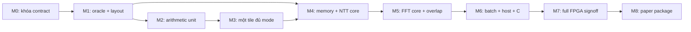

# Lộ trình dựng FlexTransform từ đầu

Trạng thái: contract0.2 đã khóa port/clock/FSM và có resource-liveness model. M0 hồ sơ và phần liveness của M1 đã có bằng chứng; chưa có RTL, các gate numeric/RTL/PPA còn phải làm. Không phải danh sách việc đã hoàn thành; thời gian phụ thuộc năng lực/giờ làm và tool, nên khóa theo **gate đầu ra**, không hứa số tuần chưa có cơ sở.

## 1. Trình tự

Nếu làm một mình, theo thứ tự này; M1 layout và M2 arithmetic có thể xen kẽ nhưng không ghép core khi cả hai chưa có unit contract. Không cần viết full Falcon để chốt transform accelerator.

## M0 — Chốt hồ sơ và tạo workspace

- Đọc README/architecture/spec01..07; giải quyết điểm chưa đồng ý trước khi viết module lớn.
- Khóa numerical assets/reference bằng reference_lock; giữ baseline read-only.
- Tạo filelist riêng, output riêng, profile xc7z020clg400-2/16tile/64DSP/48BRAM.
- Quy ước một cạnh nhận/độ trễ, tag, byte/limb order và lỗi.

**Gate:** check_design PASS; mọi requirement có test/gate; không có placeholder arithmetic “giảm tạm precision”. Bộ hồ sơ hiện có hỗ trợ gate này, nhưng quyết định của người thiết kế vẫn cần được ghi nếu đổi.

## M1 — Oracle và model trước RTL toàn hệ thống

- Viết model arithmetic thuần integer, đối chiếu C và assets đã khóa.
- Viết config/mapping/descriptor generator mới theo spec03; xuất trace bank/root/tile/expected output.
- Tạo latency manifest schema; lúc này field chưa đo phải đánh dấu proposed.
- Viết scoreboard liveness cho side16 và FFT buffer8/4/2; kiểm context queue16.

**Gate:** decode/mapping exhaustive trên phạm vi hỗ trợ; arithmetic payload giữ nguyên; negative controls số học fail đúng dự kiến. Model không có bank/resource conflict.

## M2 — Các unit arithmetic và RAM

Thứ tự viết: leaf array→fuse→addsub→reduce_or_sum→Montgomery scalar→packed→MAC68/combine→native alignment→host normalizer. Song song viết data/root memory đơn giản và đo latency RAM.

**Gate:** từng unit đúng oracle, probe latency rõ ràng, synth arithmetic suy luận4 DSP/tile và RAM đúng loại. Không dùng `%q`/divider hoặc multiplier lớn ngoài array. Chưa chạy P&R cả system.

## M3 — Một tile đủ mọi mode

- Ghép control/operand/state, từ NTT32 rồi packed hai nhóm, FFT32→FFT64→FFT128→native64.
- Chạy nhiều butterfly liên tục, pointer wrap, output đúng thứ tự và tag.
- Cfg chỉ lúc drain; reset abort sạch; busy không buộc1/0.
- Đo tất cả tile latency và throughput; cập nhật manifest, bỏ giá trị proposed khi đã có evidence.

**Gate:** CT/GS, tất cả precision, native và pairing đúng; packed có4 butterfly/3clock khi đủ việc; không overflow state. Synth tile profile đủ mode. Nếu vượt budget, sửa state/mux/register trước khi nhân16.

## M4 — Mảng/bộ nhớ với NTT trước

- Nối16 tile,32 bank,16 root RAM và mạng4 nguồn.
- Dựng descriptor/context/writeback; chạy scalar NTT đơn job có barrier giữa tầng trước.
- Thêm packed internal layer, hmin1/2, small-N/dummy.
- Done sau tất cả tail write; kiểm response mask và không phụ thuộc hardcoded tile0.

**Gate:** NTT core cả hai chiều nhiều q đúng oracle, mapping không trùng cổng, root đúng thứ tự, reset/mode transition đúng. Cấu hình phi hợp lệ bị từ chối, descriptor hợp lệ không treo.

## M5 — FFT core và overlap

- Thêm FFT program chung, input re/im xen kẽ, output real-limbs rồi imaginary-limbs.
- Thêm native alignment và host-read normalize, kiểm riêng lifetime raw/normalized output.
- Khi barrier core đã đúng, bật overlap theo event planner; giữ read/write context riêng.

**Gate:** FFT32/64/128/native CT/GS đúng full golden; mọi thay đổi latency đã phản ánh ở gap/root/program. Báo cycle/kernel và resource; không thay golden để sửa lịch.

## M6 — Batch, command và host thật

- Ghép bank-jobs/row-jobs, cả chiều, mọi tổ hợp vừa mapping.
- Ghép AXI/frontend ack, snapshot và backpressure. Adapter riêng cho harness cũ; không sửa source baseline.
- Chạy1.026 kernel, four-state trên các đường mới,74 lời gọi C sống/14artifact/4signature.
- Đo kernel cycles, host cycles, normalized useful product slots, fill/drain và lỗi/stall do producer nếu có.

**Gate:** không sai bit; cùng arithmetic payload/hash; reset/AXI pass; C không fallback. Single và batch được báo riêng, không suy speedup signer từ kernel.

## M7 — Timing và diện tích toàn hệ thống

1. Synth toàn host/core/data/root trên part mục tiêu, phân rã theo module.
2. Kiểm64DSP/48BRAM; LUT budget whole-system≤35k, performance checkpoint theo design.json.
3. Tích hợp PS7/AXI/MMCM/reset cùng scope baseline; P&R160MHz.
4. Phân loại critical paths: host command, global program/config/reset, memory routing, tile arithmetic, hold short paths. Sửa RTL boundary trước; chỉ directive có lý do và evidence.
5. Tái kiểm source mới ở scope chịu ảnh hưởng sau mỗi thay đổi.

**Gate:** setup/hold/pulse-width đều pass,0unconstrained endpoint, DRC/routing/CDC được audit; same numerical/protocol tests pass. Synth pass không thay signoff. Chưa đo board thì không ghi hardware-tested.

Nếu chưa đạt35k/160MHz, giữ implementation là candidate; không bỏ mode hay đổi contract âm thầm. Có thể chọn một điểm PPA khác nhưng phải ghi là quyết định thiết kế mới, không biến target thành kết quả.

## M8 — Gói nghiên cứu và chuyển mốc

- Lặp lại các ablation có ích trên RTL mới: split FFT/NTT arithmetic, separate T_hi, single stream, sparse feed, reduction riêng.
- So đúng chip/contract/scope và workload; không cộng area từ paper khác công nghệ.
- Đưa sơ đồ RTL, numeric contract, cycle/q/N/batch, PPA và correctness vào artifact.
- Source mới chỉ thành baseline khi người dùng nhận; giữ toàn bộ baseline/evidence cũ.

**Gate:** kết quả tái lập, nhận định không vượt dữ liệu. Novelty cần đối chiếu literature, không suy từ việc rewrite chạy đúng.

## 2. Các quyết định đã chọn cho lần dựng đầu

| Quyết định | Lý do | Chỉ mở lại khi |
|---|---|---|
| 16 tile cùng loại | Giữ mọi tile hữu ích mọi precision, có mốc đo | Đã có cycle/resource model số tile khác |
| Temporal wide FFT | Có contract/test, không cần cụm FFT rộng riêng | Cần speedup vượt period45 và có resource budget |
| Montgomery ba lượt | Giữ64DSP cho mọi mode | Chấp nhận thêm DSP và đo P&R reduction riêng |
| Packed hai nhóm +history chung | Ablation có lợi định lượng | Liveness/control mới không đạt timing/resource |
| CG và mux4 | Giảm bài toán mạng, dùng chung bộ nhớ | Có model khác chứng minh cổng/resource tốt hơn |
| Host-read IFFT normalize | Giữ numerical/API hiện có | Muốn chaining kernel, cần contract/output storage mới |
| Một context q | Core hiện không cần trộn q | Có workload đa q đồng thời và kiểm sở hữu state |

## 3. Việc đầu tiên khi bắt tay viết

Viết `ft_defs.svh` và unit-test `ft_leaf_array`, đồng thời đóng model config/geometry. Sau đó chứng minh một tile đủ mode và liveness trước khi ghép16. Không bắt đầu bằng top AXI lớn hoặc một scheduler toàn mảng chưa có latency số học.
