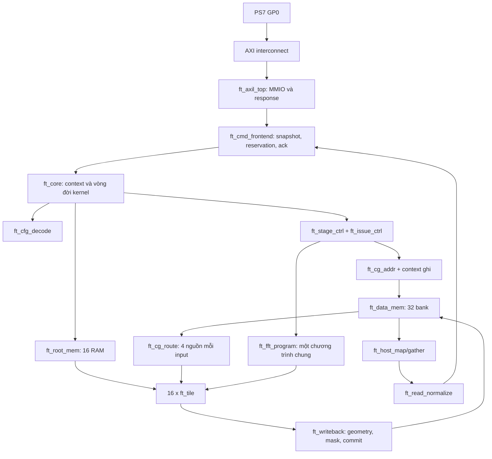
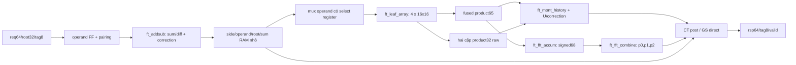

# Kiến trúc bản viết mới — contract0.2

Trạng thái: microarchitecture0.2 đã khóa theo spec08..11 và JSON contracts. Arithmetic compatibility target: baseline3.1; chưa có RTL/PPA mới.

## 1. Cấu trúc tổng thể

Một clock tính toán/AXI. Top hệ thống FPGA còn PS7, MMCM và reset controller; chúng không nằm trong `ft_core`. Clock mặc định kế thừa điều kiện baseline khi tới gate P&R, không tự coi một OOC core pass là toàn hệ thống pass.

## 2. Trong mỗi tile

Đây là các **khối trách nhiệm**, không yêu cầu mỗi ô có thêm một tầng FF hoặc một bộ cộng riêng. Một resource có thể có nhiều owner theo mode; ownership phải hiện rõ trong bảng mux/control, tránh tách module rồi vô tình nhân đôi arithmetic.

## 3. Resource nào dùng chung?

| Resource vật lý | FFT | NTT32 | Packed16 |
|---|---|---|---|
| 4 leaf 16×16 | Ghép tích32×32, quét limb | Ghép32×32, ba lượt T/m/mq | Tách hai nhóm, mỗi nhóm hai lane |
| Cộng/trừ butterfly | Limb sum/difference, carry/borrow | CT post hoặc GS pre | Hai lane tách carry |
| Hai correction chain | Tổng o.re+o.im và wr+wi | ±q cho sum/difference | ±q từng lane |
| Chain correction cuối Montgomery | p0+p1 của 3M | U−q | U−q hai lane |
| T-subtract | p0−p1 rồi p2−(p0+p1) | Không cần T-combine FFT | Không cần T-combine FFT |
| Side RAM | Nhánh A hoặc A+B | x hoặc x+y, tag | Hai side/lane và pairing |
| T_hi/NZ history | Không phải history FFT riêng | High(T), NZ(low T) | Một history phục vụ cả hai nhóm |

Không chia thời gian C0/C1 vốn phải tạo sum và difference cùng lúc. Không kéo mọi dữ liệu của 16 tile tới một adder trung tâm. Sharing được thực hiện gần nơi giữ dữ liệu.

## 4. Điều phối và state

- Một sequencer FFT cho mảng; tile giữ dữ liệu, carry và accumulator riêng. Chương trình điều khiển được register gần consumer.
- Một lịch period3 chung cho NTT. NTT32 nhận một gói/3 clock/tile; packed nhận hai gói/3 clock/tile, mỗi gói hai butterfly.
- Context cấu hình không đổi khi kernel đang chạy. Đổi mode/precision/q chỉ tại ranh giới context đã drain/reset.
- Mux/address select tính sớm một clock. Token valid, tag, mask, địa chỉ và data cùng dịch qua các ranh giới pipeline.
- Không tạo 16 bản address generator hoặc full FFT sequencer. Không broadcast một phép so sánh dài trực tiếp tới reset/enable của mọi FF.

## 5. Viết mới những chỗ dễ lỗi của baseline

| Baseline tham chiếu | Lựa chọn0.2 | Lý do / điều cần đo |
|---|---|---|
| Tile idle buộc 1 | Busy thật từ in-flight và các pipeline valid | Không dùng cờ giả để cho phép cfg |
| Tile có slot/floor/en nghiên cứu không dùng trong core | Một q context, round cố định theo mode, không API stall tile | Thu hẹp contract RTL cần viết/kiểm; không bỏ tính năng core |
| Host có settle hằng theo lệnh | Frontend có reservation và ack thực | Không dựa vào con số chờ rải rác trong driver/RTL |
| Completion dựa vào tile0 và lịch đúng | Context ghi + terminal-mask đã nhận | Done sau write commit của mọi tile cần thiết |
| Executor lớn chứa host/RAM/scheduler | Các module có trách nhiệm riêng | Đo chi phí và timing từng boundary |

Các thay đổi TO-BE này chưa có số đo. Nếu cần tăng pipeline vì timing, đổi latency manifest và sinh gap mới; không ép cycle-equivalence với baseline bằng cách bỏ FF cần thiết.

## 6. Context ghi khi chồng lấp tầng

Giữ một queue context theo thứ tự các tầng đã phát. Một entry gồm stage_id, active mask, destination buffer/geometry, expected last tag, response owner và cờ tầng cuối. Chọn depth16: số tầng hợp lệ tối đa10, không có kernel thứ hai đang chạy. Model phải chứng minh thứ tự response theo tầng; nếu không đúng, dừng và sửa cách định danh, không đoán bằng read_stage.

Push trước request đầu của tầng; pop chỉ sau write cuối của mọi tile trong active mask đã commit. Head context được register trước dùng. Completion mask chỉ cần 16 bit, không dựng scoreboard toàn địa chỉ RAM.

Tag tile giữ 8 bit `{k[4:0],plane[2:0]}`. Stage/buffer thuộc context toàn mảng, không mở một bus stage/địa chỉ rộng chạy qua mọi thanh ghi của mọi tile. `rsp_last` của tile mới chỉ chỉ ra beat cuối butterfly; không thay thế tail condition của cả tầng.

## 7. Resource và timing budget

Ngân sách tổng vẫn là ≤35k LUT toàn hệ thống, 64 DSP, 48 RAMB18. Mốc OOC tham chiếu gồm host/data/root là 34.185 LUT; khoảng dư nhỏ, do đó việc tách module không được tự thêm FIFO rộng và adapter ở mọi boundary.

Theo phân rã routed: khoảng 7,3k LUT ở executor/memory routing và 25,9k ở tile; tile còn khoảng 10,8k LUT trộn state/mux/reduction/FFT. Không gán tất cả chi phí này cho bộ nhân. Mọi tiết kiệm của rewrite phải đo lại.

Chia đường dài bằng FF hợp lý: command decode → context; address → BRAM; BRAM → route FF; program → local select; LUTRAM → multiplier input; product → accumulate/correction; host gather → round → shift → response. Không dùng false-path hoặc timing directive để che một đường hoạt động. DSP/BRAM inference attributes có thể dùng để biểu đạt loại resource.

## 8. Tiêu chí khóa kiến trúc

Khóa khi model có lịch hợp lệ cho mọi cấu hình hỗ trợ, một tile đủ ba precision/hai loại NTT, dữ liệu/root đủ cổng, và command lifecycle không mơ hồ. Sau đó mới đo toàn mảng. Một hình butterfly giống nhau chưa đủ chứng minh sharing hoặc PPA.
